# SWIFTDROP
## Parcel Delivery & Courier Management System
### Design Documentation: Use Cases, Data Model, Architecture, Integration Design, Key Flows and Justifications

| Item | Details |
| :--- | :--- |
| **Module** | Enterprise Application Development (Group Assignment, 20 marks) |
| **Group number** | ______ |
| **Team size** | 10 members (see the contribution sheet in [Appendix A](#appendix-a-contribution-sheet)) |
| **Submission** | Design documentation report |
| **Date** | October 2026 |

*Every diagram in this report is drawn with native Word shapes. Click a diagram, then click any box, arrow or label inside it to move, recolour or retype it.*

---

## Contents

- [Contents](#contents)
- [List of Figures](#list-of-figures)
- [1 Introduction](#1-introduction)
  - [1.1 Background](#11-background)
  - [1.2 Purpose of this document](#12-purpose-of-this-document)
  - [1.3 Scope](#13-scope)
  - [1.4 Assumptions and constraints](#14-assumptions-and-constraints)
  - [1.5 Technology choices](#15-technology-choices)
- [2 Users, Roles and Access Rules](#2-users-roles-and-access-rules)
- [3 Use Case Modelling](#3-use-case-modelling)
  - [3.1 Customer and recipient](#31-customer-and-recipient)
  - [3.2 Merchant](#32-merchant)
  - [3.3 Courier](#33-courier)
  - [3.4 Dispatcher and admin](#34-dispatcher-and-admin)
  - [3.5 Use case specifications](#35-use-case-specifications)
- [4 Data Design](#4-data-design)
  - [4.1 Entity overview](#41-entity-overview)
  - [4.2 Design decisions](#42-design-decisions)
- [5 System Architecture](#5-system-architecture)
  - [5.1 Options we considered](#51-options-we-considered)
  - [5.2 The chosen architecture](#52-the-chosen-architecture)
  - [5.3 Inside the Core API](#53-inside-the-core-api)
  - [5.4 Why there is no separate BFF](#54-why-there-is-no-separate-bff)
  - [5.5 Deployment view](#55-deployment-view)
- [6 Integration Design](#6-integration-design)
  - [6.1 Integration patterns used](#61-integration-patterns-used)
  - [6.2 Event flow](#62-event-flow)
  - [6.3 Event contract](#63-event-contract)
  - [6.4 Queues and routing keys](#64-queues-and-routing-keys)
  - [6.5 Reliability guarantees](#65-reliability-guarantees)
  - [6.6 Real-time tracking](#66-real-time-tracking)
- [7 Key Flows](#7-key-flows)
  - [7.1 Creating a delivery](#71-creating-a-delivery)
  - [7.2 Merchant creates an order through the API](#72-merchant-creates-an-order-through-the-api)
  - [7.3 Courier status update triggering notifications](#73-courier-status-update-triggering-notifications)
  - [7.4 OAuth 2.0 login with Google](#74-oauth-20-login-with-google)
  - [7.5 Parcel lifecycle](#75-parcel-lifecycle)
  - [7.6 Dispatcher assigns a parcel](#76-dispatcher-assigns-a-parcel)
  - [7.7 Webhook delivery and retry](#77-webhook-delivery-and-retry)
- [8 Design Patterns and Principles](#8-design-patterns-and-principles)
  - [8.1 Patterns applied](#81-patterns-applied)
  - [8.2 Principles](#82-principles)
- [9 Security Design](#9-security-design)
  - [9.1 Authentication](#91-authentication)
  - [9.2 Authorisation](#92-authorisation)
  - [9.3 Merchant API and webhooks](#93-merchant-api-and-webhooks)
  - [9.4 Personal data](#94-personal-data)
  - [9.5 Secrets and configuration](#95-secrets-and-configuration)
  - [9.6 Threats and mitigations](#96-threats-and-mitigations)
- [10 API Design](#10-api-design)
  - [10.1 Conventions](#101-conventions)
  - [10.2 Main endpoints](#102-main-endpoints)
  - [10.3 Error format](#103-error-format)
- [11 Testing Approach](#11-testing-approach)
- [12 Bonus Features](#12-bonus-features)
  - [12.1 Kubernetes deployment](#121-kubernetes-deployment)
  - [12.2 AI delivery assistant](#122-ai-delivery-assistant)
- [13 Conclusion](#13-conclusion)
- [Appendix A: Contribution Sheet](#appendix-a-contribution-sheet)
- [Appendix B: Editing the Diagrams](#appendix-b-editing-the-diagrams)

---

## List of Figures

- **Figure 1**: Customer and recipient use cases *(Page 8)*
- **Figure 2**: Merchant use cases *(Page 9)*
- **Figure 3**: Courier use cases *(Page 10)*
- **Figure 4**: Dispatcher and admin use cases *(Page 11)*
- **Figure 5**: Entity-relationship diagram *(Page 13)*
- **Figure 6**: Layered view of the SwiftDrop architecture *(Page 17)*
- **Figure 7**: Container deployment view (Docker Compose and Kubernetes) *(Page 19)*
- **Figure 8**: Event-driven integration through RabbitMQ *(Page 21)*
- **Figure 9**: Sequence diagram: customer creates a delivery *(Page 24)*
- **Figure 10**: Sequence diagram: merchant API order and webhook *(Page 25)*
- **Figure 11**: Sequence diagram: courier status update and fan-out *(Page 26)*
- **Figure 12**: Sequence diagram: Google sign-in with authorization code and PKCE *(Page 27)*
- **Figure 13**: State diagram: parcel lifecycle *(Page 28)*
- **Figure 14**: Activity diagram: assigning a parcel to a courier *(Page 29)*
- **Figure 15**: Activity diagram: webhook delivery with retry *(Page 30)*
- **Figure 16**: AI delivery assistant calling the API through MCP tools *(Page 38)*

---

## 1 Introduction

### 1.1 Background
SwiftDrop is a courier company that delivers parcels across the whole island. Up to now, bookings have come in over the phone and been tracked in shared spreadsheets. That worked when the company was small, but it has started to hurt. Customers ring the hotline to ask where their parcel is because they have no other way of knowing. Dispatchers juggle courier assignments from memory. Partner online stores email order lists that someone then retypes, which is slow and causes mistakes in addresses and phone numbers.

Our team was asked to replace this with a proper platform. Customers should be able to book and track parcels themselves, merchants should be able to push orders straight from their e-commerce systems, dispatchers should see every unassigned parcel and every courier's workload on one screen, and couriers should update progress from their phones as they work.

### 1.2 Purpose of this document
This report records the design of that platform and, just as importantly, the reasons behind it. It covers the use case models for each type of user, the data model, the overall architecture, the way the system integrates with external parties, the sequence and activity flows for the most important scenarios, and the design patterns we applied. Where we had to choose between options, we say what we picked and why, including the options we turned down.

We wrote it for two audiences: the evaluators marking the assignment, and ourselves. A ten-person team needs a shared picture of the system before people start writing code in parallel, and this document is that picture.

### 1.3 Scope
**In scope**: customer, merchant, courier and dispatcher/admin functionality as described in the brief; JWT authentication with Google sign-in; a secured merchant API; event-driven notifications and webhooks; live tracking; containerised deployment with Docker Compose; and the two bonus items, Kubernetes deployment and an AI delivery assistant.

**Out of scope for this version**: online card payments (fees are shown and recorded, and settlement is handled offline as SwiftDrop does today), route optimisation, warehouse and hub inventory, and native mobile apps. The courier interface is a mobile-first progressive web app instead.

### 1.4 Assumptions and constraints
- Prices are in Sri Lankan Rupees and stored as integer cents to avoid rounding errors.
- Delivery zones follow district groupings (for example Western, Central, Southern), and pricing depends on the origin zone, destination zone, parcel size class and weight.
- Couriers use mid-range Android phones on mobile data, so the courier screens must be light and work on patchy connections.
- The team has roughly one semester, so we favour a stack that most members already know over one that would look impressive but slow everyone down.
- Everything must run locally with a single `docker compose up` so that every member, and the evaluators, can reproduce the system.

### 1.5 Technology choices
The table below lists the main technologies. Most of the team already writes TypeScript, so using it on both the front and back end means people can move between tasks without switching languages.

#### Table 1: Technology stack
| Concern | Choice | Why we picked it |
| :--- | :--- | :--- |
| **Frontend** | React 18, Vite, TypeScript, Tailwind CSS | Component model suits four role-based UIs sharing one design system; fast builds. |
| **Backend** | Node.js 20, Express, TypeScript | Team familiarity; large ecosystem for OAuth, AMQP and WebSockets. |
| **Validation** | Zod schemas shared by API and SPA | One schema validates input on both sides, so rules are written once. |
| **Database** | PostgreSQL 16 with Prisma ORM | Relational data with strong constraints; transactions needed for the outbox. |
| **Message broker** | RabbitMQ 3.13 (topic exchange) | Routing keys, dead-letter queues and TTL give us retries without extra code. |
| **Real-time** | Socket.IO with Redis adapter | WebSockets with automatic fallback to long-polling; works across replicas. |
| **Object storage** | MinIO (S3-compatible) | Proof-of-delivery photos and PDF receipts stay out of the database. |
| **Auth** | JWT (RS256), Google OpenID Connect, OAuth 2.0 client credentials | Stateless API auth plus standards-based social login and machine access. |
| **Testing** | Jest, Supertest, Testcontainers | Unit and integration tests against real Postgres and RabbitMQ containers. |
| **Deployment** | Docker, Docker Compose, Kubernetes with Helm | Same images locally and on the cluster. |

---

## 2 Users, Roles and Access Rules

The platform has five roles. A person holds exactly one role per account. We considered allowing several roles per account, but nothing in the brief needs it, and a single role keeps both the JWT claims and the authorisation checks simpler.

#### Table 2: Roles in the system
| Role | Who they are | Main goals | How they sign in |
| :--- | :--- | :--- | :--- |
| **Customer** | Individuals sending parcels | Book, see the fee up front, track, download receipts | Email + password, or Google |
| **Recipient (guest)** | Anyone holding a tracking number | See the status of one parcel | No login; public tracking page |
| **Merchant** | Partner online stores | Create orders from their own system, get status webhooks | Dashboard login; API via client credentials |
| **Courier** | SwiftDrop delivery staff | See today's jobs, update status, record proof | Email + password (accounts created by admin) |
| **Dispatcher / Admin** | Operations staff | Assign parcels, watch workloads, manage users, zones, pricing | Email + password |

Role checks alone are not enough. A courier is allowed to update parcel status, but only for parcels assigned to them. A customer can read parcels, but only their own. These ownership rules are enforced in the service layer by scoping every database query, not by hiding buttons in the UI. The matrix below summarises the rules; "own" means the record must belong to the caller.

#### Table 3: Role-based access matrix
| Capability | Customer | Merchant | Courier | Dispatcher | Admin |
| :--- | :--- | :--- | :--- | :--- | :--- |
| **Create delivery request** | own | own (API) | - | yes | yes |
| **View parcel and history** | own | own | assigned | all | all |
| **Update parcel status** | - | - | assigned | yes | yes |
| **Assign / reassign courier** | - | - | - | yes | yes |
| **Approve merchants** | - | - | - | - | yes |
| **Manage users, zones, pricing** | - | - | - | - | yes |
| **View reports** | - | own orders | - | yes | yes |
| **Manage API keys and webhooks** | - | own | - | - | yes |

---

## 3 Use Case Modelling

We split the use cases into one diagram per main actor, because a single diagram with every use case became unreadable. Blue ovals are the actor's primary goals. Green ovals are supporting use cases linked with «include» (always happens as part of the base use case) or «extend» (optional behaviour added under certain conditions). Actors on the right are secondary: systems or people that take part in a use case but do not start it.

### 3.1 Customer and recipient

#### Figure 1: Customer and recipient use cases
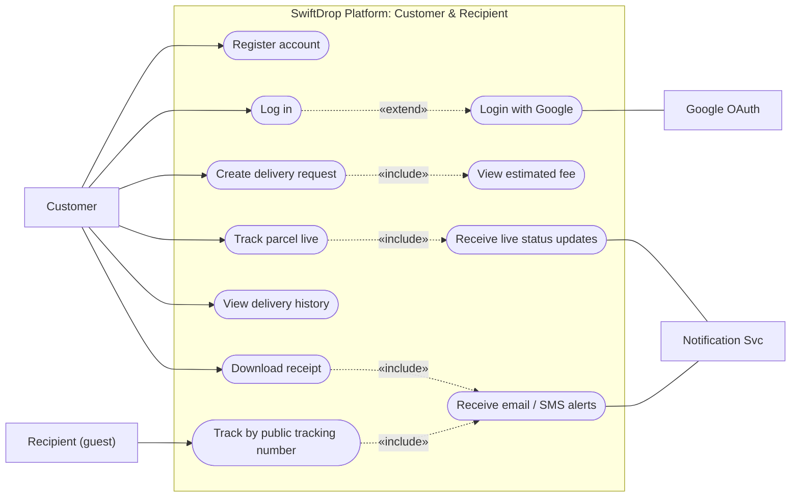

Creating a delivery always includes calculating the fee, because the brief requires the customer to see an estimate before confirming. Logging in with Google extends the normal login rather than replacing it, so a customer who signed up with email can still log in with a password. The recipient is a separate actor because they usually have no account at all. They only know the tracking number printed on the SMS or receipt, so public tracking deliberately shows less detail than the logged-in view.

---

### 3.2 Merchant

#### Figure 2: Merchant use cases
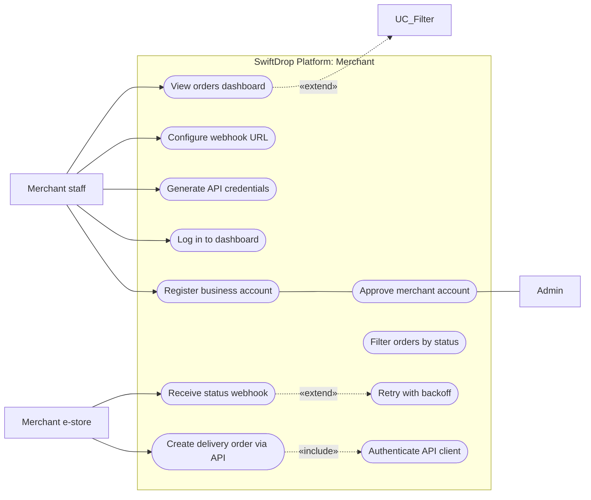

We modelled the merchant as two actors. **Merchant staff** are people using the dashboard. The **merchant e-store** is their software calling our API. The distinction matters for security: staff log in with a password and get a user JWT, while the e-store authenticates with client credentials and gets a token limited to order scopes. Registration needs an administrator's approval before the merchant can create API credentials, which stops anyone from signing up and flooding the system with fake orders.

---

### 3.3 Courier

#### Figure 3: Courier use cases
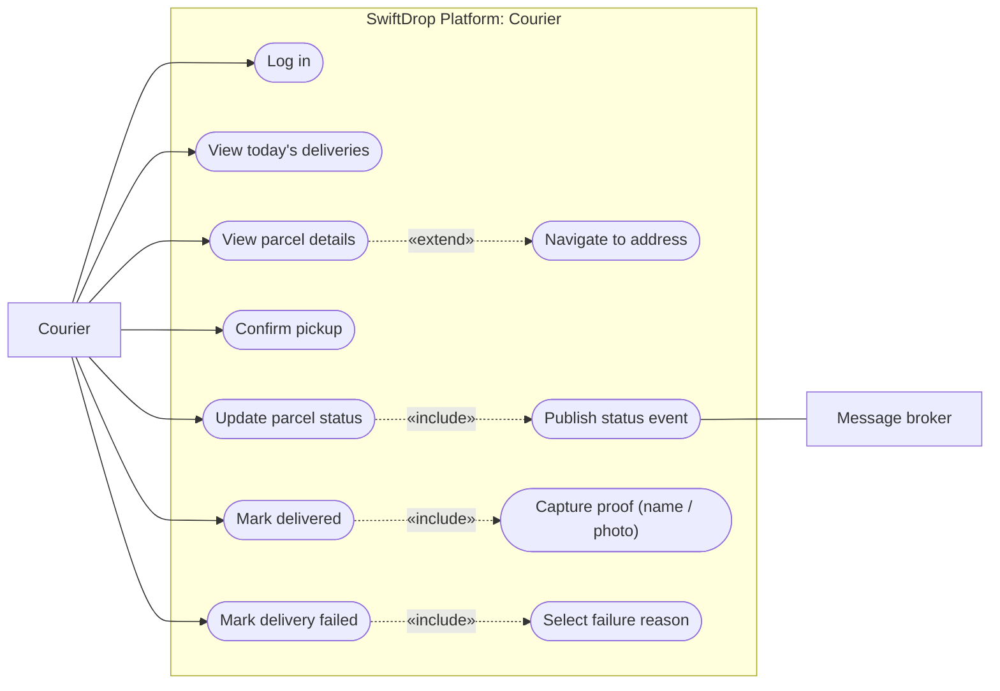

Every status update includes publishing a status-change event. This is the hook that drives notifications, merchant webhooks and live tracking, which is why the message broker appears as a secondary actor. Marking a parcel delivered always includes capturing proof (the recipient's name, a photo, or both), and marking it failed always includes choosing a reason from a fixed list such as "recipient not available" or "address not found".

---

### 3.4 Dispatcher and admin

#### Figure 4: Dispatcher and admin use cases
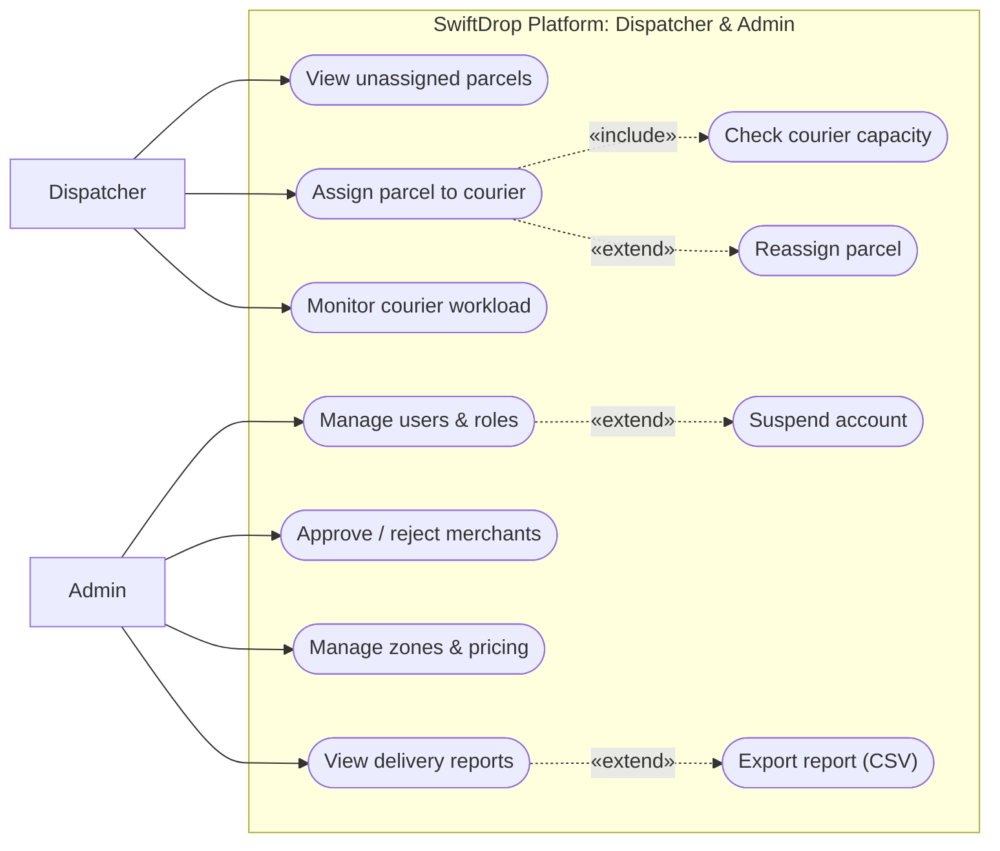

Dispatchers handle the daily operational work; admins handle configuration. Assigning a parcel always includes a capacity check so that no courier is given more active jobs than their configured limit. Reassignment extends assignment for cases such as a courier calling in sick halfway through the day.

---

### 3.5 Use case specifications

Two use cases carry most of the business logic, so we wrote full specifications for them.

#### Table 4: Use case specification: create delivery request
| Field | UC-C03 Create delivery request |
| :--- | :--- |
| **Primary actor** | Customer |
| **Preconditions** | Customer is logged in with a verified email or a Google account. |
| **Main flow** | 1. Customer enters pickup address, drop-off address, recipient name and phone, size class and weight.<br>2. System validates the input and resolves both addresses to delivery zones.<br>3. System calculates the fee using the active pricing rule and shows a quote valid for 15 minutes.<br>4. Customer confirms.<br>5. System creates the parcel with status Created, records the first history entry and returns a tracking number.<br>6. System publishes a `parcel.created` event; the customer receives a confirmation email. |
| **Alternative flows** | **2a.** Address outside any zone: system explains that the area is not yet served.<br>**4a.** Quote expired: system recalculates and asks the customer to confirm the new fee.<br>**5a.** Duplicate submit (same Idempotency-Key): system returns the original parcel instead of creating a second one. |
| **Postconditions** | Parcel exists in status `Created` and appears in the dispatcher's unassigned queue. |

#### Table 5: Use case specification: update parcel status
| Field | UC-K05 Update parcel status (courier) |
| :--- | :--- |
| **Primary actor** | Courier |
| **Preconditions** | Courier is logged in and the parcel is assigned to them. |
| **Main flow** | 1. Courier opens the parcel from today's list and chooses the next status.<br>2. For Delivered, courier enters the recipient's name and optionally attaches a photo.<br>3. System checks that the transition is allowed from the current status.<br>4. System saves the new status and history entry, and writes an outbox event in the same transaction.<br>5. Customer, merchant and anyone watching the tracking page see the change within seconds. |
| **Alternative flows** | **1a.** Parcel not assigned to this courier: system returns 403 and logs the attempt.<br>**3a.** Invalid transition (for example Created to Delivered): system returns 409 with an explanation.<br>**2b.** No network: the PWA queues the update and retries when the connection returns. |
| **Postconditions** | Status and history updated; a `parcel.status.changed` event is published exactly once from the outbox. |

---

## 4 Data Design

The entity-relationship diagram below shows the tables in PostgreSQL. Colours group related entities: blue for identity and access, amber for parcels and their history, violet for zones and pricing, green for outbound communication, and grey for the integration outbox.

#### Figure 5: Entity-relationship diagram
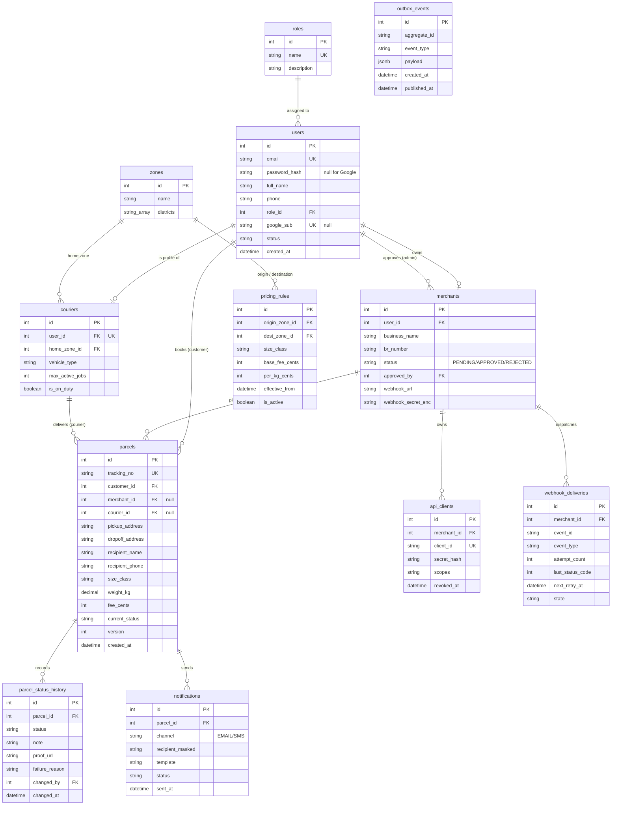

### 4.1 Entity overview

#### Table 6: Entity overview
| Entity | What it stores | Notes |
| :--- | :--- | :--- |
| **users / roles** | Every person who can log in, and their role | `password_hash` is null for Google-only accounts; `google_sub` links the Google identity. |
| **merchants** | Business profile, approval status, webhook settings | Webhook secret is encrypted at rest, never shown again after creation. |
| **api_clients** | Client credentials issued to a merchant | Only a hash of the secret is stored, like a password. |
| **couriers** | Courier profile, home zone, capacity | `max_active_jobs` drives the capacity check during assignment. |
| **zones / pricing_rules** | Delivery zones and fee rules between them | Rules are versioned with `effective_from`, so old receipts keep their original price. |
| **parcels** | The delivery itself and its current state | `current_status` is denormalised for fast dashboards; `version` supports optimistic locking. |
| **parcel_status_history** | Every status change, who made it and when | Append-only. This is the audit trail and the timeline shown to customers. |
| **webhook_deliveries** | Each attempt to call a merchant webhook | Lets merchants and support staff see why a webhook failed. |
| **notifications** | Emails and SMS sent | Recipient stored masked (for example `077***4521`) to limit personal data. |
| **outbox_events** | Events waiting to be published to RabbitMQ | Written in the same transaction as the business change. |

### 4.2 Design decisions
- **Status history is append-only.** We never update or delete history rows. This gives a reliable audit trail if a customer disputes a delivery, and it doubles as the timeline on the tracking page.
- **Current status is kept on the parcel as well.** Strictly speaking it can be derived from the latest history row, but dashboards filter by status constantly. Storing it avoids a subquery on every list view. Both are written in the same transaction, so they cannot drift apart.
- **Money is stored as integer cents.** Floating-point arithmetic on currency produces rounding errors, so `fee_cents`, `base_fee_cents` and `per_kg_cents` are integers.
- **Tracking numbers are not sequential.** They follow the pattern `SD-` plus eight random characters from an unambiguous alphabet, with a check character. A sequential number would let anyone guess other people's tracking numbers on the public page.
- **Optimistic locking on parcels.** Two dispatchers can try to assign the same parcel at the same moment. The `version` column makes the second update fail cleanly instead of silently overwriting the first.
- **Indexes follow the queries.** We index `parcels(tracking_no)`, `parcels(courier_id, current_status)`, `parcels(merchant_id, created_at)` and `parcel_status_history(parcel_id, changed_at)` because these back the tracking page, the courier's daily list, the merchant dashboard and the timeline.

---

## 5 System Architecture

### 5.1 Options we considered
We looked at three architectural styles before settling on one. The table summarises the discussion.

#### Table 7: Architecture options
| Option | Strengths | Weaknesses | Verdict |
| :--- | :--- | :--- | :--- |
| **Layered monolith** | Simple to build, test and deploy; one codebase | Notifications and webhooks would run inside request handlers, so a slow merchant endpoint slows down a courier's update | Rejected |
| **Full microservices** | Independent scaling and deployment; good for large organisations | Ten students would spend most of the semester on service discovery, distributed transactions and debugging across services | Rejected |
| **Modular monolith with event-driven workers** | Clear module boundaries, one database transaction for business changes, slow work moved out of the request path | Modules must be kept honest; one deployable for the core means one larger release | **Chosen** |

The deciding factor was where the system actually needs to be separate. Parcel creation, pricing, assignment and status updates are tightly linked and benefit from sharing one database transaction. Notifications and merchant webhooks are different: they talk to the outside world, they can be slow, and they can fail. Those are the parts we pulled out into separate worker services connected through RabbitMQ. Everything else lives in one well-structured Core API.

---

### 5.2 The chosen architecture

#### Figure 6: Layered view of the SwiftDrop architecture
```mermaid
flowchart TB
    subgraph PRESENTATION["PRESENTATION LAYER"]
        direction TB
        subgraph SPA["React 18 SPA (Vite + TypeScript), role-based routes"]
            CustomerPortal["Customer portal<br/>(booking, history, receipts)"]
            PublicTrack["Public tracking<br/>(mobile-first page)"]
            MerchantDash["Merchant dashboard<br/>(orders, keys, webhooks)"]
            CourierPWA["Courier PWA<br/>(today's jobs, proof upload)"]
            AdminConsole["Dispatcher / Admin<br/>(assign, zones, reports)"]
        end
        MerchantEcom["Merchant e-commerce platforms<br/>machine clients (REST)"]
        AIAssistantWidget["AI Delivery Assistant<br/>chat widget in SPA"]
    end

    subgraph EDGE["EDGE"]
        Nginx["Nginx reverse proxy / Kubernetes Ingress<br/>TLS, routing (/api/v1, /oauth, /socket.io), rate limiting, static assets"]
    end

    subgraph BUSINESS["BUSINESS LOGIC LAYER"]
        direction TB
        subgraph CoreAPI["Core API: modular monolith (Node.js 20, Express, TypeScript)"]
            AuthMod["Auth & Identity<br/>JWT, Google OAuth, RBAC"]
            ParcelsMod["Parcels & Tracking<br/>status state machine"]
            PricingMod["Pricing<br/>Strategy per zone/size"]
            DispatchMod["Dispatch<br/>assignment, workload"]
            MerchantsMod["Merchants & API clients<br/>keys, client credentials"]
            ReportsMod["Reports & Admin<br/>users, zones, KPIs"]
            RealtimeGW["Realtime Gateway (Socket.IO)<br/>rooms per tracking number"]
            SharedKernel["Shared kernel<br/>Zod validation, error handler, PII-safe logger"]
            RepoOutbox["Repositories (Prisma) + Outbox writer<br/>state change and event saved in one transaction"]
        end
        AI_Svc["AI Assistant Service<br/>LLM + MCP tools:<br/>get_parcel_status, quote_fee"]
        Notif_Svc["Notification Service<br/>consumes status events,<br/>sends email / mock SMS"]
        Webhook_Disp["Webhook Dispatcher<br/>HMAC-signed POST,<br/>exponential retry + DLQ"]
    end

    subgraph ASYNC["INTEGRATION LAYER (ASYNC)"]
        OutboxRelay["Outbox Relay<br/>polls & publishes"]
        RabbitMQ["RabbitMQ topic exchange: swiftdrop.events<br/>queues: notifications.q · webhooks.q · webhooks.retry.q · realtime.q · *.dlq"]
    end

    subgraph DATA["DATA LAYER"]
        Postgres[(PostgreSQL 16<br/>users, parcels, history, pricing, outbox)]
        Redis[(Redis 7<br/>Socket.IO adapter, rate-limit counters)]
        MinIO[(MinIO S3 API<br/>proof-of-delivery photos, PDF receipts)]
    end

    subgraph EXTERNAL["EXTERNAL SYSTEMS"]
        GoogleAuth["Google OAuth 2.0<br/>OpenID Connect"]
        SMTPGateway["SMTP (Mailpit in dev)<br/>email delivery"]
        SMSGateway["Mock SMS gateway<br/>logs masked SMS"]
        LLMProvider["LLM provider API<br/>tool calling"]
    end

    SPA -->|HTTPS + WSS| Nginx
    MerchantEcom -->|HTTPS REST| Nginx
    AIAssistantWidget -->|REST with user JWT| AI_Svc

    Nginx --> CoreAPI
    RepoOutbox -->|SQL / TCP| Postgres
    RealtimeGW --> Redis
    OutboxRelay -->|polls outbox table| Postgres
    OutboxRelay -->|publishes| RabbitMQ

    RabbitMQ -->|AMQP consume| Notif_Svc
    RabbitMQ -->|AMQP consume| Webhook_Disp
    RabbitMQ -->|AMQP consume| RealtimeGW

    AuthMod --> GoogleAuth
    Notif_Svc --> SMTPGateway
    Notif_Svc --> SMSGateway
    AI_Svc --> LLMProvider
    AI_Svc -->|REST with user JWT| CoreAPI
```

The diagram reads top to bottom, following a request.
- **Presentation layer.** One React single-page application serves all four user groups through role-based routes, plus the public tracking page. Merchant e-commerce systems are also clients, but they talk to the API directly instead of through the UI. The AI assistant is a chat widget inside the SPA.
- **Edge.** Nginx (or the Kubernetes Ingress in the cluster) terminates TLS, routes `/api/v1`, `/oauth` and `/socket.io` to the right service, serves the static frontend, and applies rate limits before traffic reaches application code.
- **Business logic layer.** The Core API holds six modules with clear boundaries. Each module follows controller, service, repository layering internally. Next to it run three separate services: the Notification Service, the Webhook Dispatcher and the AI Assistant Service.
- **Integration layer.** The Outbox Relay reads committed events from the database and publishes them to a RabbitMQ topic exchange. Queues fan the events out to each consumer.
- **Data layer.** PostgreSQL is the system of record. Redis backs Socket.IO when more than one API replica is running and stores rate-limit counters. MinIO stores proof-of-delivery photos and generated receipts.

### 5.3 Inside the Core API
Each module owns its tables and exposes a small service interface. The Dispatch module, for example, never writes to the pricing tables; if it needs a fee it calls `PricingService.quote()`. Modules do not import each other's repositories. We enforce this with ESLint import rules, so a violation fails the build rather than relying on code review alone.

Within a module a request passes through the same chain every time: Express middleware for authentication, role check and validation, then a thin controller, then the service where the business rules live, then a repository that talks to Prisma. Controllers never contain business rules and services never touch `req` or `res`. That separation is what makes the services easy to unit test.

### 5.4 Why there is no separate BFF
The brief mentions a backend-for-frontend as an option. We considered a separate BFF service, but the Core API already groups its routes by audience: `/api/v1/customer/...`, `/api/v1/merchant/...`, `/api/v1/courier/...` and `/api/v1/admin/...`. Each group returns responses shaped for its screen, for example the courier's daily list includes only what fits on a phone. In effect these route groups are BFFs inside the monolith. Adding a separate service would have meant another deployable and another network hop with no real benefit at our scale.

---

### 5.5 Deployment view

#### Figure 7: Container deployment view (Docker Compose and Kubernetes)
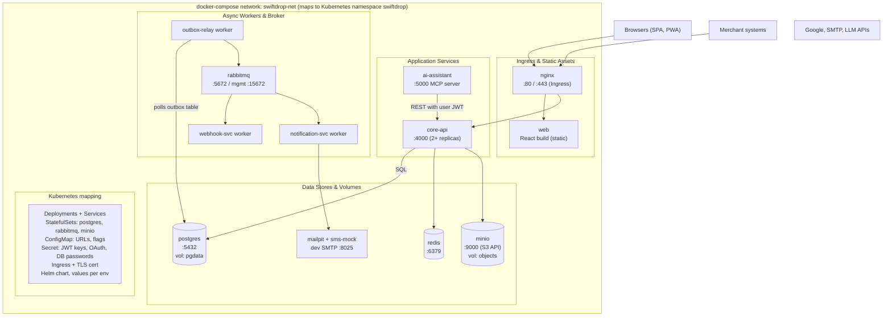

Every box with a port is its own container built from its own Dockerfile using multi-stage builds, so production images contain only compiled JavaScript and production dependencies. Docker Compose wires them together on one network for local development. The same images run on Kubernetes, where stateless services become Deployments, the database, broker and object store become StatefulSets with persistent volumes, configuration moves into ConfigMaps and credentials into Secrets.

---

## 6 Integration Design

SwiftDrop has to talk to several outside parties: browsers, merchant systems, Google, email and SMS providers, and an LLM provider. It also has internal services that need to react to each other's changes. We chose a pattern for each integration point based on what that interaction actually needs.

### 6.1 Integration patterns used

#### Table 8: Integration patterns and justification
| Pattern | Where we use it | Why this pattern |
| :--- | :--- | :--- |
| **Request / reply (synchronous REST)** | SPA to Core API; merchant order creation; AI assistant tools calling the API | The caller needs an answer straight away, such as a quote, a tracking number or a validation error. |
| **Publish / subscribe via message broker** | Status-change events from Core API to notification, webhook and realtime consumers | One event has several independent consumers. The producer should not know or wait for them. |
| **Transactional outbox** | Core API writes events to `outbox_events` in the same transaction as the business change | Prevents the classic bug where the database commits but the message is lost, or the reverse. |
| **Webhook (HTTP callback)** | Webhook Dispatcher notifying merchant systems | Merchants asked to be told about changes instead of polling us. |
| **Retry with exponential backoff and dead-letter queue** | Webhook delivery | Merchant endpoints go down; we retry with growing gaps, then park the message for inspection. |
| **Server push (WebSocket)** | Live tracking via Socket.IO | Customers see changes within a second without refreshing; falls back to long-polling. |
| **OAuth 2.0 / OpenID Connect** | Google login (authorization code with PKCE); merchant API (client credentials) | Standard, well-tested protocols instead of inventing our own token exchange. |

---

### 6.2 Event flow

#### Figure 8: Event-driven integration through RabbitMQ
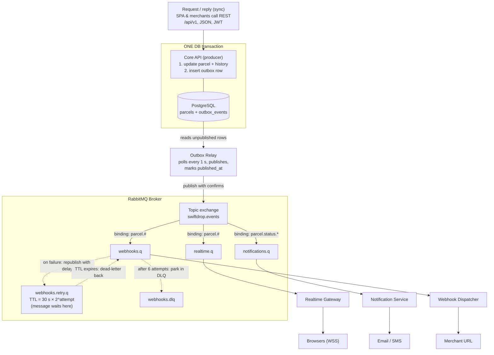

When a courier marks a parcel as Out for Delivery, the Core API updates the parcel, adds a history row and inserts an outbox row, all in one transaction. If anything fails, all three are rolled back, so we never send a notification about a change that did not happen. The Outbox Relay polls for unpublished rows every second, publishes them with publisher confirms switched on, and only then marks them as published.

The topic exchange routes each event using its routing key. Three queues are bound to it, one per consumer, so a slow webhook endpoint cannot hold up email notifications or live tracking. Each consumer acknowledges a message only after it has finished processing it.

---

### 6.3 Event contract

All events share one envelope. Consumers depend only on this contract, never on the producer's tables.

```json
{
  "eventId": "6f1c2a9e-3b0d-4c7e-9a51-1d2f0c8b7e44",
  "type": "parcel.status.changed",
  "version": 1,
  "occurredAt": "2026-10-23T09:14:05Z",
  "sequence": 4,
  "data": {
    "trackingNo": "SD-7KQ2M9XA-P",
    "merchantId": "m_1042",
    "from": "IN_TRANSIT",
    "to": "OUT_FOR_DELIVERY",
    "note": null
  }
}
```

`eventId` lets consumers ignore duplicates. `sequence` increases with every change to the same parcel, so a consumer that receives events out of order can discard an older one. `version` lets us evolve the payload later without breaking existing consumers. The event carries no phone numbers or addresses; a consumer that needs them looks them up through the API, which keeps personal data out of the broker.

---

### 6.4 Queues and routing keys

#### Table 9: RabbitMQ queues
| Queue | Binding key | Consumer | Failure handling |
| :--- | :--- | :--- | :--- |
| `realtime.q` | `parcel.#` | Realtime Gateway (inside Core API) | Messages expire after 60 s; a stale live update is useless |
| `notifications.q` | `parcel.status.*` | Notification Service | 3 redeliveries, then `notifications.dlq` |
| `webhooks.q` | `parcel.#` | Webhook Dispatcher | Republished to `webhooks.retry.q` with growing TTL |
| `webhooks.retry.q` | *(none; direct)* | None. Messages wait for their TTL, then dead-letter back to `webhooks.q` | Delay of $30\text{ s} \times 2^{\text{attempt}}$ |
| `webhooks.dlq` | *(dead-letter)* | Inspected by admins; replay button in dashboard | Kept for 14 days |

### 6.5 Reliability guarantees
RabbitMQ with the outbox gives us at-least-once delivery. That means a consumer can occasionally see the same event twice, for example if it crashes after sending an email but before acknowledging the message. Every consumer is therefore idempotent: the Notification Service records the `eventId` of every message it has handled and skips repeats, and merchants are told in the API documentation to do the same with the `eventId` in each webhook.

### 6.6 Real-time tracking
Browsers connect to the Socket.IO endpoint and join a room named after the tracking number. When a status event arrives on `realtime.q`, the gateway emits it to that room. Logged-in customers can join rooms for their own parcels only; the public page can join any room but receives a reduced payload with status, time and town, not the recipient's name. If the WebSocket cannot connect (some corporate networks block it), Socket.IO falls back to long-polling automatically. With several API replicas, the Redis adapter makes sure an event emitted on one replica reaches clients connected to another.

---

## 7 Key Flows

This section walks through the flows named in the brief, using sequence diagrams for the interactions between components and activity diagrams for the decision logic. Solid arrows are synchronous calls, dashed arrows are replies, and red open-headed arrows are asynchronous messages.

### 7.1 Creating a delivery

#### Figure 9: Sequence diagram: customer creates a delivery
```mermaid
sequenceDiagram
    autonumber
    actor Customer
    participant SPA as React SPA<br/>booking form
    participant API as Core API<br/>Parcels module
    participant Pricing as Pricing<br/>Strategy
    participant DB as PostgreSQL
    participant Broker as RabbitMQ

    Customer->>SPA: Enter pickup, drop-off, size, weight
    SPA->>API: POST /api/v1/quotes (Bearer JWT)
    API->>API: validate DTO (Zod), resolve zones
    API->>Pricing: calculateFee(zones, size, kg)
    Pricing-->>API: fee breakdown (LKR)
    API-->>SPA: 200 quote {quoteId, fee, expiresAt}
    SPA-->>Customer: Show estimated fee

    Customer->>SPA: Confirm booking
    SPA->>API: POST /api/v1/parcels {quoteId} + Idempotency-Key
    API->>DB: BEGIN; insert parcel, history, outbox; COMMIT
    DB-->>API: committed
    API-->>SPA: 201 Created {trackingNo}
    API-)Broker: outbox relay publishes parcel.created
    SPA-->>Customer: Tracking number + receipt link
```

The flow is split into two requests on purpose. The first only produces a quote, so the customer sees the fee before committing to anything. The quote has an ID and an expiry time, and the second request refers to it. This stops the price from changing between what the customer saw and what they are charged, even if an admin edits the pricing rules at that exact moment. The `Idempotency-Key` header means that a double-tap on the confirm button, or a retry after a network timeout, cannot create two parcels.

---

### 7.2 Merchant creates an order through the API

#### Figure 10: Sequence diagram: merchant API order and webhook
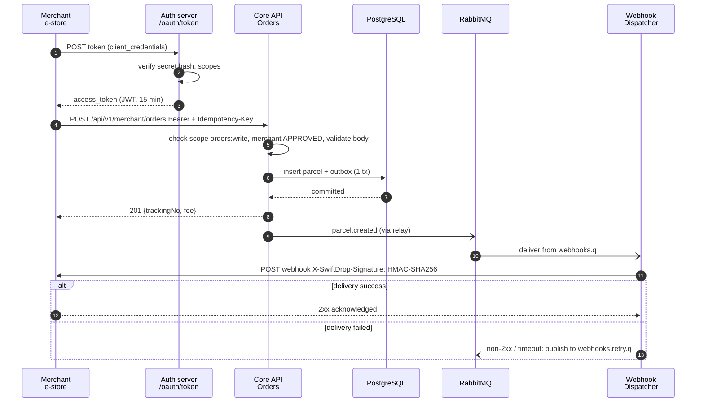

The merchant's system first exchanges its client ID and secret for a short-lived access token using the OAuth 2.0 client credentials grant. Tokens last 15 minutes, so a leaked token is only useful briefly. The order endpoint checks three things before doing any work: the token has the `orders:write` scope, the merchant is still approved, and the request body is valid. Once the parcel exists, the merchant gets a webhook for every status change. Each webhook is signed with HMAC-SHA256 using a secret only SwiftDrop and that merchant know, so the merchant can verify that the call really came from us.

---

### 7.3 Courier status update triggering notifications

#### Figure 11: Sequence diagram: courier status update and fan-out
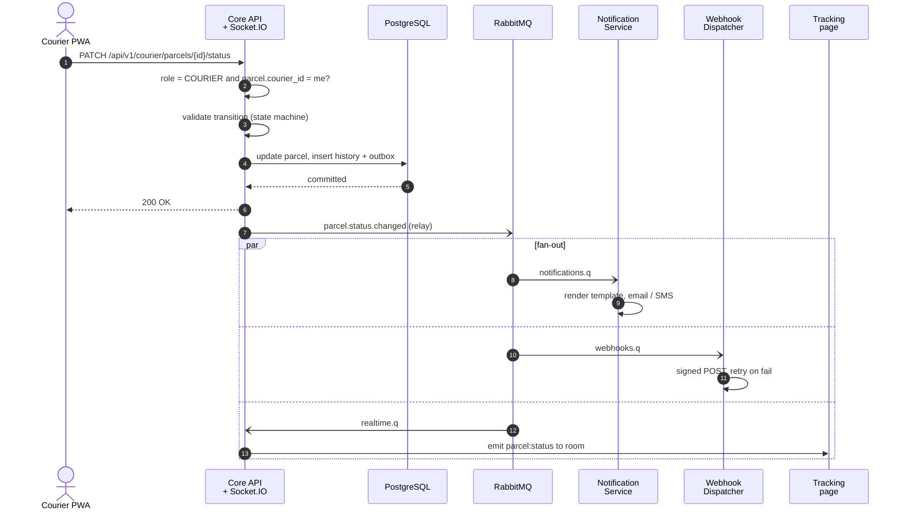

Steps 2 and 3 are where most of the security and correctness lives. The API checks both the role and the assignment, so a courier who changes the parcel ID in the URL gets a 403 instead of someone else's parcel. The state machine then rejects impossible transitions. Once the transaction commits, the courier gets an immediate response; the courier's phone does not wait for emails or webhooks. The three consumers in the shaded block run independently and in parallel.

---

### 7.4 OAuth 2.0 login with Google

#### Figure 12: Sequence diagram: Google sign-in with authorization code and PKCE
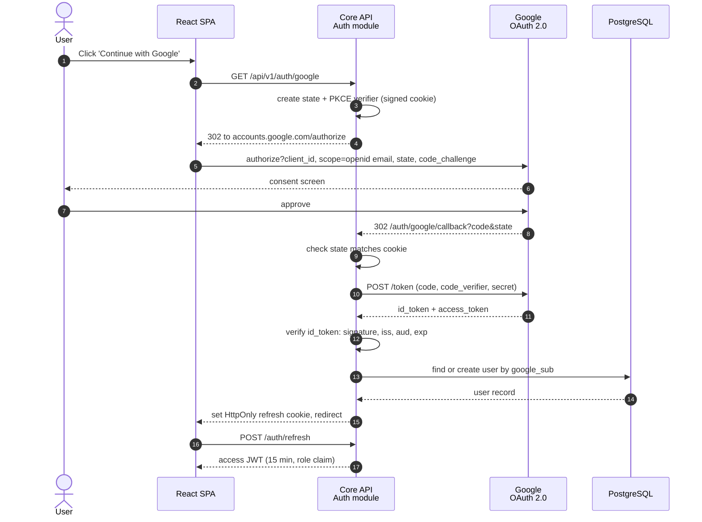

We use the authorization code flow with PKCE, handled by the backend. The SPA never sees Google's tokens. The state value protects against cross-site request forgery on the callback, and the PKCE verifier ensures that an intercepted authorization code cannot be exchanged by anyone else. We verify the ID token's signature against Google's published keys and check the issuer, audience and expiry before trusting the email inside it. After that, Google is out of the picture: the user gets our own access JWT and a refresh token in an HttpOnly cookie, exactly as if they had logged in with a password.

---

### 7.5 Parcel lifecycle

#### Figure 13: State diagram: parcel lifecycle
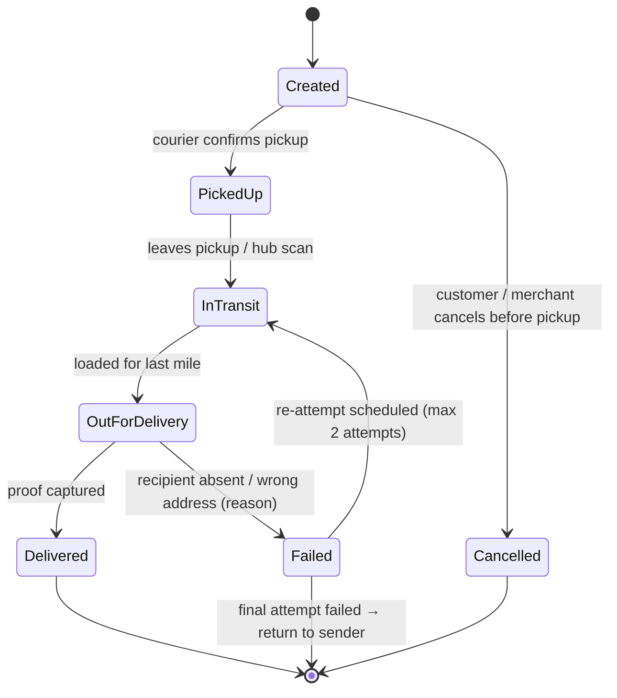

The brief lists the statuses Created, Picked Up, In Transit, Out for Delivery, Delivered and Failed. We added Cancelled for parcels withdrawn before pickup, and allowed a failed delivery to be re-attempted up to twice before the parcel is returned. The allowed transitions live in a single table in the Parcels module, so the courier API, the dispatcher console and the tests all use the same rules.

---

### 7.6 Dispatcher assigns a parcel

#### Figure 14: Activity diagram: assigning a parcel to a courier
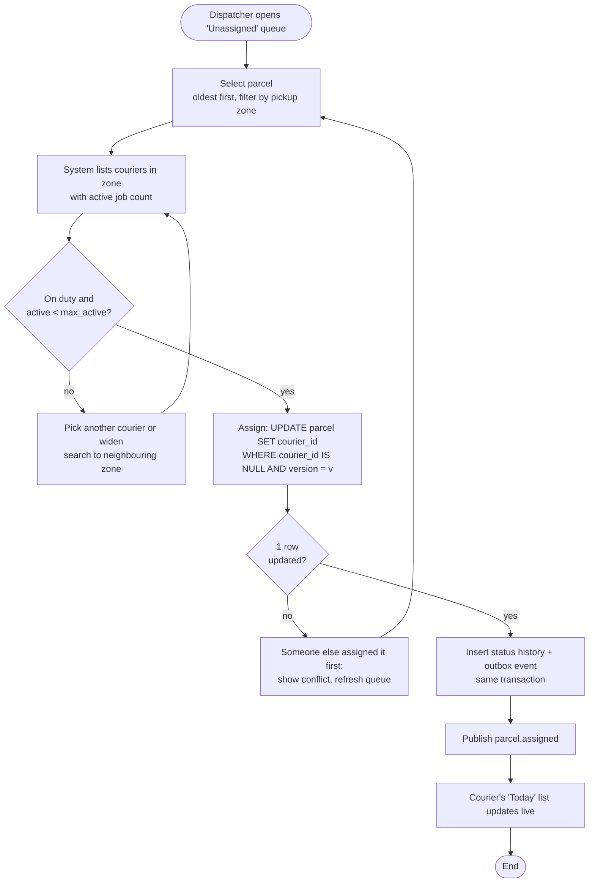

The interesting part of this flow is the conflict check. The update only succeeds if the parcel is still unassigned and its version has not changed since the dispatcher loaded it. If a colleague got there first, the dispatcher sees a clear message and a refreshed queue instead of a silent double assignment.

---

### 7.7 Webhook delivery and retry

#### Figure 15: Activity diagram: webhook delivery with retry
```mermaid
flowchart TD
    Start([Consume event from webhooks.q]) --> LoadConfig[Load merchant webhook config]
    LoadConfig --> HasUrl{Webhook URL<br/>configured?}
    
    HasUrl -- no --> EndNoSend([Nothing to send / End])
    
    HasUrl -- yes --> BuildPayload[Build payload, sign body with HMAC-SHA256<br/>header X-SwiftDrop-Signature]
    BuildPayload --> PostHttp[POST to merchant URL<br/>timeout 5 s, include event_id]
    
    PostHttp --> Check2xx{2xx<br/>response?}
    
    Check2xx -- yes --> Success[Record success (status code, latency)<br/>in webhook_deliveries]
    Success --> AckSuccess([Ack message / End])
    
    Check2xx -- no --> CheckAttempt{attempt < 6?}
    
    CheckAttempt -- yes --> PublishRetry[Publish to webhooks.retry.q<br/>TTL = 30 s × 2^attempt]
    PublishRetry -.->|TTL expires, message dead-letters back| Start
    
    CheckAttempt -- no --> DeadLetter[Move to webhooks.dlq, mark FAILED,<br/>show on merchant dashboard, alert ops]
    DeadLetter --> AckFail([Ack message / End])
```

With six attempts and a base delay of 30 seconds, the retries are spread over about 30 minutes, which covers a typical merchant deployment or short outage. Delays are implemented with RabbitMQ message TTL and dead-lettering, so the dispatcher holds no timers in memory and a restart loses nothing. Anything still failing after the last attempt goes to the dead-letter queue, appears on the merchant's dashboard with the last error, and can be replayed by an admin once the merchant fixes their endpoint.

---

## 8 Design Patterns and Principles

### 8.1 Patterns applied

#### Table 10: Design patterns and where they are used
| Pattern | Where | What it buys us |
| :--- | :--- | :--- |
| **Repository** | Every module's data access (`ParcelRepository`, `PricingRuleRepository`, ...) | Services depend on an interface, so unit tests use in-memory fakes and Prisma stays an implementation detail. |
| **Strategy** | Pricing: `StandardPricing`, `ExpressPricing`, `MerchantContractPricing` | New pricing schemes are new classes; the booking code does not change. |
| **State** | Parcel status transitions | One place defines which transitions are legal; impossible jumps are rejected everywhere. |
| **Observer / publish-subscribe** | Status events to notification, webhook and realtime consumers | The Parcels module does not know who is listening; adding a consumer touches no existing code. |
| **Transactional outbox** | Event publishing from Core API | Business change and event are saved atomically. |
| **Adapter** | `EmailSender` and `SmsSender` interfaces with SMTP and mock SMS adapters | Swapping the mock SMS for a real Sri Lankan SMS gateway later is a configuration change. |
| **Factory** | `NotificationChannelFactory`, `PricingStrategyFactory` | Choosing the right implementation is kept out of the business logic. |
| **Chain of responsibility** | Express middleware: authenticate, authorise, validate, handle | Each concern is one small function, reused across routes. |
| **Dependency injection** | Services receive repositories and clients through constructors | Easy to test and to replace dependencies per environment. |

The pricing strategy shows how small these pieces are in practice:

```typescript
interface PricingStrategy {
  quote(input: QuoteInput, rule: PricingRule): Money;
}

class StandardPricing implements PricingStrategy {
  quote({ weightKg }: QuoteInput, rule: PricingRule): Money {
    const extraKg = Math.max(0, Math.ceil(weightKg) - 1);
    return Money.cents(rule.baseFeeCents + extraKg * rule.perKgCents);
  }
}

// e.g. Colombo -> Kandy, small parcel, 2 kg:
// base 45000 + 1 x 12000 = 57000 cents = LKR 570.00
```

---

### 8.2 Principles
- **Single responsibility.** Controllers translate HTTP, services hold rules, repositories store data. The Notification Service only sends messages; it does not decide when a parcel's status may change.
- **Open/closed.** New pricing schemes, notification channels and event consumers are added by writing new classes or services, not by editing existing ones.
- **Liskov substitution.** Any `PricingStrategy` or `SmsSender` can replace another without the caller noticing. Our tests run the same contract tests against each implementation to check this.
- **Interface segregation.** The courier module depends on a narrow `ParcelStatusUpdater` interface, not on the whole parcel service with its admin-only methods.
- **Dependency inversion.** Business code depends on interfaces defined in the domain layer; the infrastructure layer implements them.
- **DRY.** Validation schemas, status transition rules and the event envelope each exist in exactly one place and are imported wherever they are needed. The Zod schemas are shared with the frontend.
- **KISS and YAGNI.** We deliberately did not build microservices, a service mesh or event sourcing. They solve problems SwiftDrop does not have yet, and they would have cost us weeks.

---

## 9 Security Design

SwiftDrop handles names, phone numbers and home addresses, so security was part of the design from the start rather than something to add at the end.

### 9.1 Authentication
- Passwords are hashed with bcrypt at cost factor 12. Plain passwords are never logged or stored.
- Access tokens are JWTs signed with RS256, valid for 15 minutes, carrying only the user ID, role and token ID. No personal data goes into the token.
- Refresh tokens are random values stored hashed in the database, sent in an `HttpOnly`, `Secure`, `SameSite=Strict` cookie, and rotated on every use. Reusing an old refresh token revokes the whole token family, which detects stolen tokens.
- Google login follows OpenID Connect with PKCE, as described in [Section 7.4](#74-oauth-20-login-with-google).
- Login and token endpoints are rate-limited per IP and per account to slow down password guessing.

### 9.2 Authorisation
Two checks run on every protected request. The first is a role check in middleware (`requireRole('COURIER')`). The second is an ownership check inside the service, built into the database query itself, for example `WHERE id = :id AND courier_id = :currentCourier`. Because the filter is part of the query, there is no code path that loads another user's record and then forgets to check it. When the check fails we return 404 rather than 403 for customer and courier lookups, so the response does not even confirm that the parcel exists.

### 9.3 Merchant API and webhooks
- Client secrets are shown once at creation, then stored only as a hash. Merchants can rotate or revoke them from the dashboard.
- Tokens carry scopes (`orders:write`, `orders:read`), so a key used only for tracking cannot create orders.
- Each API client has its own rate limit, so one misbehaving integration cannot starve the others.
- Webhook payloads are signed with HMAC-SHA256 and include a timestamp; merchants reject signatures older than five minutes to prevent replay.
- Webhook URLs must use HTTPS and may not point at private or loopback addresses. This blocks server-side request forgery attempts aimed at our internal network.

### 9.4 Personal data
- All input is validated with Zod at the API boundary: phone numbers must match Sri Lankan formats, weights must be positive and within limits, and free-text notes are length-limited.
- Prisma uses parameterised queries throughout, which prevents SQL injection.
- The logger is configured to redact fields such as `password`, `phone`, `address` and `authorization` before anything is written.
- Errors returned to clients are generic and carry a correlation ID; the stack trace and details stay in the server logs, which are themselves redacted.
- The public tracking page shows status, time and town only. The full address and phone number are visible only to the sender, the assigned courier and staff.
- Proof-of-delivery photos are served through short-lived signed URLs, not public links.

### 9.5 Secrets and configuration
No secret appears in the repository. Each service reads configuration from environment variables, and the repository contains only a `.env.example` with placeholder values. In Kubernetes, non-sensitive settings go into ConfigMaps and credentials into Secrets. A secret-scanning step in the CI pipeline fails the build if a key is committed by accident.

### 9.6 Threats and mitigations

#### Table 11: Threat model summary (STRIDE)
| Threat | Example | Mitigation |
| :--- | :--- | :--- |
| **Spoofing** | Someone calls the order API pretending to be a merchant | OAuth client credentials, hashed secrets, short-lived scoped tokens |
| **Tampering** | Webhook payload altered in transit | HTTPS plus HMAC signature with timestamp |
| **Repudiation** | Courier claims they never marked a parcel delivered | Append-only status history with user ID, time and proof |
| **Information disclosure** | Guessing tracking numbers to read addresses | Random tracking numbers, reduced public payload, rate limits |
| **Denial of service** | Flooding the quote endpoint | Rate limiting at Nginx and per client in the API |
| **Elevation of privilege** | Courier editing another courier's parcel by changing the URL | Ownership filter in every query; tested explicitly |

---

## 10 API Design

### 10.1 Conventions
- All endpoints are versioned under `/api/v1`. A breaking change gets `/api/v2`, while v1 keeps working for at least one release so merchants have time to migrate.
- Resources use plural nouns and standard HTTP verbs. List endpoints use cursor pagination.
- POST endpoints that create parcels accept an `Idempotency-Key` header.
- Errors use one format (RFC 7807 problem details) produced by a single error-handling middleware.
- The OpenAPI 3 specification is generated from the Zod schemas and served at `/api/docs`.

### 10.2 Main endpoints

#### Table 12: Key REST endpoints
| Method and path | Role | Purpose |
| :--- | :--- | :--- |
| `POST /api/v1/auth/register`, `/auth/login` | Public | Email sign-up and login |
| `GET /api/v1/auth/google`, `/auth/google/callback` | Public | Google OAuth 2.0 flow |
| `POST /api/v1/auth/refresh` | Any signed-in user | Rotate refresh token, issue access token |
| `POST /api/v1/quotes` | Customer, Merchant | Estimate a delivery fee |
| `POST /api/v1/parcels` | Customer | Create a delivery from a quote |
| `GET /api/v1/parcels/{id}`, `/parcels/{id}/receipt` | Owner | Parcel details and PDF receipt |
| `GET /api/v1/track/{trackingNo}` | Public | Reduced tracking view |
| `POST /oauth/token` | Merchant client | Client credentials grant |
| `POST /api/v1/merchant/orders` | Merchant (scope `orders:write`) | Create an order from an e-store |
| `PUT /api/v1/merchant/webhook` | Merchant | Register webhook URL and rotate secret |
| `GET /api/v1/courier/parcels?date=today` | Courier | Today's assigned deliveries |
| `PATCH /api/v1/courier/parcels/{id}/status` | Courier (assigned) | Update status with note or proof |
| `GET /api/v1/admin/parcels?status=UNASSIGNED` | Dispatcher | Unassigned queue |
| `POST /api/v1/admin/parcels/{id}/assignment` | Dispatcher | Assign or reassign a courier |
| `GET /api/v1/admin/couriers/workload` | Dispatcher | Active jobs per courier |
| `PATCH /api/v1/admin/merchants/{id}` | Admin | Approve or reject a merchant |
| `CRUD /api/v1/admin/zones`, `/admin/pricing-rules` | Admin | Manage zones and pricing |
| `GET /api/v1/admin/reports/daily` | Dispatcher, Admin | Deliveries per day, success rate |

### 10.3 Error format
```http
HTTP/1.1 409 Conflict
Content-Type: application/problem+json

{
  "type": "https://api.swiftdrop.lk/errors/invalid-transition",
  "title": "Status change not allowed",
  "status": 409,
  "detail": "A parcel in CREATED cannot move to DELIVERED.",
  "correlationId": "c0a8012e-5f3b"
}
```

---

## 11 Testing Approach

Full test results and coverage reports are submitted separately. This section explains how the design makes the system testable and what we test at each level.

#### Table 13: Testing levels
| Level | Tools | What we cover |
| :--- | :--- | :--- |
| **Unit** | Jest | Pricing strategies, status state machine, validation schemas, services using fake repositories |
| **Integration** | Jest, Supertest, Testcontainers (PostgreSQL, RabbitMQ) | API endpoints against a real database; the outbox relay publishing to a real broker; consumers handling duplicates |
| **Authorisation** | Supertest with tokens for each role | A courier cannot read or update another courier's parcel; a customer cannot see another customer's parcel; a merchant token without `orders:write` cannot create orders |
| **Event flow** | Testcontainers RabbitMQ, mock SMTP, mock HTTP server | A status update produces exactly one notification and one signed webhook; a failing webhook endpoint is retried and finally dead-lettered |
| **Frontend** | Vitest, React Testing Library | Booking form validation, tracking page updates on socket events |

Coverage is measured with Jest's built-in coverage (Istanbul) and published from the CI pipeline as an HTML report and an lcov summary. Our target is at least 80% line coverage on the service and domain layers, where the business rules live.

---

## 12 Bonus Features

### 12.1 Kubernetes deployment
The Helm chart deploys the full system into a `swiftdrop` namespace. Stateless services (`core-api`, the workers, the AI assistant and the web frontend) run as Deployments with readiness and liveness probes on `/healthz`. PostgreSQL, RabbitMQ and MinIO run as StatefulSets with persistent volume claims. An Ingress replaces Nginx for routing and TLS. Values files separate local (minikube or kind) settings from a hosted cluster, and a HorizontalPodAutoscaler scales `core-api` on CPU.

### 12.2 AI delivery assistant

#### Figure 16: AI delivery assistant calling the API through MCP tools
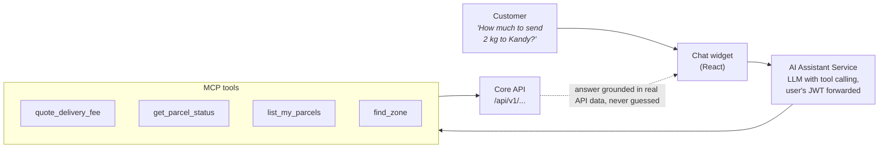

The assistant answers questions such as *"Where is my parcel?"* or *"How much to send 2 kg to Kandy?"*. It does not answer from memory. The AI Assistant Service exposes our API as Model Context Protocol tools, and the language model decides which tool to call. Every tool call goes through the normal REST API with the user's own JWT, so the assistant can only see what the user could see anyway. The tools are read-only in this version: the assistant can quote and look up, but it cannot create or cancel parcels.

---

## 13 Conclusion

The design rests on a few decisions that reinforce each other. A modular monolith keeps the core business rules in one place with one database transaction. The transactional outbox and RabbitMQ move slow and unreliable work, such as email, SMS and merchant webhooks, out of the request path without risking lost events. Role checks combined with ownership filters in every query give us authorisation we can test directly. And a single set of Docker images runs the same way on a laptop and on Kubernetes.

There are things we would add with more time: online payments, route optimisation for couriers, and splitting the Parcels module into its own service if traffic ever demands it. The module boundaries and event contracts described here are what make that later split possible without a rewrite.

---

## Appendix A: Contribution Sheet

Fill in names and registration numbers. The suggested areas match the module boundaries in [Section 5](#5-system-architecture), so each member owns a part they can explain during the demo.

#### Table 14: Contribution sheet
| # | Member name | Reg. no. | Main responsibility | Report sections |
| :-: | :--- | :--- | :--- | :--- |
| **1** | | | Team lead, architecture, integration design | 1, 5, 13 |
| **2** | | | Auth module: JWT, Google OAuth, RBAC | 2, 7.4, 9.1–9.2 |
| **3** | | | Parcels module, state machine, tracking API | 4, 7.5 |
| **4** | | | Pricing strategies, zones, quotes | 7.1, 8 |
| **5** | | | Dispatch module, courier workload | 3.4, 7.6 |
| **6** | | | Merchant API, client credentials, webhooks | 3.2, 7.2, 7.7, 9.3 |
| **7** | | | RabbitMQ, outbox relay, notification service | 6 |
| **8** | | | Frontend: customer portal, public tracking, real-time | 3.1, 6.6 |
| **9** | | | Frontend: merchant, courier PWA, admin console | 3.3, 10 |
| **10** | | | DevOps: Docker, Kubernetes, CI, testing and coverage | 5.5, 11, 12 |

---

## Appendix B: Editing the Diagrams

- Each diagram is a group of native Word shapes. Click once to select the group, then click again on a single box, arrow or label to select just that shape.
- Double-click a box to edit its text. Use Shape Format to change its fill, outline or line style.
- To rearrange freely, right-click the diagram and choose Group, then Ungroup. Select everything and choose Group again when you are done so the diagram moves as one piece.
- Figure and table numbers are fields. After adding or removing a figure, press `Ctrl+A` then `F9` to refresh the numbering, the contents and the list of figures.
