# SWIFTDROP
## Parcel Delivery & Courier Management System
### Design Documentation: Use Cases, Data Model, Architecture, Integration Design, Key Flows and Justifications

| Item | Details |
| :--- | :--- |
| **Module** | Enterprise Application Development (Group Assignment, 20 marks) |
| **Group number** | 23 |
| **Team size** | 10 members (see the contribution sheet in [Appendix A](#appendix-a-contribution-sheet)) |
| **Submission** | Design documentation report |
| **Date** | 29 October 2026 |

Status: proposed design, reconciled on 29 October 2026 with the [corrected PDF](output/pdf/SwiftDrop_Design_Report_Corrected.pdf). No application, migration, deployment or test results exist yet. This Markdown defines product requirements; [plan.md](plan.md) defines delivery and [docs/auth.md](docs/auth.md) refines authentication contracts and explicitly labelled extensions.

Diagrams below are editable Mermaid. The PDF's vector layout is maintained in [docs/report/build_report.py](docs/report/build_report.py); four working pages are imported from the original PDF. They express the same baseline contracts but are not identical drawings or a direct Markdown export. Update both representations when a contract changes, regenerate the PDF and run the documented consistency checks. The [historical audit](DOCUMENTATION_AUDIT.md) retains its original findings; [review notes](docs/report/REVIEW.md) record their current disposition.

---

## Contents

- [Contents](#contents)
- [List of Figures](#list-of-figures)
- [1 Introduction](#1-introduction)
  - [1.1 Background](#11-background)
  - [1.2 Purpose of this document](#12-purpose-of-this-document)
  - [1.3 Scope](#13-scope)
  - [1.4 Assumptions and constraints](#14-assumptions-and-constraints)
  - [1.5 Technology choices](#15-technology-choices)
- [2 Users, Roles and Access Rules](#2-users-roles-and-access-rules)
- [3 Use Case Modelling](#3-use-case-modelling)
  - [3.1 Customer and recipient](#31-customer-and-recipient)
  - [3.2 Merchant](#32-merchant)
  - [3.3 Courier](#33-courier)
  - [3.4 Dispatcher and admin](#34-dispatcher-and-admin)
  - [3.5 Use case specifications](#35-use-case-specifications)
- [4 Data Design](#4-data-design)
  - [4.1 Entity overview](#41-entity-overview)
  - [4.2 Design decisions](#42-design-decisions)
- [5 System Architecture](#5-system-architecture)
  - [5.1 Options we considered](#51-options-we-considered)
  - [5.2 The chosen architecture](#52-the-chosen-architecture)
  - [5.3 Inside the Core API](#53-inside-the-core-api)
  - [5.4 Why there is no separate BFF](#54-why-there-is-no-separate-bff)
  - [5.5 Deployment view](#55-deployment-view)
- [6 Integration Design](#6-integration-design)
  - [6.1 Integration patterns used](#61-integration-patterns-used)
  - [6.2 Event flow](#62-event-flow)
  - [6.3 Event contract](#63-event-contract)
  - [6.4 Queues and routing keys](#64-queues-and-routing-keys)
  - [6.5 Reliability guarantees](#65-reliability-guarantees)
  - [6.6 Real-time tracking](#66-real-time-tracking)
- [7 Key Flows](#7-key-flows)
  - [7.1 Creating a delivery](#71-creating-a-delivery)
  - [7.2 Merchant creates an order through the API](#72-merchant-creates-an-order-through-the-api)
  - [7.3 Courier status update triggering notifications](#73-courier-status-update-triggering-notifications)
  - [7.4 OAuth 2.0 login with Google](#74-oauth-20-login-with-google)
  - [7.5 Parcel lifecycle](#75-parcel-lifecycle)
  - [7.6 Dispatcher assigns a parcel](#76-dispatcher-assigns-a-parcel)
  - [7.7 Webhook delivery and retry](#77-webhook-delivery-and-retry)
- [8 Design Patterns and Principles](#8-design-patterns-and-principles)
  - [8.1 Patterns applied](#81-patterns-applied)
  - [8.2 Principles](#82-principles)
- [9 Security Design](#9-security-design)
  - [9.1 Authentication](#91-authentication)
  - [9.2 Authorisation](#92-authorisation)
  - [9.3 Merchant API and webhooks](#93-merchant-api-and-webhooks)
  - [9.4 Personal data](#94-personal-data)
  - [9.5 Secrets and configuration](#95-secrets-and-configuration)
  - [9.6 Threats and mitigations](#96-threats-and-mitigations)
- [10 API Design](#10-api-design)
  - [10.1 Conventions](#101-conventions)
  - [10.2 Main endpoints](#102-main-endpoints)
  - [10.3 Error format](#103-error-format)
- [11 Testing Approach](#11-testing-approach)
- [12 Bonus Features](#12-bonus-features)
  - [12.1 Kubernetes deployment](#121-kubernetes-deployment)
  - [12.2 AI delivery assistant](#122-ai-delivery-assistant)
- [13 Conclusion](#13-conclusion)
- [Appendix A: Contribution Sheet](#appendix-a-contribution-sheet)
- [Appendix B: Editing the Diagrams](#appendix-b-editing-the-diagrams)

---

## List of Figures

- **Figure 1**: Customer and recipient use cases *(Page 8)*
- **Figure 2**: Merchant use cases *(Page 9)*
- **Figure 3**: Courier use cases *(Page 10)*
- **Figure 4**: Dispatcher and admin use cases *(Page 11)*
- **Figure 5**: Entity-relationship diagram *(Page 13)*
- **Figure 6**: Layered view of the SwiftDrop architecture *(Page 17)*
- **Figure 7**: Container deployment view (Docker Compose and Kubernetes) *(Page 19)*
- **Figure 8**: Event-driven integration through RabbitMQ *(Page 21)*
- **Figure 9**: Sequence diagram: customer creates a delivery *(Page 24)*
- **Figure 10**: Sequence diagram: merchant API order and webhook *(Page 25)*
- **Figure 11**: Sequence diagram: courier status update and fan-out *(Page 26)*
- **Figure 12**: Sequence diagram: Google sign-in with authorization code and PKCE *(Page 27)*
- **Figure 13**: State diagram: parcel lifecycle *(Page 28)*
- **Figure 14**: Activity diagram: assigning a parcel to a courier *(Page 29)*
- **Figure 15**: Activity diagram: webhook delivery with retry *(Page 30)*
- **Figure 16**: AI delivery assistant calling the API through MCP tools *(Page 38)*

---

## 1 Introduction

### 1.1 Background
SwiftDrop is a courier company that delivers parcels across the whole island. Up to now, bookings have come in over the phone and been tracked in shared spreadsheets. That worked when the company was small, but it has started to hurt. Customers ring the hotline to ask where their parcel is because they have no other way of knowing. Dispatchers juggle courier assignments from memory. Partner online stores email order lists that someone then retypes, which is slow and causes mistakes in addresses and phone numbers.

Our team was asked to replace this with a proper platform. Customers should be able to book and track parcels themselves, merchants should be able to push orders straight from their e-commerce systems, dispatchers should see every unassigned parcel and every courier's workload on one screen, and couriers should update progress from their phones as they work.

### 1.2 Purpose of this document
This report records the design of that platform and, just as importantly, the reasons behind it. It covers the use case models for each type of user, the data model, the overall architecture, the way the system integrates with external parties, the sequence and activity flows for the most important scenarios, and the design patterns we applied. Where we had to choose between options, we say what we picked and why, including the options we turned down.

We wrote it for two audiences: the evaluators marking the assignment, and ourselves. A ten-person team needs a shared picture of the system before people start writing code in parallel, and this document is that picture.

### 1.3 Scope
**Baseline scope**: customer, merchant, courier, dispatcher and admin functionality; JWT authentication with Google sign-in; a scoped merchant API; event-driven email, mock SMS and signed webhooks; live tracking; and Docker Compose deployment. Kubernetes/Helm and the AI assistant are optional stretch features, started only after the baseline is demoable. The original marking rubric has not been supplied.

**Out of scope for this version**: online card payments (fees are shown and recorded, and settlement is handled offline as SwiftDrop does today), route optimisation, warehouse and hub inventory, native mobile apps and tracking the physical return-to-sender journey. The courier interface is a mobile-first progressive web app instead.

### 1.4 Assumptions and constraints
- Prices are in Sri Lankan Rupees and stored as integer cents to avoid rounding errors.
- Delivery zones follow district groupings (for example Western, Central, Southern), and pricing depends on the origin zone, destination zone, parcel size class and weight.
- Couriers use mid-range Android phones on mobile data, so the courier screens must be light and work on patchy connections.
- The team has roughly one semester, so we favour a stack that most members already know over one that would look impressive but slow everyone down.
- Everything must run locally with a single `docker compose up` so that every member, and the evaluators, can reproduce the system.

### 1.5 Technology choices
The table below lists the main technologies. Most of the team already writes TypeScript, so using it on both the front and back end means people can move between tasks without switching languages.

#### Table 1: Technology stack
| Concern | Choice | Why we picked it |
| :--- | :--- | :--- |
| **Frontend** | React 18, Vite, TypeScript, Tailwind CSS | Shared components for five roles and one operations console; fast builds. |
| **Backend** | Node.js 24 LTS, Express, TypeScript | Team familiarity; large ecosystem for OAuth, AMQP and WebSockets. |
| **Validation** | Zod schemas shared by API and SPA | One schema validates input on both sides, so rules are written once. |
| **Database** | PostgreSQL 16 with Prisma ORM | Relational data with strong constraints; transactions needed for the outbox. |
| **Message broker** | RabbitMQ topic exchange; supported compatible release to be pinned | Broker-assisted delays and fan-out; application code still implements retry policy, durable bookkeeping and confirmed transfers. |
| **Real-time** | Socket.IO with Redis adapter | WebSockets with automatic fallback to long-polling; works across replicas. |
| **Object storage** | MinIO (S3-compatible) | Proof-of-delivery photos and PDF receipts stay out of the database. |
| **Auth** | JWT (RS256), Google OpenID Connect, OAuth 2.0 client credentials | Signed access tokens plus standards-based social login and machine access; current account/revocation checks remain server-side. |
| **Testing** | Jest, Supertest, Testcontainers | Unit and integration tests against real Postgres and RabbitMQ containers. |
| **Deployment** | Docker Compose baseline; Kubernetes/Helm optional | Reuse images if stretch deployment proceeds; deployment files remain to be implemented. |

---

## 2 Users, Roles and Access Rules

The platform has five authenticated account roles: Customer, Merchant, Courier, Dispatcher and Admin. Recipient is a guest actor; merchant software is a machine actor with scoped client credentials. Admin inherits all Dispatcher operations and adds configuration and replay privileges. A person holds exactly one role per account. We considered allowing several roles per account, but nothing in the brief needs it, and a single role keeps both the JWT claims and the authorisation checks simpler.

#### Table 2: Roles in the system
| Role | Who they are | Main goals | How they sign in |
| :--- | :--- | :--- | :--- |
| **Customer** | Individuals sending parcels | Book, see the fee up front, track, download receipts | Email + password, or Google |
| **Recipient (guest)** | Anyone holding a tracking number | See the status of one parcel | No login; public tracking page |
| **Merchant** | Partner online stores | Create orders from their own system, get status webhooks | Dashboard login; API via client credentials |
| **Courier** | SwiftDrop delivery staff | See today's jobs, update status, record proof | Email + password (accounts created by admin) |
| **Dispatcher** | Operations staff | Operational parcel creation/status, assignment, cancellation, workload and reports | Email + password |
| **Admin** | Administrators | All Dispatcher operations plus users, merchant approval, zones, pricing and webhook replay | Email + password |

Role checks alone are not enough. A courier is allowed to update parcel status, but only for parcels assigned to them. A customer can read parcels, but only their own. These ownership rules must be enforced in the service layer by scoping every database query, not by hiding buttons in the UI. The matrix below summarises the rules; "own" means the record must belong to the caller.

#### Table 3: Role-based access matrix
| Capability | Customer | Merchant | Courier | Dispatcher | Admin |
| :--- | :--- | :--- | :--- | :--- | :--- |
| **Create delivery request** | own | own (API) | - | yes | yes |
| **View parcel and history** | own | own | assigned | all | all |
| **Update parcel status** | - | - | assigned | yes | yes |
| **Assign / reassign courier** | - | - | - | yes | yes |
| **Approve merchants** | - | - | - | - | yes |
| **Manage users, zones, pricing** | - | - | - | - | yes |
| **View reports** | - | own orders | - | yes | yes |
| **Manage API keys and webhooks** | - | own | - | - | yes |
| **Cancel before pickup** | own | own | - | yes | yes |
| **Replay failed webhook** | - | - | - | - | yes |

---

## 3 Use Case Modelling

We split the use cases into one diagram per main actor, because a single diagram with every use case became unreadable. In the PDF, blue ovals show primary goals and green ovals supporting use cases; Mermaid previews use the renderer theme. Relationships are linked with «include» (always happens as part of the base use case) or «extend» (optional behaviour added under certain conditions). Actors on the right are secondary: systems or people that take part in a use case but do not start it.

### 3.1 Customer and recipient

#### Figure 1: Customer and recipient use cases
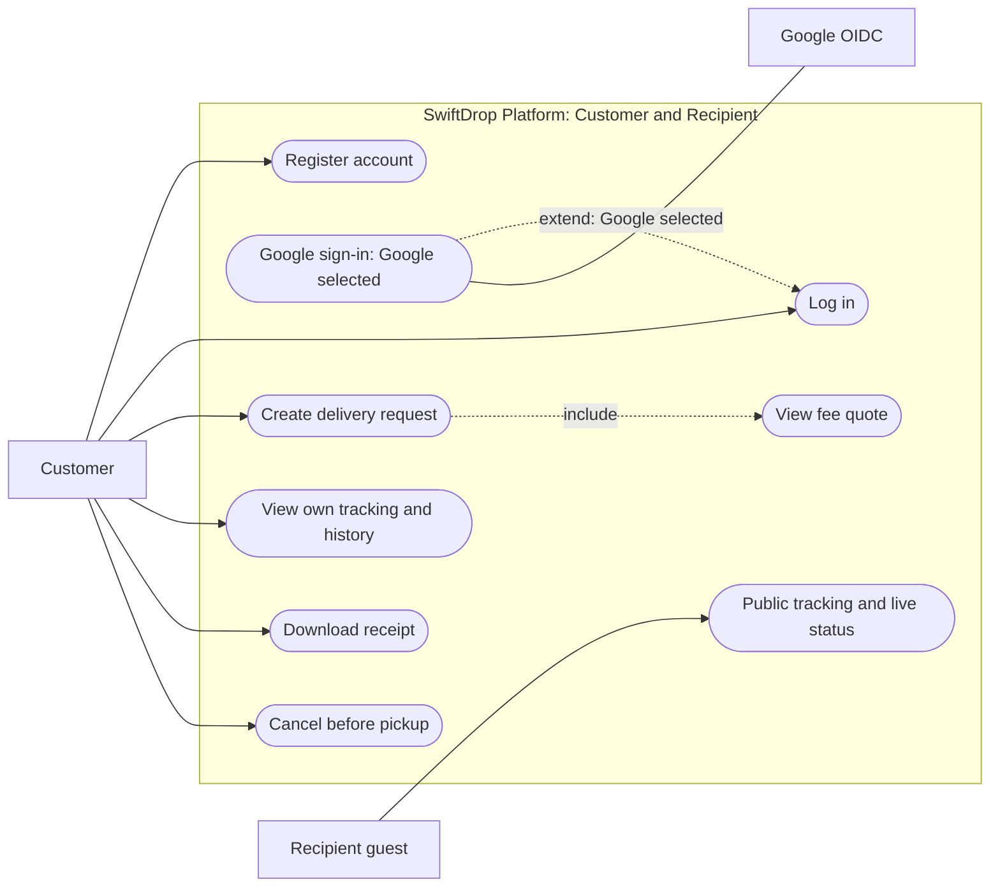

Booking includes a fee quote before confirmation. Google sign-in is an alternative login flow, shown as an extension only when Google is selected; the extension arrow points toward Login. Public tracking needs no account and exposes status, time and town only. Cancellation is owner-scoped and permitted only before pickup. Booking/status alerts follow committed business events; receipt downloads and tracking-page visits never trigger those messages. Workers and brokers are internal components, not external use-case actors.

---

### 3.2 Merchant

#### Figure 2: Merchant use cases
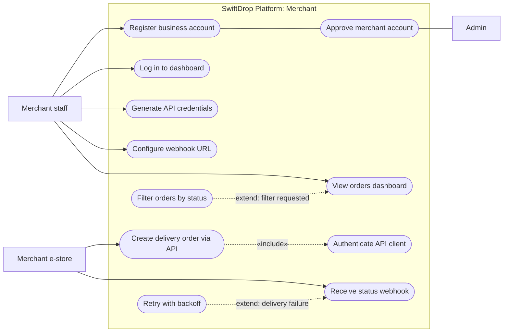

We modelled the merchant as two actors. **Merchant staff** are people using the dashboard. The **merchant e-store** is their software calling our API. The distinction matters for security: staff log in with a password and get a user JWT, while the e-store authenticates with client credentials and gets a token limited to order scopes. Registration needs an administrator's approval before the merchant can create API credentials, which stops anyone from signing up and flooding the system with fake orders.

---

### 3.3 Courier

#### Figure 3: Courier use cases
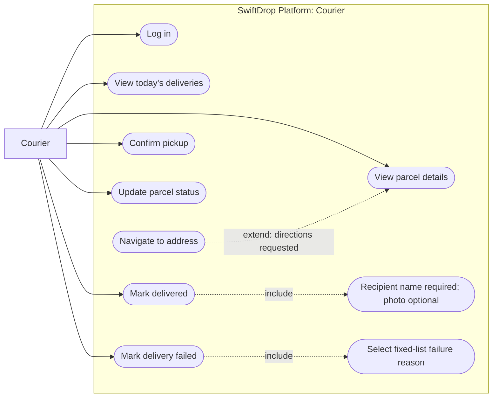

Couriers can operate only on currently assigned parcels. Navigation extends details when directions are requested. DELIVERED requires recipient name; a photo is optional and stored as a private object key. FAILED requires a fixed-list reason. The API checks ownership, version, transition and proof before atomically recording state/history/outbox; the separate relay publishes after commit. Offline replay is specified in Section 7.3.

---

### 3.4 Dispatcher and admin

#### Figure 4: Dispatcher and admin use cases
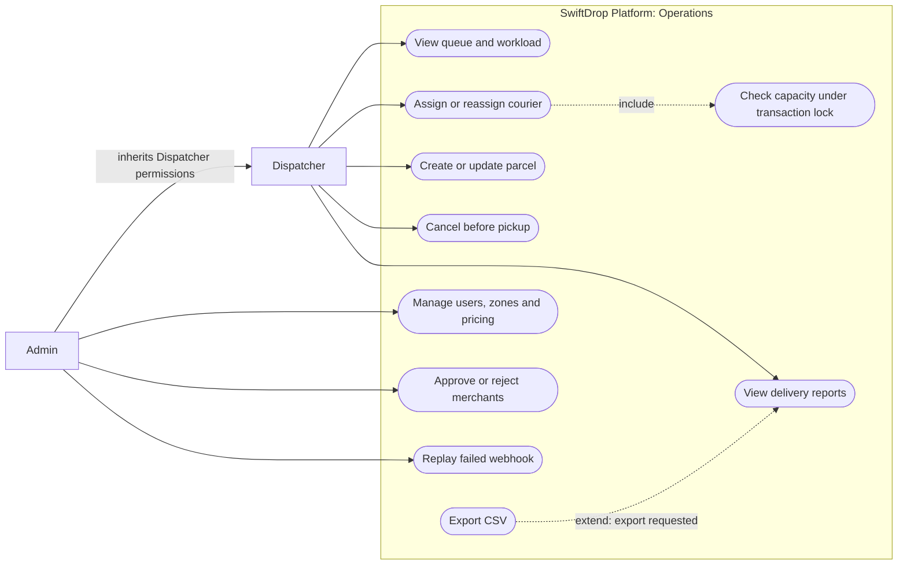

Admin inherits Dispatcher operations; the labelled inheritance association above is a Mermaid approximation of the hollow-triangle actor generalisation in the PDF. Assignment/reassignment includes a transactional capacity check; reassignment changes old/new workload atomically. Only Admin may replay failed webhooks, provision users or change configuration. Dispatcher may inspect operational failures but does not receive replay permission.

---

### 3.5 Use case specifications

Two use cases carry most of the business logic, so we wrote full specifications for them.

#### Table 4: Use case specification: create delivery request
| Field | UC-C03 Create delivery request |
| :--- | :--- |
| **Primary actor** | Customer |
| **Preconditions** | Customer is authenticated with an active account. Email verification is not a baseline booking precondition; optional verification is separately scoped in docs/auth.md. |
| **Main flow** | 1. Customer enters pickup address, drop-off address, recipient name and phone, size class and weight.<br>2. System validates the input and resolves both addresses to delivery zones.<br>3. System calculates the fee using the active pricing rule and shows a quote valid for 15 minutes.<br>4. Customer confirms.<br>5. System validates the owner-bound quote and atomically saves the parcel, history, idempotency response and outbox event; commits and returns the tracking number.<br>6. The separate relay later publishes `parcel.created`; its notification template sends confirmation email. |
| **Alternative flows** | **2a.** Address outside any zone: system explains that the area is not yet served.<br>**4a.** Quote expired: system recalculates and asks the customer to confirm the new fee.<br>**5a.** Same principal/key/body: return the saved response; a changed body with that key returns 409. Concurrent duplicates serialize. Database failure rolls back; broker outage leaves a committed outbox row for retry. |
| **Postconditions** | Parcel exists in status `Created` and appears in the dispatcher's unassigned queue. |

#### Table 5: Use case specification: update parcel status
| Field | UC-K05 Update parcel status (courier) |
| :--- | :--- |
| **Primary actor** | Courier |
| **Preconditions** | Courier is logged in and the parcel is assigned to them. |
| **Main flow** | 1. Courier sends the chosen status, expectedVersion and stable operation key for an assigned parcel.<br>2. For Delivered, courier enters the recipient's name and optionally attaches a photo.<br>3. System checks that the transition is allowed from the current status.<br>4. System saves new status/version, history, idempotency response and outbox in one transaction; capacity changes use the shared courier locks.<br>5. Consumers update customers, merchants and tracking asynchronously when dependencies are available. |
| **Alternative flows** | **1a.** Parcel not assigned to this courier: system returns 404 and logs the attempt.<br>**3a.** Invalid transition (for example Created to Delivered): system returns 409 with an explanation.<br>**2b.** No network: retain operation key, expected version and per-parcel order; replay only after original-user authentication. Stale/reassigned updates need review; failed photo upload must finish or the optional photo be omitted. |
| **Postconditions** | State/history/idempotency response/outbox are atomic. The relay publishes at least once with stable eventId; external side effects may duplicate after a crash. |

---

## 4 Data Design

The entity-relationship diagram is conceptual and selective, not a migration-ready schema. Section 4.1 supplies the omitted persistence contracts; implementation must review concrete migrations and constraints. The PDF groups related entities by colour; this Mermaid relationship view follows the preview theme. The contracts below apply in both formats.

#### Figure 5: Entity-relationship diagram
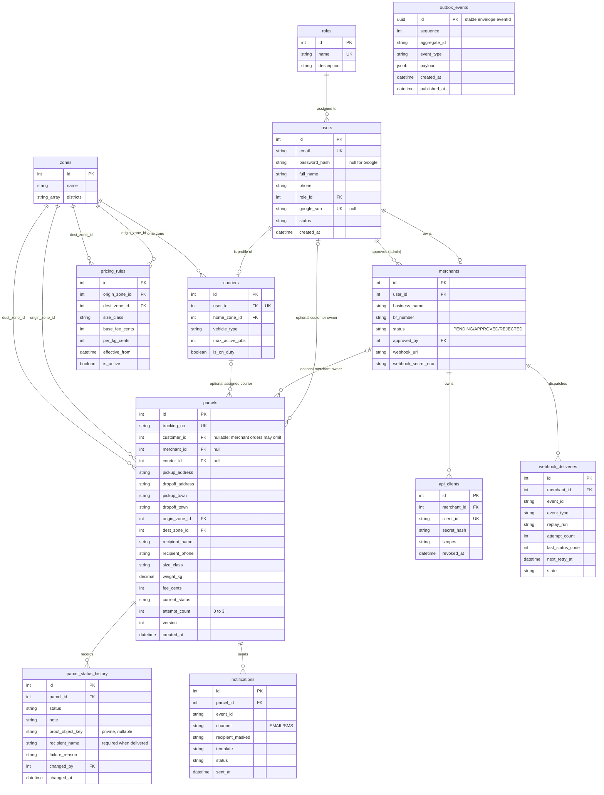

### 4.1 Entity overview

#### Table 6: Entity overview
| Entity | What it stores | Notes |
| :--- | :--- | :--- |
| **users / roles** | Every person who can log in, and their role | `password_hash` is null for Google-only accounts; `google_sub` links the Google identity. |
| **merchants** | Business profile, approval status, webhook settings | Webhook secret is encrypted at rest, never shown again after creation. |
| **api_clients** | Client credentials issued to a merchant | Only a hash of the secret is stored, like a password. |
| **couriers** | Courier profile, home zone, capacity | `max_active_jobs` drives the capacity check during assignment. |
| **zones / pricing_rules** | Delivery zones and fee rules between them | Rules are versioned with `effective_from`, so old receipts keep their original price. |
| **parcels** | Delivery, ownership and lifecycle | `customer_id` and `merchant_id` nullable individually but at least one required; merchant machine orders use `merchant_id`. Both zone FKs reference zones. Persist towns, scheduled date, version and attempt_count. |
| **parcel_status_history** | Every status change, who made it and when | Append-only. This is the audit trail and the timeline shown to customers. |
| **webhook_deliveries / webhook_attempts** | Delivery and individual HTTP attempts | Unique delivery `(merchant_id,eventId,replay_run)`; attempt 0..6, next_retry_at, state, durable lease; one row per HTTP result/error/latency/time. Replay preserves eventId. |
| **notifications** | Emails and SMS sent | Recipient stored masked (for example `077***4521`) to limit personal data. |
| **outbox_events** | Events waiting to be published | `id` equals stable envelope eventId; aggregate_id, sequence, schema version, type, occurred_at, payload, created_at/published_at. Written with business state. |
| **quotes** | Owner-bound 15-minute fee offers | Normalised inputs/hash, both zone IDs, rule version, fee_cents, expiry, consumed_parcel_id; owner/expiry/single consumption checked atomically. |
| **refresh_tokens / auth_sessions** | Hashed refresh tokens and their families | User/family ID, token_hash, expiry, consumed/replaced-by/revoked state; reuse revokes family atomically. Detailed lifecycle in docs/auth.md. |
| **idempotency_records** | Saved creation/update responses | Unique `(principal,operation,key)` plus request_hash, response status/body and expiry; concurrent duplicates serialize; changed body returns 409. |
| **processed_events** | Consumer progress / duplicate suppression | Unique `(consumer,eventId)`; lease/state/completion time. Notifications also store eventId and provider idempotency key where supported. External-send crash window remains. |

Review FKs, deletion policies, indexes and retention in concrete migrations. `proof_object_key` is never a public URL; authorised short-lived URLs are generated on demand. Authentication extensions add action-token, OAuth transaction and MFA structures only through agreed phase contracts in docs/auth.md, rather than implying those tables already exist.

### 4.2 Design decisions
- **Status history is append-only.** We never update or delete history rows. This gives a reliable audit trail if a customer disputes a delivery, and it doubles as the timeline on the tracking page.
- **Current status is kept on the parcel as well.** Strictly speaking it can be derived from the latest history row, but dashboards filter by status constantly. Storing it avoids a subquery on every list view. Both are written in the same transaction, so they cannot drift apart.
- **Money is stored as integer cents.** Floating-point arithmetic on currency produces rounding errors, so `fee_cents`, `base_fee_cents` and `per_kg_cents` are integers.
- **Tracking numbers are not sequential.** They follow the pattern `SD-` plus eight random characters from an unambiguous alphabet, with a check character. A sequential number would let anyone guess other people's tracking numbers on the public page.
- **Optimistic locking on parcels.** Two dispatchers can try to assign the same parcel at the same moment. The `version` column makes the second update fail cleanly instead of silently overwriting the first.
- **Capacity locking across parcels.** Every assignment, reassignment, duty/capacity or active-status change locks affected courier rows in sorted ID order, then the parcel. Recheck workload/on-duty/limit under lock, increment parcel version and commit history/outbox. If observed courier changed before locks, roll back and restart. Reject a limit reduction below reserved workload. Active means assigned and not DELIVERED, CANCELLED or terminal FAILED after attempt 3; retryable FAILED reserves a slot.
- **Attempts and retention.** attempt_count starts at 0 and increments on entry to OUT_FOR_DELIVERY. Dispatcher/Admin may schedule attempts 2 and 3. Retain operation keys for the supported offline window (initial target 7 days); after expiry clients reconcile before retrying creation. Retain processed IDs for at least the broker/DLQ/replay windows; define bounded cleanup.
- **Indexes follow the queries.** We index `parcels(tracking_no)`, `parcels(courier_id, current_status)`, `parcels(merchant_id, created_at)` and `parcel_status_history(parcel_id, changed_at)` because these back the tracking page, the courier's daily list, the merchant dashboard and the timeline.

---

## 5 System Architecture

### 5.1 Options we considered
We looked at three architectural styles before settling on one. The table summarises the discussion.

#### Table 7: Architecture options
| Option | Strengths | Weaknesses | Verdict |
| :--- | :--- | :--- | :--- |
| **Layered monolith** | Simple to build, test and deploy; one codebase | Layering can also use background jobs; sharing one deployment couples failure recovery and scaling. Independent workers better isolate outbound retries and latency | Rejected |
| **Full microservices** | Independent scaling and deployment; good for large organisations | Ten students would spend most of the semester on service discovery, distributed transactions and debugging across services | Rejected |
| **Modular monolith with event-driven workers** | Clear module boundaries, one database transaction for business changes, slow work moved out of the request path | Modules must be kept honest; one deployable for the core means one larger release | **Chosen** |

The deciding factor was where the system actually needs to be separate. Parcel creation, pricing, assignment and status updates are tightly linked and benefit from sharing one database transaction. Notifications and merchant webhooks are different: they talk to the outside world, they can be slow, and they can fail. Those are the parts we pulled out into separate worker services connected through RabbitMQ. Everything else lives in one well-structured Core API.

---

### 5.2 The chosen architecture

#### Figure 6: Layered view of the SwiftDrop architecture
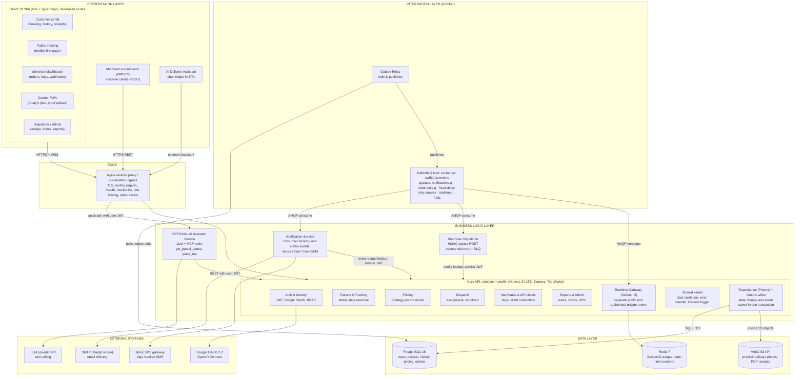

The diagram reads top to bottom, following a request.
- **Presentation layer.** One React single-page application serves the five account roles through role-based routes, plus the public tracking page. Merchant e-commerce systems are also clients, but they talk to the API directly instead of through the UI. The AI assistant is a chat widget inside the SPA.
- **Edge.** Nginx (or the Kubernetes Ingress in the cluster) terminates TLS, routes `/api/v1`, `/oauth` and `/socket.io` to the right service, serves the static frontend, and applies rate limits before traffic reaches application code.
- **Business logic layer.** The Core API holds six modules with clear boundaries. Each module follows controller, service, repository layering internally. The baseline has three workers: Outbox Relay, Notification Service and Webhook Dispatcher. Realtime stays inside Core API. AI Assistant Service is a separate optional process.
- **Integration layer.** The Outbox Relay reads committed events from the database and publishes them to a RabbitMQ topic exchange. Queues fan the events out to each consumer.
- **Data layer.** PostgreSQL is the system of record. Redis backs Socket.IO when more than one API replica is running and stores rate-limit counters. MinIO stores proof-of-delivery photos and generated receipts.

### 5.3 Inside the Core API
Each module owns its tables and exposes a small service interface. The Dispatch module, for example, never writes to the pricing tables; if it needs a fee it calls `PricingService.quote()`. Modules do not import each other's repositories. Planned ESLint import rules will reject cross-module internal imports; no working CI/build enforcement exists yet.

Within a module a request passes through the same chain every time: Express middleware for authentication, role check and validation, then a thin controller, then the service where the business rules live, then a repository that talks to Prisma. Controllers never contain business rules and services never touch `req` or `res`. That separation is what makes the services easy to unit test.

Workers needing contact/configuration use private internal API endpoints with separate short-lived service JWTs, distinct audiences and narrow `notifications:lookup` or `webhooks:config` scopes. Bind lookups to the claimed event and parcel/merchant and return only needed fields. Workers have separate broker/database identities for their own state; only the relay receives outbox publication metadata access. Never reuse human or merchant-client credentials for service lookup.

### 5.4 Why there is no separate BFF
The brief mentions a backend-for-frontend as an option. We considered a separate BFF service, but the Core API already groups its routes by audience: shared `/api/v1/parcels`, `/api/v1/merchant/...`, `/api/v1/courier/...` and `/api/v1/admin/...`. Each group returns responses shaped for its screen, for example the courier's daily list includes only what fits on a phone. In effect these route groups are BFFs inside the monolith. Adding a separate service would have meant another deployable and another network hop with no real benefit at our scale.

---

### 5.5 Deployment view

#### Figure 7: Container deployment view (Docker Compose and Kubernetes)
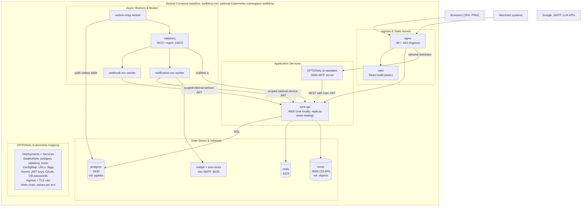

Every box with a port is its own container built from its own Dockerfile using multi-stage builds, so production images contain only compiled JavaScript and production dependencies. Docker Compose wires them together on one network for local development. If optional Kubernetes work proceeds, the same images are intended to run there, where stateless services become Deployments, the database, broker and object store become StatefulSets with persistent volumes, configuration moves into ConfigMaps and credentials into Secrets.

---

## 6 Integration Design

SwiftDrop has to talk to several outside parties: browsers, merchant systems, Google, email and SMS providers, and an LLM provider. It also has internal services that need to react to each other's changes. We chose a pattern for each integration point based on what that interaction actually needs.

### 6.1 Integration patterns used

#### Table 8: Integration patterns and justification
| Pattern | Where we use it | Why this pattern |
| :--- | :--- | :--- |
| **Request / reply (synchronous REST)** | SPA to Core API; merchant order creation; AI assistant tools calling the API | The caller needs an answer straight away, such as a quote, a tracking number or a validation error. |
| **Publish / subscribe via message broker** | Status-change events from Core API to notification, webhook and realtime consumers | One event has several independent consumers. The producer should not know or wait for them. |
| **Transactional outbox** | Core API writes events to `outbox_events` in the same transaction as the business change | Atomically records business change and event; the separate relay retries at-least-once publication after commit. |
| **Webhook (HTTP callback)** | Webhook Dispatcher notifying merchant systems | Merchants asked to be told about changes instead of polling us. |
| **Retry with exponential backoff and dead-letter queue** | Webhook delivery | Merchant endpoints go down; we retry with growing gaps, then park the message for inspection. |
| **Server push (WebSocket)** | Live tracking via Socket.IO | Customers see changes within a second without refreshing; falls back to long-polling. |
| **OAuth 2.0 / OpenID Connect** | Google login (authorization code with PKCE); merchant API (client credentials) | Standard, well-tested protocols instead of inventing our own token exchange. |

---

### 6.2 Event flow

#### Figure 8: Event-driven integration through RabbitMQ
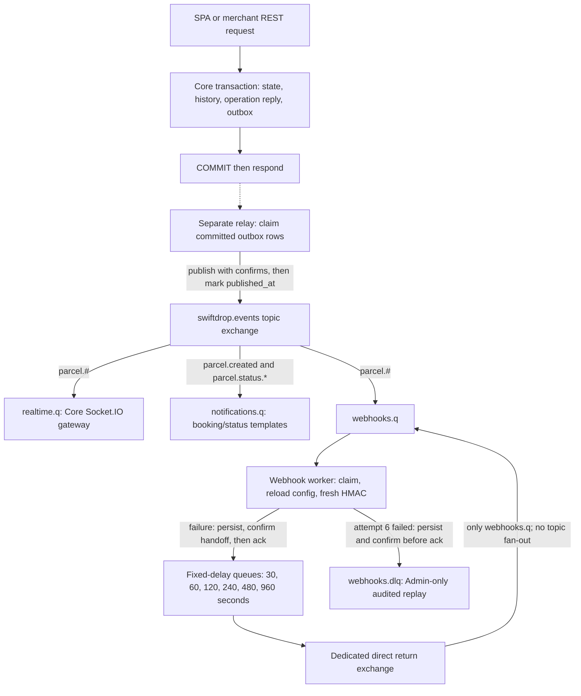

When a courier marks a parcel as Out for Delivery, the Core API updates the parcel, adds a history row and inserts an outbox row, all in one transaction. If anything fails, all three are rolled back, so we never send a notification about a change that did not happen. The Outbox Relay polls for unpublished rows every second, publishes them with publisher confirms switched on, and only then marks them as published.

The topic exchange routes each event using its routing key. Three queues are bound to it, one per consumer, so a slow webhook endpoint cannot hold up email notifications or live tracking. Each consumer acknowledges a message only after it has finished processing it.

---

### 6.3 Event contract

All events share one envelope. Consumers depend only on this contract, never on the producer's tables.

```json
{
  "eventId": "6f1c2a9e-3b0d-4c7e-9a51-1d2f0c8b7e44",
  "type": "parcel.status.changed",
  "version": 1,
  "occurredAt": "2026-10-23T09:14:05Z",
  "sequence": 4,
  "data": {
    "parcelId": "p_1042",
    "trackingNo": "SD-7KQ2M9XA-P",
    "merchantId": "m_1042",
    "from": "IN_TRANSIT",
    "to": "OUT_FOR_DELIVERY"
  }
}
```

`eventId` equals the outbox primary key and remains unchanged on retries. `version` is the envelope schema version; `sequence` increases per parcel. Realtime ignores stale sequences and reloads a snapshot on a gap; notification/webhook consumers retain every unique business event rather than discarding an unsent event because a later sequence arrived. Events omit names, contact data, photos and free-text notes. Restricted service JWTs authorise event-bound contact/configuration lookup (Section 5.3); consumers validate the envelope and park unknown versions.

---

### 6.4 Queues and routing keys

#### Table 9: RabbitMQ queues
| Queue | Binding | Consumer / failure handling |
| :--- | :--- | :--- |
| `realtime.q` | `parcel.#` | Core Socket.IO gateway; 60-second TTL; recover state by authorised REST snapshot after gaps/reconnect. |
| `notifications.q` | `parcel.created` and `parcel.status.*` | Separate booking/status templates; three redeliveries after initial attempt, then confirmed `notifications.dlq` transfer. |
| `webhooks.q` | `parcel.#` | Webhook Dispatcher; initial attempt 0, then retries 1..6; persist delivery/attempt progress. |
| `webhooks.retry.{30,60,120,240,480,960}.q` | Dedicated direct routing | One fixed message TTL per queue, no consumers. Quorum at-least-once dead-lettering returns only to `webhooks.q`, never through the topic exchange. |
| `webhooks.dlq` | Dedicated dead-letter route | Failed after attempt 6 (seven total HTTP attempts); retained 14 days; Admin-only audited replay with original eventId and new replay run. |

### 6.5 Reliability guarantees

Business state, history, idempotency response and outbox are recorded atomically. Relay publication and durable consumer queues provide at-least-once processing under configured durability assumptions. A crash after publisher confirm but before `published_at` may publish again; preserve eventId.

Consumers lease unique `(consumer,eventId)` progress and persist completion. Duplicate suppression cannot guarantee exactly-once external effects: an SMTP/HTTP send may succeed before local completion is saved. Use provider idempotency where available; otherwise duplicate email remains possible. Merchants deduplicate eventId before business effects. Replays retain eventId.

Require durable exchanges/queues, persistent messages, mandatory routing checks and publisher confirms. Confirm retry/DLQ handoffs before source acknowledgement; failed persistence/confirm leaves source unacknowledged. Fixed-delay quorum queues require compatible at-least-once dead-lettering/overflow policies and persistent volumes. Queue delays are approximate; unavailable routes, exhausted disk or permanent storage loss are operational failures, not covered by an unconditional no-loss promise.

### 6.6 Real-time tracking

Public sockets join `public:<trackingNo>` after validation/rate limiting; every payload contains only status, time, town and sequence. Private sockets join `private:<parcelId>` only after current owner/staff/courier authorisation and receive a separate private projection. Never emit a full parcel into a public room. Reassignment/revocation removes private subscriptions; reconnect reauthorises.

Socket.IO falls back to long-polling; Redis broadcasts across API replicas and polling requires sticky sessions at the proxy. Clients deduplicate by sequence and fetch an authorised snapshot after reconnect/gaps/expired messages; realtime is not the durable history.

---

## 7 Key Flows

This section walks through the flows named in the brief, using sequence diagrams for the interactions between components and activity diagrams for the decision logic. Solid arrows are synchronous calls, dashed arrows are replies, and red open-headed arrows are asynchronous messages.

### 7.1 Creating a delivery

#### Figure 9: Sequence diagram: customer creates a delivery
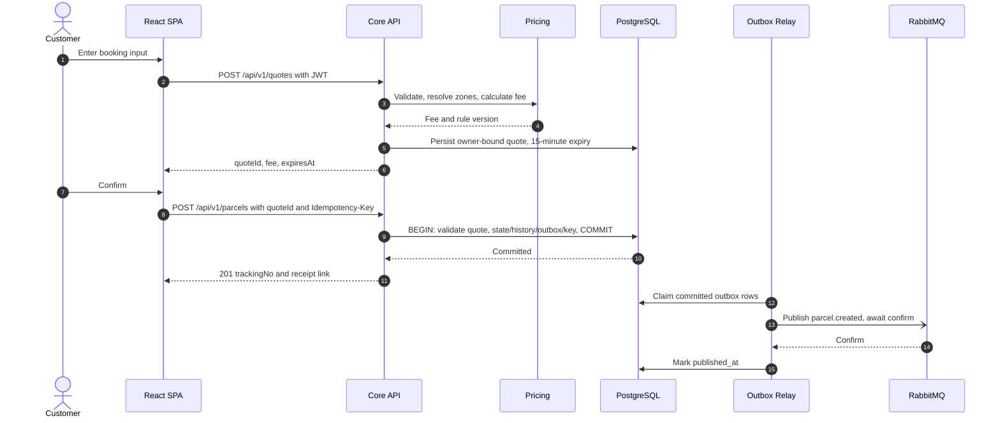

The flow is split into two requests on purpose. The first only produces a quote, so the customer sees the fee before committing to anything. The quote has an ID and an expiry time, and the second request refers to it. This stops the price from changing between what the customer saw and what they are charged, even if an admin edits the pricing rules at that exact moment. The `Idempotency-Key` header means that a double-tap on the confirm button, or a retry after a network timeout, cannot create two parcels.

---

### 7.2 Merchant creates an order through the API

#### Figure 10: Sequence diagram: merchant API order and webhook
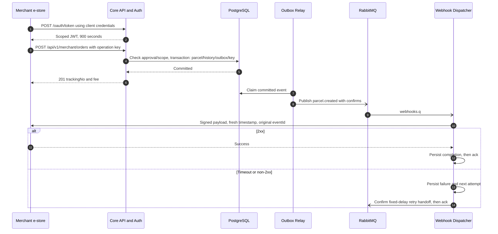

The merchant's system first exchanges its client ID and secret for a short-lived access token using the OAuth 2.0 client credentials grant. Tokens last 15 minutes, so a leaked token is only useful briefly. The order endpoint checks three things before doing any work: the token has the `orders:write` scope, the merchant is still approved, and the request body is valid. Machine orders are owned by merchant_id and may leave customer_id null. Every unique committed parcel event is eligible for its webhook. Retries and replay preserve eventId; Section 7.7 defines fresh signatures and safe acknowledgement. Each webhook is signed with HMAC-SHA256 using a secret only SwiftDrop and that merchant know, so the merchant can verify that the call really came from us.

---

### 7.3 Courier status update triggering notifications

#### Figure 11: Sequence diagram: courier status update and fan-out
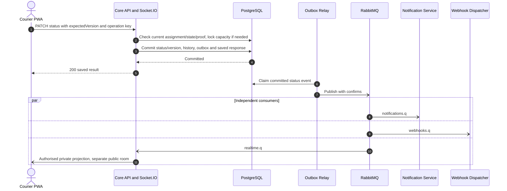

Ownership-scoped misses return 404; known role/scope denials return 403; stale versions or illegal transitions return 409. DELIVERED requires recipient name, with optional photo; FAILED requires a fixed-list reason. Private photo upload must complete and be authorised before the object key is accepted. Capacity-changing transitions use the shared courier-lock protocol.

Offline queues retain stable operation keys, expectedVersion and per-parcel dependency order without storing credentials. Reauthenticate as the original user, refresh the authorised snapshot, retry pending uploads and replay in order. Saved responses deduplicate accepted operations. Stale/conflicting updates pause for user review; reassignment gives 404. Never replace expectedVersion blindly or report success before acceptance. Device loss can lose unsynchronised local work.

---

### 7.4 OAuth 2.0 login with Google

#### Figure 12: Sequence diagram: Google sign-in with authorization code and PKCE
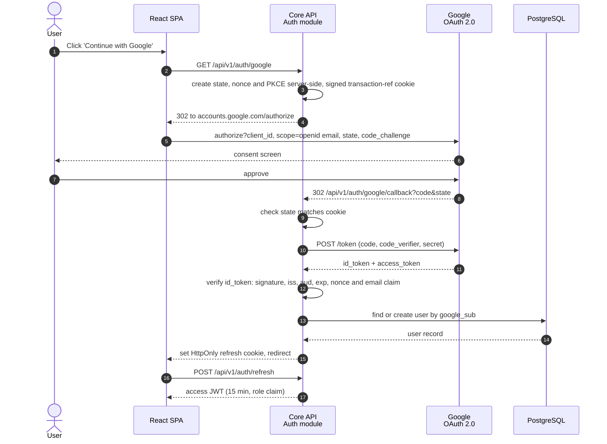

We use the authorization code flow with PKCE, handled by the backend. The SPA never sees Google's tokens. The state value protects against cross-site request forgery on the callback, and the PKCE verifier ensures that an intercepted authorization code cannot be exchanged by anyone else. We verify the ID token's signature against Google's published keys and check the issuer, audience and expiry before trusting the email inside it. After that, Google is out of the picture: the user gets our own access JWT and a refresh token in an HttpOnly cookie, exactly as if they had logged in with a password.

---

The sequence is a simplified login view. Implementation details in docs/auth.md require server-side PKCE verifier/nonce storage behind a browser-bound transaction reference, nonce validation, customer-only creation by google_sub, explicit linking on email collisions and profile completion when required. Those details refine the existing flow; email verification is not a baseline booking gate.

### 7.5 Parcel lifecycle

#### Figure 13: State diagram: parcel lifecycle
```mermaid
stateDiagram-v2
    [*] --> Created
    Created --> PickedUp: courier confirms pickup
    Created --> Cancelled: owner or staff cancels before pickup
    PickedUp --> InTransit: leaves pickup or hub
    InTransit --> OutForDelivery: attempt_count += 1
    OutForDelivery --> Delivered: recipient name; photo optional
    OutForDelivery --> Failed: fixed-list reason
    Failed --> InTransit: Dispatcher/Admin reschedules; attempt_count below 3
    Failed --> [*]: attempt_count is 3; terminal failure
    Delivered --> [*]
    Cancelled --> [*]
```

There are three total delivery attempts: the first plus at most two re-attempts. Persist attempt_count starting at 0 and increment it on entry to OUT_FOR_DELIVERY. Only Dispatcher/Admin schedules a re-attempt after FAILED with count below 3. Retryable FAILED keeps its capacity reservation; terminal FAILED after attempt 3 releases it. Physical return-to-sender tracking is outside scope. DELIVERED and CANCELLED are terminal; cancellation is permitted only before pickup. Assignment changes courier/version, not lifecycle state.

---

### 7.6 Dispatcher assigns a parcel

#### Figure 14: Activity diagram: assigning a parcel to a courier
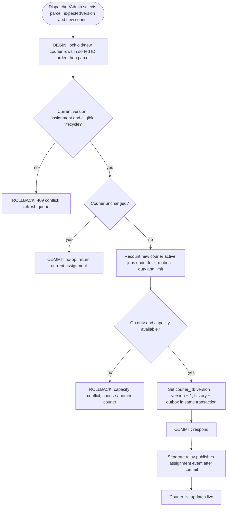

This protocol protects both the selected parcel and capacity across different parcels. Every assignment, reassignment, duty/capacity and active-status change follows the same courier-then-parcel lock order. Recheck all predicates under lock and restart from a fresh snapshot if the observed assignment changed before locks. Initial assignment requires unassigned CREATED; reassignment permits nonterminal parcels, releases old capacity and reserves new capacity atomically. Version increments prevent stale writes.

---

### 7.7 Webhook delivery and retry

#### Figure 15: Activity diagram: webhook delivery with retry
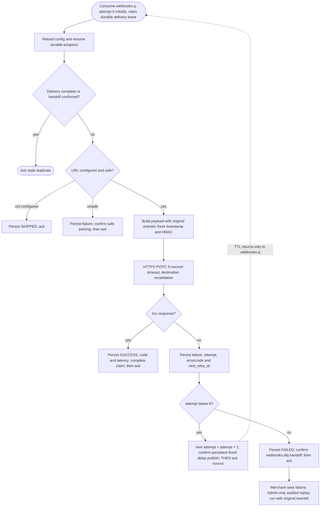

One initial HTTP attempt (0) plus six retries (1..6) uses waits of 30, 60, 120, 240, 480 and 960 seconds: 1,890 seconds, or 31.5 minutes, plus request/queue time. Each fixed-delay queue has one TTL, avoiding mixed per-message TTL head blocking. Its dedicated direct return exchange routes only to webhooks.q, never back through the topic exchange.

Persist progress before handoff. On failed persistence/confirm, leave the source unacknowledged; redelivery resumes durable state without advancing the attempt counter twice. Reload configuration and re-sign every attempt. Require quorum at-least-once dead-lettering, compatible policies and persistent volumes; timing/durability remain conditional (Section 6.5). External success before local recording can duplicate delivery. Admin replay preserves eventId and starts a new audited run.

---

## 8 Design Patterns and Principles

### 8.1 Patterns applied

#### Table 10: Design patterns and where they are used
| Pattern | Where | What it buys us |
| :--- | :--- | :--- |
| **Repository** | Every module's data access (`ParcelRepository`, `PricingRuleRepository`, ...) | Services depend on an interface, so unit tests use in-memory fakes and Prisma stays an implementation detail. |
| **Strategy** | Pricing: `StandardPricing`, `ExpressPricing`, `MerchantContractPricing` | New pricing schemes are new classes; the booking code does not change. |
| **State** | Parcel status transitions | One place defines which transitions are legal; impossible jumps are rejected everywhere. |
| **Observer / publish-subscribe** | Status events to notification, webhook and realtime consumers | The Parcels module does not know who is listening; adding a consumer touches no existing code. |
| **Transactional outbox** | Event publishing from Core API | Business change and event are saved atomically. |
| **Adapter** | `EmailSender` and `SmsSender` interfaces with SMTP and mock SMS adapters | Swapping the mock SMS for a real Sri Lankan SMS gateway later is a configuration change. |
| **Factory** | `NotificationChannelFactory`, `PricingStrategyFactory` | Choosing the right implementation is kept out of the business logic. |
| **Chain of responsibility** | Express middleware: authenticate, authorise, validate, handle | Each concern is one small function, reused across routes. |
| **Dependency injection** | Services receive repositories and clients through constructors | Easy to test and to replace dependencies per environment. |

The pricing strategy shows how small these pieces are in practice:

```typescript
interface PricingStrategy {
  quote(input: QuoteInput, rule: PricingRule): Money;
}

class StandardPricing implements PricingStrategy {
  quote({ weightKg }: QuoteInput, rule: PricingRule): Money {
    const extraKg = Math.max(0, Math.ceil(weightKg) - 1);
    return Money.cents(rule.baseFeeCents + extraKg * rule.perKgCents);
  }
}

// e.g. Colombo -> Kandy, small parcel, 2 kg:
// base 45000 + 1 x 12000 = 57000 cents = LKR 570.00
```

---

### 8.2 Principles
- **Single responsibility.** Controllers translate HTTP, services hold rules, repositories store data. The Notification Service only sends messages; it does not decide when a parcel's status may change.
- **Open/closed.** New pricing schemes, notification channels and event consumers are added by writing new classes or services, where the existing contract fits; interface changes still need consumer review.
- **Liskov substitution.** Any `PricingStrategy` or `SmsSender` can replace another without the caller noticing. Planned contract tests must run against each implementation; no passing results exist yet.
- **Interface segregation.** The courier module depends on a narrow `ParcelStatusUpdater` interface, not on the whole parcel service with its admin-only methods.
- **Dependency inversion.** Business code depends on interfaces defined in the domain layer; the infrastructure layer implements them.
- **DRY.** Validation schemas, status transition rules and the event envelope each exist in exactly one place and are imported wherever they are needed. The Zod schemas are shared with the frontend.
- **KISS and YAGNI.** The proposal deliberately avoids full microservices, a service mesh and event sourcing. They solve problems SwiftDrop does not have yet, and they would have cost us weeks.

---

## 9 Security Design

SwiftDrop handles names, phone numbers and home addresses, so security was part of the design from the start rather than something to add at the end.

### 9.1 Authentication
- Passwords must be hashed with bcrypt at cost factor 12; reject inputs above 72 UTF-8 bytes before hashing, with no silent truncation. Plain passwords are never logged or stored.
- Access tokens are JWTs signed with RS256, valid for 15 minutes, carrying only the user ID, role and token ID. No personal data goes into the token.
- Refresh tokens are random values stored hashed in the database, sent in an `HttpOnly`, `Secure`, `SameSite=Strict` cookie, and rotated on every use. Reusing an old refresh token revokes the whole token family, which detects stolen tokens.
- Google login follows OpenID Connect with PKCE, as described in [Section 7.4](#74-oauth-20-login-with-google).
- Login and token endpoints must be rate-limited per IP and per account to slow down password guessing.

### 9.2 Authorisation
Two checks run on every protected request. The first is a role check in middleware (`requireRole('COURIER')`). The second is an ownership check inside the service, built into the database query itself, for example `WHERE id = :id AND courier_id = :currentCourier`. Because the filter is part of the query, there is no code path that loads another user's record and then forgets to check it. Ownership-scoped customer, courier and merchant misses return 404 without confirming record existence. Known route-level role/scope denials return 403, absent/invalid authentication 401, and stale version/illegal transition 409. Admin inherits Dispatcher; only Admin may replay failed webhooks.

### 9.3 Merchant API and webhooks
- Client secrets are shown once at creation, then stored only as a hash. Merchants can rotate or revoke them from the dashboard.
- Tokens carry scopes (`orders:write`, `orders:read`), so a key used only for tracking cannot create orders.
- Each API client has its own rate limit, so one misbehaving integration cannot starve the others.
- Each webhook attempt signs the exact body with HMAC-SHA256 and a fresh timestamp; merchants enforce a five-minute freshness window and deduplicate eventId before business effects.
- Webhook URLs require HTTPS and per-connection IPv4/IPv6 destination validation; reject private/loopback/link-local targets and redirects. A local mock receiver may use an explicit development-only allowlist; it is empty in production.

### 9.4 Personal data
- All input is validated with Zod at the API boundary: phone numbers must match Sri Lankan formats, weights must be positive and within limits, and free-text notes are length-limited.
- Prisma uses parameterised queries throughout, which prevents SQL injection.
- The logger must redact fields such as `password`, `phone`, `address` and `authorization` before anything is written.
- Errors returned to clients are generic and carry a correlation ID; the stack trace and details stay in the server logs, which are themselves redacted.
- The public tracking page shows status, time and town only. The full address and phone number are visible only to the sender, the assigned courier and staff.
- Proof-of-delivery photos are served through short-lived signed URLs, not public links.

### 9.5 Secrets and configuration
The planned deployment reads secrets from environment/secret storage and commits only placeholder examples. Optional Kubernetes uses ConfigMaps and restricted Secrets. Secret scanning is required future CI work; no existing .env.example, deployment controls or working CI is claimed in this documentation-only repository.

### 9.6 Threats and mitigations

#### Table 11: Threat model summary (STRIDE)
| Threat | Example | Mitigation |
| :--- | :--- | :--- |
| **Spoofing** | Someone calls the order API pretending to be a merchant | OAuth client credentials, hashed secrets, short-lived scoped tokens |
| **Tampering** | Webhook payload altered in transit | HTTPS plus HMAC signature with timestamp |
| **Repudiation** | Courier claims they never marked a parcel delivered | Append-only status history with user ID, time and proof |
| **Information disclosure** | Guessing tracking numbers to read addresses | Random tracking numbers, reduced public payload, rate limits |
| **Denial of service** | Flooding the quote endpoint | Rate limiting at Nginx and per client in the API |
| **Elevation of privilege** | Courier editing another courier's parcel by changing the URL | Ownership filter in every query; tested explicitly |

---

## 10 API Design

### 10.1 Conventions
- All endpoints are versioned under `/api/v1`. A breaking change gets `/api/v2`, while v1 keeps working for at least one release so merchants have time to migrate.
- Resources use plural nouns and standard HTTP verbs. List endpoints use cursor pagination.
- Parcel creation and courier mutations require a principal-scoped `Idempotency-Key`; store request hash and response. State changes also require expectedVersion.
- Errors use one format (RFC 7807 problem details) produced by a single error-handling middleware.
- The OpenAPI 3 specification is planned to be generated from Zod and served at `/api/docs`.

### 10.2 Main endpoints

#### Table 12: Key REST endpoints (summary, not exhaustive)
| Method and path | Role / boundary | Purpose |
| :--- | :--- | :--- |
| `POST /api/v1/auth/register`, `POST /api/v1/auth/login` | Public human endpoints | Customer signup and common password login |
| `GET /api/v1/auth/google`, `GET /api/v1/auth/google/callback` | Public protocol endpoints | Customer Google login |
| `POST /api/v1/auth/refresh` | Refresh cookie + CSRF | Rotate refresh token; no valid access token required |
| `POST /api/v1/quotes` | Customer, Merchant, Dispatcher, Admin | Owner-bound fee quote |
| `POST /api/v1/parcels` | Customer, Dispatcher, Admin | Create from quote |
| `GET /api/v1/parcels`, `GET /api/v1/parcels/{id}` | Customer/Merchant own; Courier assigned detail; Dispatcher/Admin operational | Lists/detail/history scoped to capability |
| `GET /api/v1/parcels/{id}/receipt` | Owner or staff | Private PDF receipt |
| `GET /api/v1/track/{trackingNo}` | Public | Status, time, town only |
| `POST /api/v1/merchant/register` | Public | Atomic Merchant user and pending business profile |
| `POST /oauth/token` | Approved confidential merchant client | Client credentials, no refresh cookie/token |
| `POST /api/v1/merchant/orders`, `GET /api/v1/merchant/orders` | Machine orders:write/read; Merchant dashboard own read | Merchant-owned order operations |
| `PUT /api/v1/merchant/webhook` | Merchant own, Admin | Configure URL/signing secret |
| `GET /api/v1/courier/parcels?date=today` | Courier | Assigned daily list |
| `PATCH /api/v1/courier/parcels/{id}/status`, `POST /api/v1/courier/parcels/{id}/proof` | Assigned Courier | Versioned/idempotent update; private proof upload/finalise |
| `GET /api/v1/admin/parcels?status=CREATED&assigned=false` | Dispatcher, Admin | Derived unassigned filter: courier_id IS NULL; not a lifecycle status |
| `POST /api/v1/admin/parcels/{id}/assignment`, `GET /api/v1/admin/couriers/workload` | Dispatcher, Admin | Safe assignment/reassignment and workload |
| `PATCH /api/v1/admin/parcels/{id}/status`, `POST /api/v1/admin/parcels/{id}/reattempt` | Dispatcher, Admin | Legal status update; re-attempt only below attempt 3 |
| `POST /api/v1/parcels/{id}/cancel` | Customer/Merchant owner, Dispatcher, Admin | Before pickup only; machine needs orders:write |
| `POST/PATCH /api/v1/admin/users`, `POST/PATCH /api/v1/admin/couriers` | Admin | Provision/suspend users and couriers |
| `PATCH /api/v1/admin/merchants/{id}` | Admin | Approve/reject merchant |
| `CRUD /api/v1/admin/zones`, `CRUD /api/v1/admin/pricing-rules` | Admin | Configure zones/pricing |
| `GET /api/v1/admin/reports/daily` | Dispatcher, Admin | Daily report and CSV |
| `POST /api/v1/admin/webhook-deliveries/{id}/replay` | Admin only | Audited replay, original eventId |

Authentication completion/extension endpoint inventory is in [docs/auth.md](docs/auth.md) Section 7; implement it through reviewed contracts, not as an implied existing API.

### 10.3 Error format
```http
HTTP/1.1 409 Conflict
Content-Type: application/problem+json

{
  "type": "https://api.swiftdrop.lk/errors/invalid-transition",
  "title": "Status change not allowed",
  "status": 409,
  "detail": "A parcel in CREATED cannot move to DELIVERED.",
  "correlationId": "c0a8012e-5f3b"
}
```

---

## 11 Testing Approach

This is a verification plan. No implementation, migrations, CI, coverage reports or passing test results are supplied. The checks below are required future evidence, not completed application verification.

#### Table 13: Testing levels
| Level | Tools | What we cover |
| :--- | :--- | :--- |
| **Unit** | Jest | Pricing strategies, status state machine, validation schemas, services using fake repositories |
| **Integration** | Jest, Supertest, Testcontainers (PostgreSQL, RabbitMQ) | API endpoints against a real database; the outbox relay publishing to a real broker; consumers handling duplicates |
| **Authorisation** | Supertest with tokens for each role | A courier cannot read or update another courier's parcel; a customer cannot see another customer's parcel; a merchant token without `orders:write` cannot create orders |
| **Event flow** | Testcontainers RabbitMQ, mock SMTP, mock HTTP server | Booking/status bindings; tested duplicate suppression; relay crash and confirmed retry/DLQ handoff; external-send crash may duplicate without provider idempotency; fresh signatures and Admin replay |
| **Frontend** | Vitest, React Testing Library | Booking form validation, tracking page updates on socket events |

Coverage is planned to be measured with Jest's built-in coverage (Istanbul) and published from the future CI pipeline as an HTML report and an lcov summary. Our target is at least 80% line coverage on the service and domain layers, where the business rules live.

---

Required integration cases additionally include two parcels competing for a final courier slot, reassignment, cancellation/duty/status races, three-attempt rules, private proof ownership, stale/reassigned offline replay and public/private socket membership. Frontend checks cover validation, duplicate submits, loading/empty/error/success, keyboard/focus, reduced motion and 360px/desktop layouts. No Selenium or browser automation is used for testing.

## 12 Bonus Features

### 12.1 Kubernetes deployment
This is optional stretch work after the baseline. The proposed Helm chart would deploy the full system into a `swiftdrop` namespace. Stateless services (`core-api`, the workers, the AI assistant and the web frontend) run as Deployments with readiness and liveness probes on `/healthz`. PostgreSQL, RabbitMQ and MinIO run as StatefulSets with persistent volume claims. An Ingress replaces Nginx for routing and TLS. Values files separate local (minikube or kind) settings from a hosted cluster, and a HorizontalPodAutoscaler scales `core-api` on CPU.

### 12.2 AI delivery assistant

#### Figure 16: AI delivery assistant calling the API through MCP tools
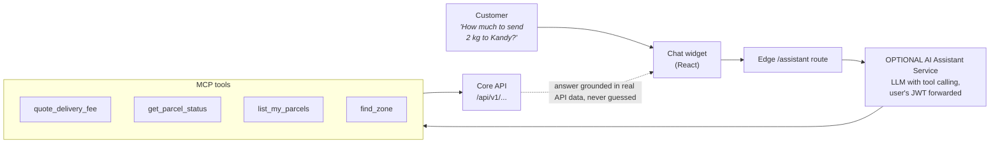

The assistant answers questions such as *"Where is my parcel?"* or *"How much to send 2 kg to Kandy?"*. It does not answer from memory. The AI Assistant Service exposes our API as Model Context Protocol tools, and the language model decides which tool to call. Every tool call goes through the normal REST API with the user's own JWT, so the assistant can only see what the user could see anyway. The tools are read-only in this version: the assistant can quote and look up, but it cannot create or cancel parcels.

---

## 13 Conclusion

The design rests on a few decisions that reinforce each other. A modular monolith keeps the core business rules in one place with one database transaction. The transactional outbox and RabbitMQ move slow and unreliable work, such as email, SMS and merchant webhooks, out of the request path using atomic event recording and at-least-once delivery under stated durability assumptions; external side effects may duplicate. Role checks combined with ownership filters in every query give us authorisation we can test directly. Docker Compose is the baseline; optional Kubernetes reuses the intended images after deployment verification.

There are things we would add with more time: online payments, route optimisation for couriers, and splitting the Parcels module into its own service if traffic ever demands it. The module boundaries and event contracts described here are what make that later split possible without a rewrite.

---

## Appendix A: Contribution Sheet

Fill in names and registration numbers. The suggested areas match the module boundaries in [Section 5](#5-system-architecture), so each member owns a part they can explain during the demo.

#### Table 14: Contribution sheet
| # | Member name | Reg. no. | Main responsibility | Report sections |
| :-: | :--- | :--- | :--- | :--- |
| **1** | | | Team lead, architecture, integration design | 1, 5, 13 |
| **2** | | | Auth module: JWT, Google OAuth, RBAC | 2, 7.4, 9.1–9.2 |
| **3** | | | Parcels module, state machine, tracking API | 4, 7.5 |
| **4** | | | Pricing strategies, zones, quotes | 7.1, 8 |
| **5** | | | Dispatch module, courier workload | 3.4, 7.6 |
| **6** | | | Merchant API, client credentials, webhooks | 3.2, 7.2, 7.7, 9.3 |
| **7** | | | RabbitMQ, outbox relay, notification service | 6 |
| **8** | | | Frontend: customer portal, public tracking, real-time | 3.1, 6.6 |
| **9** | | | Frontend: merchant, courier PWA, admin console | 3.3, 10 |
| **10** | | | DevOps: Docker, Kubernetes, CI, testing and coverage | 5.5, 11, 12 |

---

## Appendix B: Editing the Diagrams

- Edit the Mermaid blocks here for the Markdown diagrams. Figure numbers and section anchors remain stable; the listed page references refer to the 41-page corrected PDF, not Markdown pagination.
- The PDF uses vector drawings in `docs/report/build_report.py`, with original pages 9, 27, 31 and 40 imported unchanged. No native Word source is supplied. Keep the original PDF available as a build input.
- This Markdown is the product contract; the PDF presents the same corrected baseline. The delivery plan controls scheduling/ownership, and `docs/auth.md` refines authentication and labelled extensions. A change to any shared contract requires updating all affected representations in the same iteration.
- Regenerate with the bundled Python and `docs/report/build_report.py`; run `docs/report/verify_report.py`, inspect rendered pages at 100%/print size and check contents/figure destinations. See `docs/report/REVIEW.md` for exact commands and audit disposition.
- All system behavior remains proposed until implementation tests and user manual evidence exist. Original marking-rubric compliance remains unverified because the rubric is unavailable.
