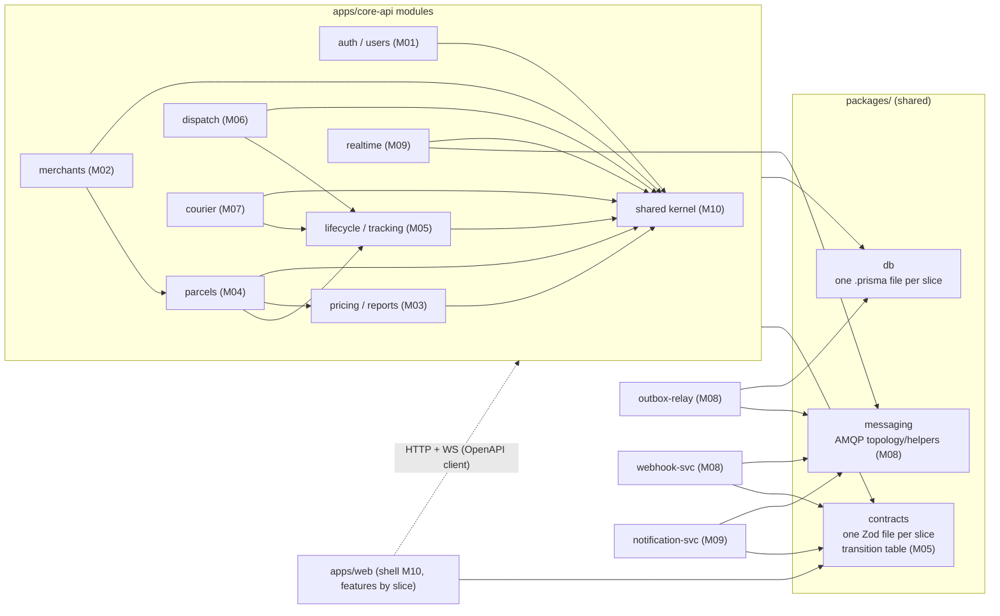

# SwiftDrop: Delivery Plan for a 10-Person Team

Source of truth for *what* we build: [SWIFTDROP_DESIGN_DOCUMENTATION.md](./SWIFTDROP_DESIGN_DOCUMENTATION.md) (referred to below as **the Design Doc**, with section numbers like `DD §7.5`).
This plan covers *how* ten people build it in parallel on GitHub without stepping on each other. Work is divided into ten vertical delivery slices (one per member), each covering database, contracts, backend, UI and tests for its deliverable; silent infrastructure work is kept out of the balance (§4).

Status (29 October 2026): application scaffolding, identity and parcel-domain migrations, local authentication, customer booking/history/public tracking, Admin zones/pricing, and RabbitMQ event relay/consumer are implemented. The initial customer booking/tracking increment is complete locally, but original Sprint 0/1 exits and later operations, merchant/staff and production gates remain incomplete. [handover.md](handover.md) records delivered evidence and remaining acceptance. [docs/auth.md](docs/auth.md) refines authentication phases and separately labelled security extensions; it does not silently promote them into baseline requirements. The original Sprint 0–5 roadmap below remains the delivery baseline. On 29 October 2026 the ownership model was re-divided from layer-based roles (A1…E2) into ten vertical delivery slices (§4); delivery status above is unchanged by that re-division.

---

## 0. Assumptions and Decisions

| # | Assumption / decision | Reason |
| :-- | :-- | :-- |
| 1 | Team size is **10**, matching the Design Doc. Work is split into ten vertical slices of equal estimated complexity (§4.2); silent infrastructure work is excluded from the balance (§4.4). | Each person owns a complete deliverable (DB, backend, frontend, tests) and can start independently, while the existing module boundaries and plan are kept. |
| 2 | Architecture, data model, event contract, API conventions and stack are **exactly as in the Design Doc**. This plan does not redesign them. | Keeps the corrected design contracts consistent; no assessment result or implemented behavior is claimed. |
| 3 | Bonus items (Kubernetes/Helm, AI assistant) are **stretch** and only start after Must-have items are demoable. | Protects core delivery if integration or quality work takes longer than planned. |
| 4 | SMS is a **mock adapter** only; payments are out of scope (DD §1.3). | As in the Design Doc. |
| 5 | Package manager is **pnpm workspaces** (monorepo). | Single lockfile, strict dependency isolation, fast CI cache. |
| 6 | Timeline is expressed in **sprints of 1 week**; total ≈ 6 sprints. Compress/stretch to your actual deadline, but keep the order. | Deadline not given. |
| 7 | Branching is **trunk-based** (short-lived branches into protected `main`). No long-lived `develop`. | Long-lived branches are the main source of merge pain in student teams. |

> [!IMPORTANT]
> Items marked **TBD-team** (repo name, GitHub org, member names, deadlines) must be filled in by the team on day 1.

---

## 1. Product Scope Summary

SwiftDrop has five account roles, one guest actor and a separate merchant machine actor:

- **Customer**: books a parcel, sees fee up front, tracks live, downloads receipt.
- **Recipient (guest)**: tracks by tracking number, no login.
- **Merchant**: dashboard + machine API (OAuth client credentials) + signed webhooks.
- **Courier**: mobile-first PWA with today's jobs, status updates, proof of delivery.
- **Dispatcher**: operational parcel creation/status, assignment, cancellation, workload and reports.
- **Admin**: inherits Dispatcher operations and adds users, merchant approval, zones/pricing and Admin-only webhook replay.

Core technical ideas (from DD §5-§7): modular monolith (`core-api`) + three async workers connected by RabbitMQ, transactional outbox, Socket.IO realtime, Postgres/Prisma, MinIO, Redis, Docker Compose.

---

## 2. Functional Requirements

Priority uses MoSCoW: **M** must, **S** should, **C** could (stretch). Accountable members (M01–M10) per requirement are in the §4.3 ownership map.

### 2.1 Identity and Access (M01)

| ID | Requirement | Pri | DD ref |
| :-- | :-- | :-: | :-- |
| FR-A1 | Customer registration and login with email + password (bcrypt cost 12). | M | §9.1 |
| FR-A2 | RS256 access JWT (15 min; user id, role, jti) + rotating refresh token in HttpOnly cookie; reuse detection revokes token family. | M | §9.1 |
| FR-A3 | Google sign-in via authorization code + PKCE; find-or-create by `google_sub`. | S | §7.4 |
| FR-A4 | Five account roles, one per user; Admin inherits Dispatcher; role/scope checks plus ownership-scoped queries (404), with route-level denial 403. | M | §2, §9.2 |
| FR-A5 | Admin creates courier / dispatcher accounts; admin can suspend accounts. | M | §3.4 |
| FR-A6 | Per-IP and per-account rate limiting on login and token endpoints. | S | §9.1 |

### 2.2 Merchants (M02, backend and frontend)

| ID | Requirement | Pri | DD ref |
| :-- | :-- | :-: | :-- |
| FR-M1 | `POST /api/v1/merchant/register` atomically creates Merchant user and `PENDING` business; Admin approves/rejects. | M | §3.2 |
| FR-M2 | Generate, rotate, revoke API clients; secret shown once, stored hashed. | M | §9.3 |
| FR-M3 | `POST /oauth/token` client-credentials grant, 15-min token, scopes `orders:read` / `orders:write`. | M | §7.2 |
| FR-M4 | `POST /merchant/orders` with `Idempotency-Key`; requires scope + `APPROVED` merchant. | M | §7.2 |
| FR-M5 | Configure webhook URL (HTTPS only, private/loopback blocked) and rotate signing secret. | M | §9.3 |
| FR-M6 | Orders dashboard with status filter; webhook delivery log and failure reasons. | S | §3.2 |

### 2.3 Pricing, Parcels, Dispatch, Tracking (M03–M07, see §4.3; each owner also builds the UI)

| ID | Requirement | Pri | DD ref |
| :-- | :-- | :-: | :-- |
| FR-P1 | CRUD for zones (district groupings) and versioned pricing rules (`effective_from`). | M | §4 |
| FR-P2 | `POST /quotes`: resolve zones, price via `PricingStrategy`, return `quoteId`, fee (integer cents, LKR), 15-min expiry. | M | §7.1 |
| FR-P3 | Customer/Dispatcher/Admin create from owner-bound `quoteId`; Merchant uses orders API. Principal-scoped `Idempotency-Key` saves request hash/response with parcel + history + outbox atomically; random tracking `SD-XXXXXXXX-C`. | M | §7.1 |
| FR-P4 | Parcel state machine with one transition table: Created → PickedUp → InTransit → OutForDelivery → Delivered; FAILED permits Dispatcher/Admin scheduling of two re-attempts (three total); attempt_count starts 0 and increments on OUT_FOR_DELIVERY; final failure releases capacity, physical return tracking outside scope. CANCELLED only before pickup. Illegal transition → `409`. | M | §7.5 |
| FR-P5 | Append-only `parcel_status_history`; denormalised `current_status` + `version` (optimistic lock). | M | §4.2 |
| FR-P6 | Customer parcel list/detail/history; owner-only (404 on foreign ids). | M | §9.2 |
| FR-P7 | Public tracking `GET /track/{trackingNo}`: status, time, town only. | M | §9.4 |
| FR-P8 | PDF receipt stored in private MinIO, served via authorised signed URL. | S | §3.1 |
| FR-P9 | Owner Customer/Merchant or Dispatcher/Admin cancels before pickup using expectedVersion, operation key and shared capacity lock protocol; history/outbox committed atomically. | M | §7.5, Table 12 |
| FR-D1 | Dispatcher unassigned queue (oldest first, filter by pickup zone). | M | §7.6 |
| FR-D2 | Dispatcher/Admin assign/reassign: lock old/new courier rows in sorted ID order, then parcel; recheck current version, on-duty and reserved capacity; atomically change old/new workload, increment version and append history/outbox. All active-status/duty/capacity paths share this protocol; unchanged courier returns a no-op. | M | §7.6 |
| FR-D3 | Courier workload view. | M | §3.4 |
| FR-K1 | Courier "today" list limited to assigned parcels. | M | §3.3 |
| FR-K2 | Courier status update; `Delivered` requires recipient name; photo optional and stored as private proof_object_key, `Failed` requires reason from fixed list. | M | §3.3, Table 5 |
| FR-K3 | Offline queue retains stable operation key, expectedVersion and per-parcel order; reauthenticate original user, refresh snapshot, finish proof upload and replay; 404/409 pauses for review rather than overwriting server state. | S | Table 5 (2b) |

### 2.4 Async Integration (M08, M09; reports M03; see §4.3)

| ID | Requirement | Pri | DD ref |
| :-- | :-- | :-: | :-- |
| FR-I1 | Outbox relay polls `outbox_events` (1 s), publishes with confirms to topic exchange `swiftdrop.events`, then marks `published_at`. | M | §6.2 |
| FR-I2 | RabbitMQ topology: `realtime.q`, `notifications.q`, `webhooks.q`, `webhooks.retry.{30,60,120,240,480,960}.q`, dedicated direct return exchange and DLQs, bindings per Table 9. | M | §6.4 |
| FR-I3 | Notification service: email via SMTP (Mailpit in dev), mock SMS adapter, booking/status templates bound to parcel.created and parcel.status.*, progress keyed by eventId, recipient masked; document possible duplicate external send without provider idempotency. | M | §6.5, §8 |
| FR-I4 | Webhook dispatcher: Fresh HMAC/timestamp per HTTP attempt, 5 s timeout, initial attempt 0 plus retries 1..6; fixed waits 30/60/120/240/480/960 s (31.5 min + overhead). Persist each attempt; confirm retry/DLQ handoff before source ack; resume durable progress after restart. | M | §7.7 |
| FR-I5 | Admin-only audited replay of failed webhook deliveries; retain original eventId and create a new replay run. Dispatcher cannot replay. | S | §6.4 |
| FR-I6 | Realtime gateway: public:<trackingNo> rooms contain status/time/town/sequence only; private:<parcelId> requires current authorisation. Revoke membership on reassignment/expiry; Redis adapter, polling sticky sessions and authorised reconnect snapshot. | M | §6.6 |
| FR-I7 | Daily report endpoint (deliveries/day, success rate) with CSV export. | S | §3.4 |

### 2.5 Frontend (each screen belongs to the slice that owns its feature; shell by M10)

| ID | Requirement | Pri | Owner |
| :-- | :-- | :-: | :-: |
| FR-F1 | App shell, design system, role-based routing and guards, typed API client, error/loading/empty states. | M | M10 |
| FR-F2 | Auth pages and refresh handling: password signup/login are M; Google button/flow is S under FR-A3, disabled with feedback until configured. Verification/recovery/MFA extensions follow docs/auth.md. | M | M01 |
| FR-F3 | Customer: booking wizard, history, live detail and pre-pickup cancellation are M; receipt download is S with FR-P8. | M | M04 (live updates M09, cancel dialog M05) |
| FR-F4 | Public tracking page, mobile-first, live updates. | M | M05 (live updates M09) |
| FR-F5 | Admin console: users/merchant approval/zones/pricing are M; reports are S with FR-I7 and Admin-only replay is S with FR-I5. | M | M01 users, M02 merchants, M03 zones/pricing/reports, M08 replay; shell M10 |
| FR-F6 | Courier PWA: assigned jobs/detail, status update, recipient name with optional private photo and installable manifest are M; offline queue is S with FR-K3. | M | M07 |
| FR-F7 | Merchant dashboard: API keys and webhook settings are M; order dashboard/filter and delivery log are S with FR-M6. | M | M02 |
| FR-F8 | Dispatcher console: unassigned queue, safe assign/reassign dialog, operational create/status/cancel and workload are M. Replay is rendered only in the Admin console under FR-F5/FR-I5. | M | M06 queue/assign/workload, M05 operational create/status/cancel |
| FR-F9 | AI assistant chat widget. | C | M03 |

Frontend rows FR-F2/F3/F5/F6/F7 are staged bundles. Their M label applies to the explicitly named baseline slice; S subfeatures retain their backend FR priority and ship only with the matching contract/API. A disabled/absent S control must explain availability where useful; it must not block the M flow. Deferral requires an owned issue. Email verification is not a baseline booking or merchant-onboarding gate.

### 2.6 Stretch (FR-B1 is silent work under M01; FR-B2/F9 is M03, then whoever is free)

| ID | Requirement | Pri | DD ref |
| :-- | :-- | :-: | :-- |
| FR-B1 | Helm chart (Deployments, StatefulSets, ConfigMap/Secret, Ingress, HPA), kind/minikube values. | C | §12.1 |
| FR-B2 | AI assistant service with read-only MCP tools: `quote_delivery_fee`, `get_parcel_status`, `list_my_parcels`, `find_zone`; user's JWT forwarded. | C | §12.2 |

---

## 3. Non-Functional Requirements

Numeric values are **targets for a demo-scale system**, to be verified by the named check, not hard guarantees.

| ID | Category | Requirement | Verification |
| :-- | :-- | :-- | :-- |
| NFR-1 | Security | No secrets in repo; `.env.example` only; secret scanning in CI. | CI gitleaks step |
| NFR-2 | Security | Authorisation = role check **and** ownership filter inside the DB query; foreign ids return 404. | Per-role authorisation test suite |
| NFR-3 | Security | Input validated by shared Zod schemas at every boundary; Prisma parameterised queries only. | Unit tests, code review checklist |
| NFR-4 | Privacy | Logs redact `password`, `phone`, `address`, `authorization`; events carry no phone/address; notification recipient masked. | Logger unit test, event schema test |
| NFR-5 | Reliability | Atomic business/history/outbox writes; at-least-once publication under configured durability; stable eventId and durable consumer progress. External side effects may duplicate after a crash. Persistent messages, quorum retry dead-lettering, routing checks and confirms-before-ack required. | Testcontainers event-flow tests |
| NFR-6 | Reliability | Duplicate submits with same `Idempotency-Key` return original resource. | Integration test |
| NFR-7 | Data integrity | Integer cents; append-only history; expectedVersion and incremented version; shared courier-row lock protocol protects cross-parcel capacity and reassignment. | Unit + concurrency integration test |
| NFR-8 | Performance | p95 < 300 ms for `quotes`, `track`, courier list on a laptop with seeded data (≈10k parcels). Indexes per DD §4.2. | Simple k6/autocannon script (Sprint 5) |
| NFR-9 | Scalability | `core-api` is stateless; Socket.IO via Redis adapter allows 2+ replicas; cursor pagination on all lists. | Run 2 replicas in Compose and test |
| NFR-10 | Availability | `/healthz` and `/readyz` on every service; graceful shutdown (finish in-flight messages). | Manual + container healthchecks |
| NFR-11 | Usability | Courier PWA usable on mid-range Android over slow mobile data; JS budget for courier route < 250 KB gzip (target); tap targets ≥ 44 px. | Bundle analyzer, manual device check |
| NFR-12 | Accessibility | Keyboard navigable, visible focus, labelled form controls, WCAG AA contrast, `prefers-reduced-motion` respected. | axe checks in CI/dev, manual keyboard pass |
| NFR-13 | Observability | Structured JSON logs (pino) with correlation id propagated API → outbox → consumers. | Log inspection |
| NFR-14 | Maintainability | TypeScript `strict`; ESLint boundaries rule forbids cross-module imports; ≥ 80 % line coverage on service/domain layers. | CI coverage gate |
| NFR-15 | Portability | `docker compose up` brings the whole system up from a clean clone; seeded demo data. | New-member onboarding test |
| NFR-16 | Cost | Everything runs on free/OSS components locally and on GitHub free-tier CI. LLM provider (stretch) must have a free tier or run locally and sits behind an interface. | Review |

---

## 4. Team Structure and Ownership

Work is divided into **ten vertical delivery slices, one per member**. A slice is a product deliverable, not a technical layer. Its owner builds *everything* the deliverable needs: Prisma tables and migrations, `packages/contracts` schemas, the backend module, every UI screen (including the admin/staff screens that sit inside another console), the slice's MSW handlers, tests, seed fixtures and docs. Example: the identity slice includes auth backend, auth UI, user-administration UI and the identity tables.

Principles used for the split:

1. **Equal complexity, by deliverable.** Backend, database, frontend and quality/security complexity are all counted (§4.2). Nobody is a "frontend-only" or "backend-only" member.
2. **Silent work is not counted.** Folder structure, CI/CD, Compose/Docker, Kubernetes/Helm, lint/format presets and repository automation are enabling work. It is excluded from the balance so that it never decides who gets which deliverable (§4.4).
3. **Independent start.** Every slice can begin on Day 1 with contracts, its own tables, fakes of its neighbours and MSW mocks, and can reach a demoable state before neighbours finish (§4.5). Integration is by the contracts in §10.
4. **One owner per table, module and feature folder.** A feature's UI lives in the owner's feature folder even when it is mounted inside another console (for example the merchant-approval page is M02's but shown in the Admin console).

Each member owns their slice's files and is first reviewer for them; the paired member is the backup reviewer. Names are TBD-team; member IDs M01–M10 are permanent and match the number below. Within a slice, coordinate shared files before editing them.

### 4.1 Delivery slices

| # | Member | Slice | Deliverable (requirement IDs) | Owned data (Prisma file) | Primary code locations |
| :-: | :-: | :-- | :-- | :-- | :-- |
| 1 | M01 | **Identity, access and user administration** | FR-A1–A6; FR-F2; Admin users screens of FR-F5; authenticate/requireRole/service-JWT verifier | users, roles, session families, refresh hashes, access grants, verification tokens, OAuth transactions (`identity.prisma`) | `core-api/src/modules/{auth,users}`, `web/src/features/{auth,users}`, `contracts/src/identity*` |
| 2 | M02 | **Merchant platform** | FR-M1–M6; FR-F7; merchant-approval screens of FR-F5; `/oauth/token`; merchant orders; webhook configuration | merchants, API clients, merchant webhook config (`merchant.prisma`) | `core-api/src/modules/merchants`, `web/src/features/merchant`, `contracts/src/merchant*` |
| 3 | M03 | **Pricing, zones and reports** | FR-P1, FR-P2, FR-I7; zones/pricing/reports screens of FR-F5; NFR-8 performance script; stretch FR-B2/F9 | zones, zone districts, pricing rules, quotes (`pricing.prisma`) | `core-api/src/modules/{pricing,reports}`, `web/src/features/pricing`, `contracts/src/pricing*`, `apps/ai-assistant` (stretch) |
| 4 | M04 | **Customer booking and parcel records** | FR-P3, FR-P6, FR-P8; FR-F3; `ParcelsService.createFromQuote()` and merchant variant; idempotency helper | parcels, idempotency records, receipts (`parcel.prisma`) | `core-api/src/modules/parcels`, `web/src/features/customer`, `contracts/src/parcel*` |
| 5 | M05 | **Parcel lifecycle, cancellation and public tracking** | FR-P4, FR-P5, FR-P7, FR-P9; FR-F4; staff operational create/status/cancel screens of FR-F8; transition table | status history, attempt counters, transition rules (`lifecycle.prisma`; `parcels.current_status/version` written only by `LifecycleService`) | `core-api/src/modules/{lifecycle,tracking}`, `web/src/features/{tracking,staff-ops}`, `contracts/src/lifecycle*` |
| 6 | M06 | **Dispatch and courier capacity** | FR-D1–D3; queue/assign/reassign/workload screens of FR-F8; capacity lock protocol with M05 | courier profiles (on-duty, capacity, workload), assignments (`dispatch.prisma`) | `core-api/src/modules/dispatch`, `web/src/features/dispatcher`, `contracts/src/dispatch*` |
| 7 | M07 | **Courier delivery and offline PWA** | FR-K1–K3; FR-F6; proof upload; offline replay | courier operation ledger, proof metadata (`courier.prisma`) | `core-api/src/modules/courier`, `web/src/features/courier`, `contracts/src/courier*` |
| 8 | M08 | **Eventing and webhook delivery** | FR-I1, FR-I2, FR-I4, FR-I5; Admin replay and delivery-log screens; `outbox.add()`; broker topology | outbox events, webhook deliveries/attempts, replay runs (`messaging.prisma`) | `apps/outbox-relay`, `apps/webhook-svc`, `packages/messaging`, `core-api/src/shared/outbox`, `web/src/features/webhook-admin` |
| 9 | M09 | **Notifications and realtime** | FR-I3, FR-I6; live timeline/update parts of FR-F3/F4 (Socket.IO client) | processed events/notification log (`notification.prisma`), realtime membership state (Redis) | `apps/notification-svc`, `core-api/src/modules/realtime`, `web/src/shared/realtime`, `contracts/src/events*` |
| 10 | M10 | **Platform kernel and web foundation** | FR-F1; shared kernel; OpenAPI and typed client pipeline; MSW harness; accessibility/bundle/observability cross-cutting NFRs | seed composition and index/pagination conventions only (`packages/db/seed`) | `core-api/src/shared` (except `outbox`), `core-api/src/app.ts`, `web/src/{shared,mocks}`, `contracts/src/{common,openapi}*` |

**Review pairs (seams that must agree):** M01↔M02 (human vs machine identity), M03↔M04 (quote → parcel), M05↔M06 (lifecycle ↔ assignment locks), M07↔M10 (offline PWA ↔ shared client/foundation), M08↔M09 (event producers ↔ consumers). Pairing is for review and backup; it does not transfer ownership. Shared contracts and schema changes still follow §7.5–§7.6.

Rules:
1. You only edit files in your own slice. Anything else goes through a PR to that owner (or a request in an issue).
2. Cross-area changes are limited to the **shared packages** (§6) and follow their own protocol.
3. Planned CODEOWNERS rules will enforce this through reviews (§7.3); the current repository settings must be checked before implementation.
4. Existing code written before this split (for example the combined pricing/booking/tracking increment in `modules/parcels` and `features/parcels`) is divided to the owners above by small refactor PRs the first time the owning member touches it; no behaviour change is allowed in those PRs.

### 4.2 Complexity balance

Units are **relative planning estimates** (not measured effort): Database 1–5, Backend 1–12, Frontend 1–9, Quality/security (authorisation, concurrency, failure and performance tests, hardening) 1–4. Targets are ≈ 20 units per member. Silent work (§4.4) is deliberately excluded. Completed baseline work is *not* subtracted; delivery status is tracked in [handover.md](handover.md).

| # | Member | DB | Backend | Frontend | Quality/security | Total | Main complexity driver |
| :-: | :-: | :-: | :-: | :-: | :-: | :-: | :-- |
| 1 | M01 | 3 | 9 | 5 | 3 | **20** | Token/session security, RBAC, Google OIDC, suspension across replicas |
| 2 | M02 | 4 | 9 | 5 | 2 | **20** | Machine OAuth, hashed credentials, SSRF guard, idempotent merchant orders |
| 3 | M03 | 3 | 7 | 6 | 4 | **20** | Versioned pricing, quote expiry, strategy pattern, reports/CSV, p95 targets |
| 4 | M04 | 4 | 8 | 6 | 2 | **20** | Atomic parcel+history+outbox+idempotency write, wizard, private receipts |
| 5 | M05 | 3 | 9 | 5 | 3 | **20** | Single transition table, optimistic locking, attempts, cancellation, privacy |
| 6 | M06 | 3 | 9 | 5 | 3 | **20** | Sorted-lock assignment protocol, capacity invariants, concurrency tests |
| 7 | M07 | 2 | 7 | 9 | 2 | **20** | Offline queue, original-user replay, proof capture, PWA/performance budget |
| 8 | M08 | 3 | 11 | 2 | 4 | **20** | Relay confirms, retry/DLQ topology, signed webhook attempts, replay |
| 9 | M09 | 2 | 10 | 5 | 3 | **20** | Event-keyed progress, duplicate limits, room authorisation, reconnect snapshot |
| 10 | M10 | 1 | 7 | 9 | 3 | **20** | Error/logging/UoW kernel, typed client, MSW, accessibility and bundle budgets |

### 4.3 Requirement ownership map

Every requirement in §2 and §3 has exactly one accountable member. Where a screen sits inside a console owned by someone else, the *feature owner* builds it.

| Member | Requirements owned |
| :-: | :-- |
| M01 | FR-A1, FR-A2, FR-A3, FR-A4, FR-A5, FR-A6, FR-F2, Admin users pages (part of FR-F5) |
| M02 | FR-M1, FR-M2, FR-M3, FR-M4, FR-M5, FR-M6, FR-F7, merchant-approval page (part of FR-F5) |
| M03 | FR-P1, FR-P2, FR-I7, Admin zones/pricing/reports pages (part of FR-F5), FR-B2, FR-F9 (stretch), NFR-8 script |
| M04 | FR-P3, FR-P6, FR-P8, FR-F3 |
| M05 | FR-P4, FR-P5, FR-P7, FR-P9, FR-F4, operational create/status/cancel part of FR-F8 |
| M06 | FR-D1, FR-D2, FR-D3, queue/assign/workload part of FR-F8 |
| M07 | FR-K1, FR-K2, FR-K3, FR-F6 |
| M08 | FR-I1, FR-I2, FR-I4, FR-I5 (including Admin replay page, part of FR-F5) |
| M09 | FR-I3, FR-I6, live-update parts of FR-F3/FR-F4 |
| M10 | FR-F1, cross-cutting tooling for NFR-9–14 (each owner still meets the NFRs in their own code) |
| Silent work (§4.4) | FR-B1 (Helm), NFR-1 secret scanning, NFR-15 clean-clone `docker compose up`, NFR-16 review |

### 4.4 Silent work (not counted in the balance)

These items are necessary but are intentionally **not** deliverables and **not** part of the complexity totals:

- Repository and folder structure, pnpm workspace, TypeScript/ESLint/Prettier presets, Husky/commitlint.
- Docker Compose files, Dockerfiles, `.env.example` hygiene, local infrastructure containers.
- GitHub Actions CI/CD, path filters, gitleaks, Dependabot, CODEOWNERS, branch protection, templates, labels, project board, release tags.
- Kubernetes/Helm chart and kind/minikube instructions (FR-B1, stretch).
- Testcontainers harness, role token factory and shared seed fixtures (each owner then adds fixtures for their slice).

**Stewardship:** M01 is the steward because the repository, Compose and CI foundation already exist from M01's earlier work. Stewardship is review-and-maintain, not "do it for everyone": each member adds the Dockerfile, Compose service, CI path filter and Helm values for services they own, via a PR the steward reviews. If silent work grows beyond roughly 10 % of any member's week, the team redistributes it by issue, still without altering the §4.1 slices.

### 4.5 How each member can start independently

| Member | Starts now with | Stubs/fakes used until neighbours land | First independent PR | Integrates with |
| :-: | :-- | :-- | :-- | :-- |
| M01 | Staff provisioning/suspension, Admin users UI, service-JWT verifier contract | None (baseline auth exists) | `feat(users): admin creates courier/dispatcher` | M08/M09 (worker lookups), M02 (machine boundary) |
| M02 | Merchant tables, registration/approval, API-client CRUD, `/oauth/token` | In-memory fake `ParcelsService`, MSW | `feat(merchants): registration + pending state` | M04 (orders), M08 (webhook attempts) |
| M03 | Zones/pricing tables, pure quote engine with unit tests, Admin pricing UI | MSW | `feat(pricing): quote engine + seed rules` | M04 (quoteId consumption), M05 (reports data) |
| M04 | Parcel/idempotency tables, `createFromQuote` against a quote interface, booking wizard | Fake quote provider, fake outbox, MSW | `feat(parcels): atomic create with idempotency` | M03 (quotes), M05 (history/lifecycle), M08 (outbox) |
| M05 | Transition table (pure function + tests), lifecycle service on in-memory repositories, tracking page | MSW, fake parcel repository | `feat(contracts): parcel transition table` | M04 (tables), M06 (locks), M07 (courier updates) |
| M06 | Courier profile/capacity tables, assignment under the lock protocol on a seeded DB, dispatcher console | Seeded parcels/couriers, MSW | `feat(dispatch): capacity-safe assignment` | M05 (versioned transitions), M07 (assigned jobs) |
| M07 | PWA shell, service worker, offline queue, operation ledger, MinIO proof upload | MSW, seeded assigned parcels | `feat(courier): offline queue with operation keys` | M05 (transitions), M06 (assignment) |
| M08 | Topology, relay, retry/DLQ, webhook-svc, attempt tables | Fake event source and fake merchant receiver | `feat(messaging): swiftdrop.events topology` | M02 (webhook config), every producer via `outbox.add` |
| M09 | Notification templates and progress, realtime gateway and rooms, Socket.IO client | Fixture events from contracts, Mailpit, fake lookups | `feat(notif): booking confirmation template` | M01 (service JWT), M04/M05 (parcel data), M08 (events) |
| M10 | Kernel (RFC 7807, redacted logger, correlation id, cursor pagination), design system, typed client, MSW harness | None | `feat(web): app shell, route table, design tokens` | Everyone (consumers) |

### 4.6 Legacy A–E crosswalk

Earlier revisions of this plan, `docs/auth.md` and historical handover entries use ten *layer-based* roles (A1…E2). They map to the current slices as follows. Those older references remain historical; where they conflict with §4.1, §4.1 wins.

| Legacy role | Now |
| :-- | :-- |
| A1 Platform and DevOps | Silent work (§4.4), steward M01 |
| A2 Async and shared platform | M08 (outbox, relay, webhooks), M09 (notifications, realtime), M10 (shared kernel), M03 (reports) |
| B1 Identity and users | M01 |
| B2 Merchant backend | M02 |
| C1 Parcels, pricing and data | M04 (parcels, receipts), M03 (pricing), M05 (lifecycle, tracking, transition table); each slice owns its own tables |
| C2 Dispatch and courier backend | M06 (dispatch), M07 (courier) |
| D1 Web foundation and customer | M10 (foundation), M04 (customer UI), M05 (tracking UI), M01 (auth UI), M09 (live updates) |
| D2 Admin web | Split by feature: users M01, merchants M02, zones/pricing/reports M03, replay M08; shell M10 |
| E1 Courier web | M07 |
| E2 Merchant and dispatcher web | Merchant M02, dispatcher M06 (operational forms M05), MSW harness M10 (handlers per owner) |

### 4.7 Module and dependency map



Cross-module calls inside `core-api` go **only** through each module's `index.ts` public interface (e.g. Parcels calls `PricingService.quote()`, never the pricing repository; Dispatch and Courier call `LifecycleService`, never write `parcels.current_status`). Planned ESLint rules (`eslint-plugin-boundaries` or `no-restricted-imports`) will enforce this; no working CI is claimed.

---

## 5. Technology Stack and Tooling

Stack is as in DD Table 1. Tooling added by this plan is marked *(plan)*.

| Concern | Choice |
| :-- | :-- |
| Runtime / language | Node.js 24 LTS, TypeScript `strict` everywhere |
| Backend | Express, Zod, Prisma (pin a maintained Node 24-compatible version; use `prisma/schema/*.prisma` only if the installed version supports it) |
| Messaging | Supported RabbitMQ release (pin compatible quorum dead-letter policies) via `amqplib`; topology declared in `packages/messaging` |
| Data | PostgreSQL 16, Redis 7, MinIO |
| Realtime | Socket.IO + Redis adapter |
| Frontend | React 18, Vite, Tailwind, React Router, TanStack Query *(plan)*, vite-plugin-pwa *(plan)* |
| API contract | OpenAPI 3 generated from Zod via `@asteasolutions/zod-to-openapi` *(plan)*; typed client via `openapi-typescript` + `openapi-fetch` *(plan)* |
| Frontend mocking | MSW (Mock Service Worker) driven by the OpenAPI document *(plan)* so no UI owner waits for a backend; each owner writes handlers for their own endpoints in M10's harness |
| Logging | pino with redaction *(plan)* |
| Tests | Jest + Supertest + Testcontainers (backend); Vitest + React Testing Library (frontend) |
| Quality gates *(plan)* | ESLint, Prettier, `tsc --noEmit`, Husky + lint-staged (pre-commit), commitlint (Conventional Commits), gitleaks |
| Local infra | Docker Compose, Mailpit |
| CI | GitHub Actions (free tier): cache pnpm store, path filters so only affected packages run |
| Stretch | Helm + kind/minikube; MCP server + LLM provider behind an interface |

---

## 6. Repository Layout and Conflict Hotspots

```text
swiftdrop/
├─ apps/
│  ├─ core-api/           # modular monolith; each module owned by one slice (§4.1)
│  │  └─ src/
│  │     ├─ shared/       # kernel (M10): errors (RFC 7807), logger, authn middleware, UoW; shared/outbox (M08)
│  │     ├─ modules/
│  │     │  ├─ auth/ users/             # M01
│  │     │  ├─ merchants/               # M02
│  │     │  ├─ pricing/ reports/        # M03
│  │     │  ├─ parcels/                 # M04
│  │     │  ├─ lifecycle/ tracking/     # M05
│  │     │  ├─ dispatch/                # M06
│  │     │  ├─ courier/                 # M07
│  │     │  └─ realtime/                # M09
│  │     └─ app.ts        # registers modules from modules/index.ts (pre-filled in Sprint 0)
│  ├─ web/                # React SPA; one folder per feature, lazy-loaded routes
│  │  └─ src/{shared,features/*,mocks}   # shared + mocks: M10; each features/* folder belongs to its slice
│  ├─ outbox-relay/       # M08
│  ├─ notification-svc/   # M09
│  ├─ webhook-svc/        # M08
│  └─ ai-assistant/       # stretch (M03)
├─ packages/
│  ├─ contracts/          # Zod schemas (one file per slice), enums, event envelope, transition table (M05), error types
│  ├─ db/                 # prisma/schema/*.prisma (one file per slice), migrations, client, seed
│  ├─ messaging/          # exchange/queue/binding constants + publish/consume helpers (M08)
│  └─ config/             # eslint, tsconfig, prettier presets (silent work)
├─ infra/                 # silent work: compose files, nginx, (helm/ later)
├─ docs/                  # ADRs, API notes, runbooks
├─ .github/               # silent work: workflows, CODEOWNERS, PR/issue templates
├─ compose.yaml           # infra only: postgres, redis, rabbitmq, minio, mailpit
├─ compose.apps.yaml      # app containers
├─ .env.example
└─ plan.md
```

### 6.1 Designed-in conflict avoidance

| Hotspot | Normal result | How we prevent it |
| :-- | :-- | :-- |
| `schema.prisma` and migrations | Everyone edits one file; two people create migrations from the same base | **Sprint 0 reviews DD §4 contracts and delivers an initial migration/seed for agreed baseline and Sprint 1 dependencies.** The ERD is conceptual, so validate missing fields/constraints first. Later feature/extension migrations are expected and additive. Each slice owns its own tables in its own per-domain file (`identity.prisma` M01, `merchant.prisma` M02, `pricing.prisma` M03, `parcel.prisma` M04, `lifecycle.prisma` M05, `dispatch.prisma` M06, `courier.prisma` M07, `messaging.prisma` M08, `notification.prisma` M09), so concurrent edits rarely touch the same file. Procedure in §7.5. |
| `pnpm-lock.yaml` | Constant conflicts | Enable `merge-git-branch-lockfiles`; on conflict run `git checkout main -- pnpm-lock.yaml && pnpm install`. Do not hand-edit. |
| `core-api/src/app.ts` route registration | Everyone adds a line | Module routers from §6 pre-registered in Sprint 0 as empty routers. Modules only fill their own `routes.ts`. |
| `web` router and navigation | Everyone edits one route table | Each feature exports `routes.tsx` and `nav.ts`; the central router imports the list once (pre-filled in Sprint 0). |
| `packages/contracts` | Shared types change under people's feet | Contract change protocol (§7.6). |
| `compose.yaml` | Many edits | Infra containers changed only by steward M01 (or by PR approved by M01); apps are in a separate `compose.apps.yaml`, where each member adds their own services. |
| `.env.example` | Everyone adds variables | Append-only, one section per service, steward M01 reviews. |
| Docs | Overlapping edits | Each area edits its own file in `docs/`; ADRs are new files (`docs/adr/NNNN-title.md`). |

---

## 7. Git and GitHub Workflow

### 7.1 Branching: trunk-based

- `main` is **protected**: no direct pushes; PR + passing CI + ≥ 1 approval; squash merge only; linear history; branches auto-deleted after merge.
- Feature branches are **short-lived (target ≤ 2 days, hard limit 4)** and branch from latest `main`.
- Naming: `<type>/<area>-<short-description>`, e.g. `feat/parcels-state-machine`, `fix/auth-refresh-reuse`, `chore/ci-cache`.
- Rebase on `main` at least once a day: `git fetch && git rebase origin/main`.
- Unfinished work that must merge is hidden behind a **feature flag or an unmounted route**; never keep a branch open to "finish the feature".
- Milestones are marked by **tags** (`v0.1-walking-skeleton`, `v0.2-ops`, ...), not by branches.

### 7.2 Commits and PRs

- Conventional Commits: `feat(parcels): add transition table`, scopes = `auth|users|merchants|parcels|pricing|dispatch|courier|realtime|reports|relay|notif|webhook|web|contracts|db|infra|ci|docs`.
- PR title = squash commit message. Target **≤ 400 changed lines**; larger work is split into stacked or sequential PRs.
- PR template checklist: linked issue, what/why, screenshots for UI, tests added, migration included (y/n), contract change (y/n), env var added (y/n), manual test notes.
- Review SLA: first review within **one working day**. Reviewer = CODEOWNER of touched paths. Author merges after approval.
- Draft PRs are encouraged early for visibility; mark ready when CI is green.

### 7.3 Protections and automation

| Mechanism | Setting |
| :-- | :-- |
| `CODEOWNERS` | Maps each path in §4 to its owner. `packages/contracts`, `packages/db`, `packages/messaging`, `compose*.yaml`, `.github/` require owner **and** one other approval. |
| Required status checks | `lint`, `typecheck`, `unit`, `integration` (path-filtered), `build`, `secret-scan`. |
| Branch rules | Require branches up to date before merge; dismiss stale approvals on new commits; block force-push to `main`. |
| Local hooks | Husky pre-commit (lint-staged + prettier), commit-msg (commitlint). |
| Dependabot | Weekly, grouped, minor/patch only. |

### 7.4 Issues and board

- GitHub Issues + a GitHub Project board (Backlog → Ready → In progress → In review → Done).
- Every issue has: label `slice:M01`–`slice:M10` (or `silent` for §4.4 work), `type:feat|bug|chore`, `sprint:N`, `priority:M|S|C`, acceptance criteria (copy relevant FR IDs), and an estimate (S/M/L; L must be split).
- Each FR in §2 becomes one or more issues; the issue title starts with its FR ID.
- A 15-minute async/sync standup three times a week; a 45-minute sprint planning + demo on the last day of each sprint.

### 7.5 Database schema change protocol

DD §4 is conceptual. Sprint 0 agrees baseline contracts and implements the reviewed initial migration; subsequent feature/extension migrations are expected and coordinated, never evidence of an already-complete schema.

1. Open an issue labelled `schema-change` and announce it in the team chat **before** coding.
2. The member who owns the table (§4.1 "Owned data") creates **one small additive migration per PR**; a member needing a column in another slice's table opens the issue and the table owner approves or makes the change. Prefer additive changes (new nullable column/table); avoid renames/drops until after the demo.
3. The PR must contain: updated `.prisma` file(s), migration folder, updated seed if needed, updated `packages/contracts` types if exposed.
4. **Never edit a merged migration.** Fix forward with a new one.
5. If someone else merged a migration first: rebase, delete your migration folder, `pnpm db:reset`, re-run `prisma migrate dev` so it regenerates on top of the new head, and re-run tests.
6. Everyone runs `pnpm db:reset` after pulling a PR labelled `schema-change`.

### 7.6 Contract change protocol (`packages/contracts`, OpenAPI, events)

- **API and event shapes are designed before they are implemented.** The Zod schema PR lands first; both provider and consumer then code against it.
- Additive changes (new optional field/endpoint): normal PR, owner + one consumer approve.
- Breaking changes (rename, remove, type change): need an issue, agreement from all consumers' owners, and a coordinated PR (provider keeps old shape for one sprint when possible). Event payloads follow the envelope in DD §6.3 and are versioned with `version`.
- CI regenerates `openapi.json` and the typed client; a diff in the generated file must be committed in the same PR (CI fails otherwise), so frontend people see API changes in review.

### 7.7 Daily developer loop

1. `git switch main && git pull && pnpm install` (and `pnpm db:reset` if flagged).
2. `docker compose up -d` (infra), `pnpm dev` (runs the apps you need; `pnpm --filter <app> dev` for one).
3. Create branch, implement with tests, `pnpm lint && pnpm typecheck && pnpm test`.
4. Push, open PR, request review, respond to comments, squash-merge.
5. Delete branch; pull `main`; repeat.

---

## 8. Runtime Workflows to Implement

These are specified in the Design Doc; this table lists who builds each step so integration is planned, not accidental. Members are the slice owners in §4.1.

| Workflow | DD ref | Steps → owner |
| :-- | :-- | :-- |
| **Create delivery** | §7.1 | Booking UI (M04) → `POST /quotes` (M03) → `POST /parcels` + idempotency (M04) → first history row via `LifecycleService` (M05) → outbox row via `outbox.add` (M08) → relay (M08) |
| **Merchant order + webhook** | §7.2, §7.7 | Token endpoint + scope check + order endpoint (M02, parcel creation via M04's `ParcelsService`) → outbox (M08) → webhook-svc (M08) → merchant dashboard delivery log (M02, reading M08's log API) |
| **Courier status update fan-out** | §7.3 | PWA (M07) → courier endpoint (M07) → `LifecycleService.transition` (M05) → outbox (M08) → notifications (M09), webhooks (M08), realtime (M09) → tracking page (M05 page, M09 live updates) |
| **Google login** | §7.4 | Auth module and login button/callback handling, both M01 |
| **Parcel lifecycle** | §7.5 | Transition table in `packages/contracts` (M05) used by API, UIs and tests |
| **Dispatcher assignment** | §7.6 | Dispatcher console (M06) → assignment endpoint with sorted courier locks, workload recheck and incremented parcel version (M06 with M05's lock protocol) → `parcel.assigned` event (M08 transport) → courier list live update (M07, M09 transport) |
| **Merchant approval** | §3.2 | Registration (M02) → approval page (M02, mounted in the Admin console) → API client generation unlocked (M02) |

Parcel creation is shared between the customer and merchant paths: M04 exposes `ParcelsService.createFromQuote()` (and a merchant variant) through the module's `index.ts`, and M02 calls it; M02 does **not** duplicate parcel logic. Likewise only M05's `LifecycleService` writes `parcels.current_status`, `version`, `attempt_count` and `parcel_status_history`; M04, M06 and M07 call it.

---

## 9. Implementation Plan

Timeline assumes 6 one-week sprints. Each sprint ends with a **demoable increment** on `main`, tagged. Every row is one member's vertical slice (DB + contracts + backend + UI + tests). Silent work (§4.4) is not listed per sprint; M01 steers it alongside the slice work. Rows already delivered are tracked in [handover.md](handover.md); a "delivered baseline" label here means implemented locally on a branch, not integrated or accepted.

### Sprint 0: Foundation (≈ 3-4 days; everyone works in parallel after Day 1)

**Day 1:**
- M01 (steward): confirm GitHub repo (TBD-team), branch protection, CODEOWNERS, PR/issue templates, labels (`slice:M01`–`M10`), project board, workspace skeleton, CI, Compose infrastructure, `.env.example`, onboarding README. Creates the Google Cloud OAuth client (localhost redirect URIs) and shares credentials **privately** (never in repo).
- M10: scaffold the `core-api` kernel (health endpoint, pre-registered empty module routers, RFC 7807 handler, redacted pino logger, correlation-id middleware) and the `apps/web` scaffold with pre-registered feature routes.
- Everyone: join repo, install Node 24 LTS / pnpm / Docker, and agree the contract list in §10.

**Day 2-4 (parallel, each against fakes and MSW):**

| Member | Deliverable |
| :-: | :-- |
| M01 | Auth design notes (`docs/auth.md`): token claims, cookie settings, scopes; `authenticate` / `requireRole` interfaces and dev stub; service-principal/audience/scope contract with M08/M09; `identity.prisma`. |
| M02 | Merchant tables draft (`merchant.prisma`), merchant/API-client/`/oauth/token` contracts and MSW handlers; in-memory fake `ParcelsService`. |
| M03 | `pricing.prisma`, zone/pricing/quote contracts, pure quote engine with unit tests, MSW handlers, Admin pricing screen shell. |
| M04 | `parcel.prisma`, parcel/idempotency contracts, `createFromQuote` interface, booking wizard shell, MSW handlers. |
| M05 | Transition table and `LifecycleService` interface in `packages/contracts` (pure function + tests); `lifecycle.prisma`; tracking page shell, MSW handlers. |
| M06 | `dispatch.prisma` (courier profile, capacity), assignment/lock-protocol notes agreed with M05, dispatcher console shell, MSW handlers. |
| M07 | `courier.prisma`, courier operation contracts, PWA manifest/service-worker skeleton, courier screen shells, MSW handlers. |
| M08 | `packages/messaging` topology, `outbox.add(tx, event)` and outbox schema (`messaging.prisma`), event envelope with M09. |
| M09 | Event fixtures from contracts, notification/realtime skeletons and their contracts, Socket.IO event mock emitter, `notification.prisma`. |
| M10 | Design tokens, base components, layout shell, role guards, OpenAPI → typed client pipeline, MSW harness and `pnpm --filter web dev:mock` mode, seed composition. |

The reviewed initial migration is agreed by owners in a Sprint 0 schema review; each owner then lands their own additive migration (§7.5). Existing local migrations (identity, parcel/booking) are the starting point, not a finished schema.

**Exit criteria (Sprint 0):** fresh clone → `cp .env.example .env && docker compose up -d && pnpm i && pnpm db:reset && pnpm dev` works for every member; CI green; seed creates one user per role (`admin@swiftdrop.test`, etc.; dev-only passwords documented in README); web runs against mocks; tag `v0.0-foundation`.

### Sprint 1: Walking skeleton (vertical slice plus relay/logging consumer)

Goal: customer registers → logs in → gets a quote → books a parcel → sees it in history and on the public tracking page.

| Member | Work |
| :-: | :-- |
| M01 | FR-A1/A2/A4 and FR-F2: register, login, refresh families/reuse/logout, account guards, CSRF-safe cookies, basic throttling/redaction. No verification gate. (Delivered baseline.) |
| M02 | Merchant registration (pending state) and API-client CRUD behind the in-memory `ParcelsService` fake; merchant dashboard shell with MSW. |
| M03 | FR-P1/P2: zones/pricing read and CRUD, quotes with expiry, Admin zones/pricing screens (minimum). (Delivered baseline.) |
| M04 | FR-P3/P6: parcel creation with `Idempotency-Key`, history/list/detail, booking wizard, customer history/detail. (Delivered baseline.) |
| M05 | FR-P7/FR-F4 public tracking API and page (polling); first `LifecycleService` history write; transition table with tests. (Tracking delivered baseline.) |
| M06 | Courier profile/capacity tables, seeded couriers, assignment contract tests, dispatcher queue read endpoint with MSW screen. |
| M07 | PWA shell with mocked jobs, courier operation contract and ledger table. |
| M08 | FR-I1/I2: outbox relay publishing to RabbitMQ with a logging consumer, health/readiness, Testcontainers event-flow harness. (Delivered baseline.) |
| M09 | Notification and realtime services consuming fixture events; Mailpit connected; service-identity lookup contract. |
| M10 | Typed client, shared table/list/form patterns, MSW coverage for DD Table 12, accessibility baseline. |

**Exit:** demo on `main` end-to-end with real backend; tag `v0.1-walking-skeleton`.

### Sprint 2: Operations and events

| Member | Work |
| :-: | :-- |
| M01 | FR-A5: admin creates courier/dispatcher and suspends users (revoking sessions in the same transaction), Admin users screens; service-JWT verifier for worker lookups; optional verification per `docs/auth.md`. |
| M02 | FR-M1/M2: registration/approval endpoints, approval screen in Admin console, API client CRUD with once-shown secrets, merchant credentials screen. |
| M03 | FR-I7: daily report endpoint, CSV export and Admin reports screen; versioned `effective_from` pricing edge cases and quote-expiry recalculation. |
| M04 | Merchant and staff variants of `createFromQuote`, cursor pagination on lists, customer detail polish and quote-expiry UX. |
| M05 | FR-P4 state machine with `attempt_count`; FR-P9 pre-pickup cancellation sharing the capacity lock protocol; staff operational create/status/cancel screens. |
| M06 | FR-D1/D2/D3: unassigned queue, safe assign/reassign with sorted locks, workload, dispatcher console against real APIs. |
| M07 | FR-K1/K2: today list, status updates, recipient name, private proof upload, courier PWA online flow against real API. |
| M08 | Retry/DLQ topology, persistent confirms hardening, `outbox.add` adoption by every producer, webhook-svc skeleton and replay design. |
| M09 | FR-I3 notification service (booking/status Mailpit templates, eventId progress) and FR-I6 realtime gateway with live customer timeline. |
| M10 | Route/nav composition across features, error/empty/loading patterns, correlation-id propagation API → outbox → consumers, accessibility checks in CI. |

**Exit:** dispatcher assigns → courier updates → customer page changes live → email visible in Mailpit; tag `v0.2-ops`.

### Sprint 3: Integrations and merchants

| Member | Work |
| :-: | :-- |
| M01 | FR-A3 Google OAuth with PKCE (delivered baseline, live acceptance outstanding) and FR-A6 full rate limiting; Admin users hardening. |
| M02 | FR-M3 `/oauth/token`, FR-M4 merchant orders with idempotency, FR-M5 webhook configuration with SSRF guard, merchant orders dashboard and delivery-log views. |
| M03 | Pricing strategies, performance index review and k6/autocannon script for NFR-8. |
| M04 | FR-P8 private receipt PDF/signed URLs and customer receipt screen. |
| M05 | FAILED re-attempt scheduling (Dispatcher/Admin, three attempts total), cancellation edge cases, public-tracking privacy tests. |
| M06 | Capacity release on final failure, concurrency suite, assignment/courier query performance checks. |
| M07 | Proof capture UI (recipient name required, photo optional), offline queue preparation with operation keys and versions, accessibility fixes. |
| M08 | FR-I4 webhook dispatcher (fresh HMAC per attempt, fixed waits, DLQ, durable attempts), FR-I5 Admin-only replay endpoint and Admin replay/delivery-log screens. |
| M09 | Mock SMS adapter, duplicate-suppression tests, realtime membership revocation on reassignment/expiry, authorised reconnect snapshot. |
| M10 | Bundle budgets (NFR-11), OpenAPI at `/api/docs`, 2-replica `core-api` statelessness check with M09's Redis adapter. |

**Exit:** a merchant script creates an order with client credentials, receives a signed webhook, and a forced failure shows retries then DLQ; tag `v0.3-integrations`.

### Sprint 4: Hardening and quality

- Each member writes the authorisation, ownership and failure tests for their own endpoints and screens; M10 assembles the role × endpoint-family matrix harness and M01 maintains the per-role token factory.
- Event-flow tests: booking/status bindings, tested duplicate suppression, external-send crash duplicate limit, confirmed retry/DLQ handoffs and fresh signatures (M08/M09, with M02, M05 and M06 supplying scenarios).
- FR-K3: M07 delivers original-user offline replay and conflict review, with M05 and M06 supplying replay/idempotency/version contracts.
- Accessibility pass (axe + keyboard + reduced motion) across all pages: each member for their own screens, M10 for shared components.
- Rate limiting, error/empty/loading states, copy and validation audit by each owner.
- Coverage gate at 80 % for service/domain layers; each member closes gaps in their modules.
- Performance smoke and 2-replica `core-api` check (M03, M10, M05, M06).
- Docs: OpenAPI at `/api/docs`, README, runbook, ADRs for deviations from the Design Doc (each member, own area).

**Exit:** all **M** FRs done; **S** FRs delivered or explicitly deferred in an owned issue, including dependent UI controls; tag `v0.4-rc1`.

### Sprint 5: Stretch, polish, release

- M01 (silent work): FR-B1 Helm chart and kind/minikube instructions.
- M03, with help from M09 if core work is complete: FR-B2/F9 AI assistant (read-only tools, JWT forwarded).
- All: bug bash from the manual test plan (§12), demo data reset, rehearsal, final report updates (update the Design Doc where implementation intentionally diverged; sections per owner as in DD Appendix A).
- Freeze `main` 2 days before the deadline: only bug-fix PRs.

**Exit:** tag `v1.0`.

---

## 10. Integration Contracts Between Owners

What each owner promises others, and how to unblock before it exists. IDs are used by [handover.md](handover.md)'s dependency register.

| ID | Provider → Consumer | Interface | Unblocking stub available from |
| :-- | :-- | :-- | :-- |
| X-01 | M10 → all | Kernel: RFC 7807 errors, redacted logger, correlation id, UoW, cursor pagination; typed client, route table, design system, MSW harness | Sprint 0 |
| X-02 | M01 → all | `authenticate`, `requireRole`, `req.user {id, role}` | Dev stub in Sprint 0; real in Sprint 1 |
| X-03 | M01 ↔ M08/M09 | Service-JWT issuance/verifier for event-bound worker lookups (`notifications:lookup`, `webhooks:config`) | Contract Sprint 0; real Sprint 2 |
| X-04 | M03 → M04 | `PricingService.quote()` and owner-bound `quoteId` validation | Interface Sprint 0 |
| X-05 | M04 → M02, M05, M06, M07 | `ParcelsService.createFromQuote()` (and merchant/staff variants), idempotency helper, `parcels` read model | Interface Sprint 0; implementation Sprint 1 |
| X-06 | M05 → M04, M06, M07, M02 | Transition table, `LifecycleService.transition()/cancel()/recordCreated()` and event types in `packages/contracts` | Pure table Sprint 0; service Sprint 2 |
| X-07 | M05 ↔ M06 | Shared courier-row/parcel lock protocol (sorted IDs, version recheck) for assignment, cancellation, duty and capacity changes | Written protocol Sprint 0; code Sprint 2 |
| X-08 | M06 → M07 | Assigned-parcel read model and `parcel.assigned` contract | Seeded fixtures Sprint 0 |
| X-09 | M08 → all producers | `outbox.add(tx, event)` in the same Prisma transaction; envelope per DD §6.3 | Sprint 0 |
| X-10 | M08 → M09, M02 | Topology constants and consumer harness; webhook delivery-log API for the merchant dashboard | MSW until Sprint 3 |
| X-11 | M02 → M08 | Merchant webhook configuration lookup (service JWT) | Fake config in M08 until Sprint 3 |
| X-12 | M09 → web | Socket.IO events `parcel:status` / `parcel:assigned` (distinct public/private projection DTOs) | Event mock emitter Sprint 0; real Sprint 2 |
| X-13 | Every member → M10 | Per-feature `routes.tsx` and `nav.ts`, MSW handlers for own endpoints | Sprint 0 |
| X-14 | Every member → M01 (steward) | Dockerfile/Compose/CI/Helm entries for own services (silent work, §4.4) | When the service first runs |

---

## 11. Definition of Ready and Done

**Ready:** issue has acceptance criteria, linked FR IDs, contract/schema dependencies identified, estimate ≤ L.

**Done (every PR):**
- [ ] Meets acceptance criteria and FR text.
- [ ] Unit tests (domain/service) and, if an endpoint or consumer, an integration test; authorisation case covered.
- [ ] `lint`, `typecheck`, tests, build all green in CI.
- [ ] Input validated with Zod; no secrets/PII in code, logs, or fixtures; errors use RFC 7807 format.
- [ ] UI: loading, empty, error, and validation states; keyboard + focus; responsive at 360 px and desktop.
- [ ] Contract/OpenAPI changes committed; migration included if needed; `.env.example` updated if needed.
- [ ] Docs/ADR updated if behaviour or decisions changed.
- [ ] One CODEOWNER approval (two for shared packages).

---

## 12. Verification Strategy and Manual Test Plan

### 12.1 Automated (per DD §11)

| Level | Tooling | Owner |
| :-- | :-- | :-: |
| Unit: pricing, transitions, validation, services with fake repositories | Jest | each module owner |
| Integration: API vs real Postgres/RabbitMQ | Jest + Supertest + Testcontainers | each module owner, harness by steward M01 |
| Authorisation matrix | Supertest with token per role | each owner for own endpoints; matrix harness M10, token factory M01 |
| Event flow: outbox → relay → consumers, duplicate and failure cases | Testcontainers + mock SMTP/HTTP | M08 (webhooks), M09 (notifications/realtime) |
| Frontend: forms, socket-driven updates | Vitest + RTL | each UI owner (M09 for the realtime hook) |

No browser automation (Selenium etc.) is used; UI end-to-end checks are manual (below).

### 12.2 Standing manual test plan (run at the end of each sprint, extended as features land)

**Future setup (scripts/files do not exist yet; disposable local DB only):** `cp -n .env.example .env && docker compose up -d && pnpm i && pnpm db:reset && pnpm dev`. Open the web app at the URL printed by Vite; Mailpit at `http://localhost:8025`; RabbitMQ UI at `http://localhost:15672`.

1. **Customer booking:** log in as seeded customer → Book → enter Colombo → Kandy, small, 2 kg → expect fee LKR 570.00 (with the example rule from DD §8) → confirm → expect tracking number `SD-…`. Double-click Confirm: expect only one parcel.
2. **Public tracking:** open `/track/<trackingNo>` logged out → status, time, town only; no name/phone/address.
3. **Dispatch:** as dispatcher, open unassigned queue → assign to a courier; open a second browser session and assign the same parcel → expect conflict and refresh. Assign two different parcels to a courier with one free slot → only one succeeds; reassign → old/new workloads change atomically; unchanged courier → success/no-op.
4. **Courier:** as courier, see only assigned parcels → PickedUp → InTransit → OutForDelivery → Delivered with recipient name. Try an illegal jump (Created → Delivered) → expect clear `409` message.
5. **Live update and notifications:** keep customer detail page open during step 4 → timeline updates within seconds; Mailpit shows booking/status templates without unrelated assignment alerts. Tested duplicate suppression covers normal redelivery; an external-send crash may still duplicate without provider idempotency.
6. **Merchant:** register → admin approves → create API client → call `/oauth/token` then `/api/v1/merchant/orders` with a private HTTP client → webhook received with valid `X-SwiftDrop-Signature`. Stop the receiver → expect retries then DLQ entry; restart, then replay as Admin only; expect original eventId, new replay run and no notification/realtime fan-out. Check attempts 0..6, fresh signatures, failed confirms and durable restart progress.
7. **Authorisation:** as customer B request customer A's parcel id → 404. As courier X request courier Y's parcel → 404 with no data leak. A known route-level role/scope denial returns 403. Dispatcher replay attempt must fail.
8. **Edge and failure states:** expired quote (wait or shorten TTL in dev) → recalculated fee prompt; address outside zones → friendly message; offline courier update → queued with key/version, then reauthenticated as original user; stale/reassigned/photo-upload failures stop for review; stop RabbitMQ → API still accepts updates, events publish after restart; narrow viewport 360 px; keyboard-only pass; reduced-motion setting.

---

## 13. Risks and Mitigations

| Risk | Impact | Mitigation |
| :-- | :-- | :-- |
| Frontend blocked on backend | Idle time, late integration | Contract-first + MSW mocks from Sprint 0 |
| Schema/migration collisions | Broken DB for everyone | Reviewed baseline schema/contracts in Sprint 0; planned additive migrations under §7.5 |
| Foundation bottleneck (M01 steward work and M10 kernel in Sprint 0) | Whole team waits | M01 and M10 keep Day 1 small; every other member starts on contracts, own tables, fakes and MSW screens in parallel (§4.5) |
| Scope too large for 10 | Missed deadline | MoSCoW; stretch items last; **S** items can be cut by issue decision, not silently |
| Owner unavailable | Blocked reviews | Review pairs (§4.1); any CODEOWNER from the paired member can approve |
| Long-lived branches | Painful merges | ≤ 2-day branches, daily rebase, flags for unfinished work |
| Event bugs only visible when everything runs | Late failures | Sprint 1 relay + logging consumers; event-flow tests in CI from Sprint 2 |
| Google OAuth setup delays | Auth slip | Set up Day 1; FR-A3 is **S**, email login is the fallback |
| LLM provider cost/limits | Stretch blocked | Provider behind an interface; free tier or local model; feature is optional |
| CI minutes exhausted | Blocked merges | Path filters, caching, Testcontainers only when relevant paths change |
| Secrets leak | Security incident | `.env` in `.gitignore`, gitleaks, secrets shared out-of-band |

---

## 14. Deferred / Out of Scope

- Online payments, route optimisation, hub inventory, native apps and physical return-to-sender tracking (DD §1.3).
- Splitting `parcels` into its own service (DD §13).
- Real SMS gateway (planned adapter boundary; no implementation exists yet).
- Full Kubernetes and AI assistant if Sprint 4 exit criteria slip.


## 15. Reconciliation decisions and authentication extensions

The corrected baseline is shared with DD and the report: no mandatory email-verification booking gate; recipient name required/photo optional; three total delivery attempts; Admin inherits Dispatcher; replay Admin-only; private proof objects; separate public/private socket rooms; sorted courier locks; atomic outbox/idempotency writes; initial webhook attempt plus six retries (31.5-minute wait sum). Supported runtime line is Node.js 24 LTS; pin and check compatible patches before scaffolding.

[docs/auth.md](docs/auth.md) is the detailed authentication implementation plan. Its phases map to Sprints 0–4. Its legacy A1–E2 role letters are translated by the §4.6 crosswalk: identity and Admin users belong to M01, merchant machine access to M02, schema review across the owners of the tables involved (M01, M02, M04, M05, M06, M07), service identities to M01 with M08/M09, courier replay boundaries to M05/M06/M07, and customer/staff/merchant/courier screens to the owners of those features. Email verification, recovery/session-management UI, invitations and privileged MFA are explicitly scoped extensions with issues/estimates; optional verification does not gate baseline booking/onboarding. Do not assume all extensions fit alongside baseline FRs without sizing. Production policy/configuration gates remain in auth §12.

Sprint 0 is a reviewed schema/contract foundation, Sprint 1 customer password auth plus the booking slice and relay/logging consumer, Sprint 2 staff/merchant onboarding and operations, Sprint 3 Google/machine tokens/webhooks, Sprint 4 hardening and sized security extensions, Sprint 5 optional stretch. No sprint or control is marked implemented. D3's stale ownership reference, five-person risk, bundled priorities and “no async” wording are corrected in this plan.
