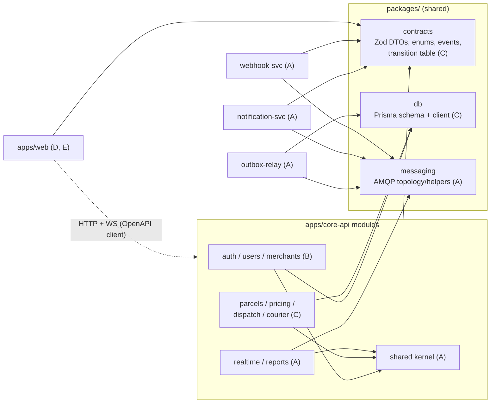

# SwiftDrop: Delivery Plan for a 5-Person Team

Source of truth for *what* we build: [SWIFTDROP_DESIGN_DOCUMENTATION.md](./SWIFTDROP_DESIGN_DOCUMENTATION.md) (referred to below as **the Design Doc**, with section numbers like `DD §7.5`).
This plan covers *how* five people build it in parallel on GitHub without stepping on each other.

---

## 0. Assumptions and Decisions

| # | Assumption / decision | Reason |
| :-- | :-- | :-- |
| 1 | Team size is **5** (the Design Doc assumes 10). | Per request. Module boundaries in the Design Doc are merged into 5 ownership areas (§3). |
| 2 | Architecture, data model, event contract, API conventions and stack are **exactly as in the Design Doc**. This plan does not redesign them. | Avoids rework of an already-assessed design. |
| 3 | Bonus items (Kubernetes/Helm, AI assistant) are **stretch** and only start after Must-have items are demoable. | 5 people cannot carry 10 people's scope. |
| 4 | SMS is a **mock adapter** only; payments are out of scope (DD §1.3). | As in the Design Doc. |
| 5 | Package manager is **pnpm workspaces** (monorepo). | Single lockfile, strict dependency isolation, fast CI cache. |
| 6 | Timeline is expressed in **sprints of 1 week**; total ≈ 6 sprints. Compress/stretch to your actual deadline, but keep the order. | Deadline not given. |
| 7 | Branching is **trunk-based** (short-lived branches into protected `main`). No long-lived `develop`. | Long-lived branches are the main source of merge pain in student teams. |

> [!IMPORTANT]
> Items marked **TBD-team** (repo name, GitHub org, member names, deadlines) must be filled in by the team on day 1.

---

## 1. Product Scope Summary

SwiftDrop is a parcel delivery and courier management platform with four user groups plus a public tracking page:

- **Customer**: books a parcel, sees fee up front, tracks live, downloads receipt.
- **Recipient (guest)**: tracks by tracking number, no login.
- **Merchant**: dashboard + machine API (OAuth client credentials) + signed webhooks.
- **Courier**: mobile-first PWA with today's jobs, status updates, proof of delivery.
- **Dispatcher / Admin**: assignment, workload, users, merchants approval, zones, pricing, reports.

Core technical ideas (from DD §5-§7): modular monolith (`core-api`) + three async workers connected by RabbitMQ, transactional outbox, Socket.IO realtime, Postgres/Prisma, MinIO, Redis, Docker Compose.

---

## 2. Functional Requirements

Priority uses MoSCoW: **M** must, **S** should, **C** could (stretch). *Owner* refers to the ownership areas in §3 (A-E).

### 2.1 Identity and Access (Owner B)

| ID | Requirement | Pri | DD ref |
| :-- | :-- | :-: | :-- |
| FR-A1 | Customer registration and login with email + password (bcrypt cost 12). | M | §9.1 |
| FR-A2 | RS256 access JWT (15 min; user id, role, jti) + rotating refresh token in HttpOnly cookie; reuse detection revokes token family. | M | §9.1 |
| FR-A3 | Google sign-in via authorization code + PKCE; find-or-create by `google_sub`. | S | §7.4 |
| FR-A4 | One role per user; role middleware (`requireRole`) plus ownership-scoped queries. | M | §2, §9.2 |
| FR-A5 | Admin creates courier / dispatcher accounts; admin can suspend accounts. | M | §3.4 |
| FR-A6 | Per-IP and per-account rate limiting on login and token endpoints. | S | §9.1 |

### 2.2 Merchants (Owner B backend, E frontend)

| ID | Requirement | Pri | DD ref |
| :-- | :-- | :-: | :-- |
| FR-M1 | Merchant business registration → status `PENDING`; admin approves/rejects. | M | §3.2 |
| FR-M2 | Generate, rotate, revoke API clients; secret shown once, stored hashed. | M | §9.3 |
| FR-M3 | `POST /oauth/token` client-credentials grant, 15-min token, scopes `orders:read` / `orders:write`. | M | §7.2 |
| FR-M4 | `POST /merchant/orders` with `Idempotency-Key`; requires scope + `APPROVED` merchant. | M | §7.2 |
| FR-M5 | Configure webhook URL (HTTPS only, private/loopback blocked) and rotate signing secret. | M | §9.3 |
| FR-M6 | Orders dashboard with status filter; webhook delivery log and failure reasons. | S | §3.2 |

### 2.3 Pricing, Parcels, Dispatch, Tracking (Owner C backend; D/E frontend)

| ID | Requirement | Pri | DD ref |
| :-- | :-- | :-: | :-- |
| FR-P1 | CRUD for zones (district groupings) and versioned pricing rules (`effective_from`). | M | §4 |
| FR-P2 | `POST /quotes`: resolve zones, price via `PricingStrategy`, return `quoteId`, fee (integer cents, LKR), 15-min expiry. | M | §7.1 |
| FR-P3 | `POST /parcels` from `quoteId` with `Idempotency-Key`; random tracking number `SD-XXXXXXXX-C`; writes parcel + history + outbox in one transaction. | M | §7.1 |
| FR-P4 | Parcel state machine with one transition table: Created → PickedUp → InTransit → OutForDelivery → Delivered; Failed (≤2 re-attempts); Cancelled before pickup. Illegal transition → `409`. | M | §7.5 |
| FR-P5 | Append-only `parcel_status_history`; denormalised `current_status` + `version` (optimistic lock). | M | §4.2 |
| FR-P6 | Customer parcel list/detail/history; owner-only (404 on foreign ids). | M | §9.2 |
| FR-P7 | Public tracking `GET /track/{trackingNo}`: status, time, town only. | M | §9.4 |
| FR-P8 | PDF receipt stored in MinIO, served via signed URL. | S | §3.1 |
| FR-D1 | Dispatcher unassigned queue (oldest first, filter by pickup zone). | M | §7.6 |
| FR-D2 | Assign / reassign with capacity check (`on duty` and `active < max_active_jobs`) and optimistic-lock conflict handling. | M | §7.6 |
| FR-D3 | Courier workload view. | M | §3.4 |
| FR-K1 | Courier "today" list limited to assigned parcels. | M | §3.3 |
| FR-K2 | Courier status update; `Delivered` requires proof (name and/or photo), `Failed` requires reason from fixed list. | M | §3.3, Table 5 |
| FR-K3 | Courier PWA queues status updates offline and retries on reconnect. | S | Table 5 (2b) |

### 2.4 Async Integration (Owner A)

| ID | Requirement | Pri | DD ref |
| :-- | :-- | :-: | :-- |
| FR-I1 | Outbox relay polls `outbox_events` (1 s), publishes with confirms to topic exchange `swiftdrop.events`, then marks `published_at`. | M | §6.2 |
| FR-I2 | RabbitMQ topology: `realtime.q`, `notifications.q`, `webhooks.q`, `webhooks.retry.q`, DLQs, bindings per Table 9. | M | §6.4 |
| FR-I3 | Notification service: email via SMTP (Mailpit in dev), mock SMS adapter, templates, idempotent by `eventId`, recipient stored masked. | M | §6.5, §8 |
| FR-I4 | Webhook dispatcher: HMAC-SHA256 + timestamp, 5 s timeout, 6 attempts with TTL `30 s × 2^attempt`, then DLQ; records `webhook_deliveries`. | M | §7.7 |
| FR-I5 | Admin replay of DLQ messages. | S | §6.4 |
| FR-I6 | Realtime gateway: Socket.IO rooms per tracking number; reduced payload for public; Redis adapter. | M | §6.6 |
| FR-I7 | Daily report endpoint (deliveries/day, success rate) with CSV export. | S | §3.4 |

### 2.5 Frontend (Owners D and E)

| ID | Requirement | Pri | Owner |
| :-- | :-- | :-: | :-: |
| FR-F1 | App shell, design system, role-based routing and guards, typed API client, error/loading/empty states. | M | D |
| FR-F2 | Auth pages (register, login, Google button), session refresh handling. | M | D |
| FR-F3 | Customer: booking wizard (quote → confirm), history, parcel detail with live timeline, receipt download. | M | D |
| FR-F4 | Public tracking page, mobile-first, live updates. | M | D |
| FR-F5 | Admin console: users, merchant approvals, zones, pricing rules, reports. | M | D |
| FR-F6 | Courier PWA: today's jobs, detail, status update, proof capture, offline queue, installable manifest. | M | E |
| FR-F7 | Merchant dashboard: orders, API keys, webhook settings, delivery log. | M | E |
| FR-F8 | Dispatcher console: unassigned queue, assign dialog with capacity, workload board, DLQ replay. | M | E |
| FR-F9 | AI assistant chat widget. | C | D |

### 2.6 Stretch (Owner A, then whoever is free)

| ID | Requirement | Pri | DD ref |
| :-- | :-- | :-: | :-- |
| FR-B1 | Helm chart (Deployments, StatefulSets, ConfigMap/Secret, Ingress, HPA), kind/minikube values. | C | §12.1 |
| FR-B2 | AI assistant service with read-only MCP tools: `quote_delivery_fee`, `get_parcel_status`, `list_my_parcels`, `find_zone`; user's JWT forwarded. | C | §12.2 |

---

## 3. Non-Functional Requirements

Numeric values are **targets for a demo-scale system**, to be verified by the named check, not hard guarantees.

| ID | Category | Requirement | Verification |
| :-- | :-- | :-- | :-- |
| NFR-1 | Security | No secrets in repo; `.env.example` only; secret scanning in CI. | CI gitleaks step |
| NFR-2 | Security | Authorisation = role check **and** ownership filter inside the DB query; foreign ids return 404. | Per-role authorisation test suite |
| NFR-3 | Security | Input validated by shared Zod schemas at every boundary; Prisma parameterised queries only. | Unit tests, code review checklist |
| NFR-4 | Privacy | Logs redact `password`, `phone`, `address`, `authorization`; events carry no phone/address; notification recipient masked. | Logger unit test, event schema test |
| NFR-5 | Reliability | At-least-once delivery; every consumer idempotent on `eventId`; outbox guarantees no lost events. | Testcontainers event-flow tests |
| NFR-6 | Reliability | Duplicate submits with same `Idempotency-Key` return original resource. | Integration test |
| NFR-7 | Data integrity | Money as integer cents; history append-only; parcel updates use optimistic locking. | Unit + concurrency integration test |
| NFR-8 | Performance | p95 < 300 ms for `quotes`, `track`, courier list on a laptop with seeded data (≈10k parcels). Indexes per DD §4.2. | Simple k6/autocannon script (Sprint 5) |
| NFR-9 | Scalability | `core-api` is stateless; Socket.IO via Redis adapter allows 2+ replicas; cursor pagination on all lists. | Run 2 replicas in Compose and test |
| NFR-10 | Availability | `/healthz` and `/readyz` on every service; graceful shutdown (finish in-flight messages). | Manual + container healthchecks |
| NFR-11 | Usability | Courier PWA usable on mid-range Android over slow mobile data; JS budget for courier route < 250 KB gzip (target); tap targets ≥ 44 px. | Bundle analyzer, manual device check |
| NFR-12 | Accessibility | Keyboard navigable, visible focus, labelled form controls, WCAG AA contrast, `prefers-reduced-motion` respected. | axe checks in CI/dev, manual keyboard pass |
| NFR-13 | Observability | Structured JSON logs (pino) with correlation id propagated API → outbox → consumers. | Log inspection |
| NFR-14 | Maintainability | TypeScript `strict`; ESLint boundaries rule forbids cross-module imports; ≥ 80 % line coverage on service/domain layers. | CI coverage gate |
| NFR-15 | Portability | `docker compose up` brings the whole system up from a clean clone; seeded demo data. | New-member onboarding test |
| NFR-16 | Cost | Everything runs on free/OSS components locally and on GitHub free-tier CI. LLM provider (stretch) must have a free tier or run locally and sits behind an interface. | Review |

---

## 4. Team Structure and Ownership

Five areas, each with **one owner** (final say, first reviewer) and a **buddy** (second reviewer, bus-factor cover). Names are TBD-team.

| Area | Owner focus | Primary code locations | Buddy |
| :-: | :-- | :-- | :-: |
| **A: Platform and Async** | Monorepo, CI/CD, Docker Compose, shared kernel (error handler, logger, outbox writer, correlation id), outbox relay, RabbitMQ topology, notification service, webhook dispatcher, realtime gateway, reports, then Helm/AI | `apps/outbox-relay`, `apps/notification-svc`, `apps/webhook-svc`, `packages/messaging`, `core-api/src/shared`, `core-api/src/modules/realtime`, `core-api/src/modules/reports`, `infra/`, `.github/` | C |
| **B: Identity and Merchants** | Auth, JWT, refresh rotation, Google OAuth, RBAC middleware, users admin, merchants, API clients, `/oauth/token`, merchant orders endpoint | `core-api/src/modules/auth`, `modules/users`, `modules/merchants` | A |
| **C: Parcels, Pricing, Dispatch** | Prisma schema ownership, state machine, quotes/pricing strategies, parcels, history, tracking, assignment, courier endpoints, receipts, proof upload | `packages/db`, `core-api/src/modules/parcels`, `modules/pricing`, `modules/dispatch`, `modules/courier` | B |
| **D: Web Core (Customer, Public, Admin)** | Design system, app shell, routing, API client, auth pages, customer portal, public tracking, admin console, AI widget | `apps/web/src/shared`, `features/auth`, `features/customer`, `features/tracking`, `features/admin` | E |
| **E: Web Operations (Courier, Merchant, Dispatcher)** | Courier PWA (offline queue, manifest, service worker), merchant dashboard, dispatcher console, mock API handlers | `apps/web/src/features/courier`, `features/merchant`, `features/dispatcher`, `apps/web/src/mocks` | D |

Rules:
1. You only edit files in your own area. Anything else goes through a PR to that owner (or a request in an issue).
2. Cross-area changes are limited to the **shared packages** (§6) and follow their own protocol.
3. CODEOWNERS enforces this automatically (§7.3).

### 4.1 Module and dependency map



Cross-module calls inside `core-api` go **only** through each module's `index.ts` public interface (e.g. Dispatch calls `PricingService.quote()`, never the pricing repository). Enforced by ESLint (`eslint-plugin-boundaries` or `no-restricted-imports`).

---

## 5. Technology Stack and Tooling

Stack is as in DD Table 1. Tooling added by this plan is marked *(plan)*.

| Concern | Choice |
| :-- | :-- |
| Runtime / language | Node.js 20 LTS, TypeScript `strict` everywhere |
| Backend | Express, Zod, Prisma (use the multi-file schema feature, `prisma/schema/*.prisma`, available in current Prisma 6.x; verify installed version) |
| Messaging | RabbitMQ 3.13 via `amqplib`; topology declared in `packages/messaging` |
| Data | PostgreSQL 16, Redis 7, MinIO |
| Realtime | Socket.IO + Redis adapter |
| Frontend | React 18, Vite, Tailwind, React Router, TanStack Query *(plan)*, vite-plugin-pwa *(plan)* |
| API contract | OpenAPI 3 generated from Zod via `@asteasolutions/zod-to-openapi` *(plan)*; typed client via `openapi-typescript` + `openapi-fetch` *(plan)* |
| Frontend mocking | MSW (Mock Service Worker) driven by the OpenAPI document *(plan)* so D/E never wait for backend |
| Logging | pino with redaction *(plan)* |
| Tests | Jest + Supertest + Testcontainers (backend); Vitest + React Testing Library (frontend) |
| Quality gates *(plan)* | ESLint, Prettier, `tsc --noEmit`, Husky + lint-staged (pre-commit), commitlint (Conventional Commits), gitleaks |
| Local infra | Docker Compose, Mailpit |
| CI | GitHub Actions (free tier): cache pnpm store, path filters so only affected packages run |
| Stretch | Helm + kind/minikube; MCP server + LLM provider behind an interface |

---

## 6. Repository Layout and Conflict Hotspots

```text
swiftdrop/
├─ apps/
│  ├─ core-api/           # modular monolith (A scaffolds; modules owned per §4)
│  │  └─ src/
│  │     ├─ shared/       # kernel: errors (RFC 7807), logger, authn middleware, outbox writer, UoW
│  │     ├─ modules/
│  │     │  ├─ auth/ users/ merchants/                  # B
│  │     │  ├─ parcels/ pricing/ dispatch/ courier/     # C
│  │     │  └─ realtime/ reports/                       # A
│  │     └─ app.ts        # registers modules from modules/index.ts (pre-filled in Sprint 0)
│  ├─ web/                # React SPA; one folder per feature, lazy-loaded routes
│  │  └─ src/{shared,features/*,mocks}
│  ├─ outbox-relay/       # A
│  ├─ notification-svc/   # A
│  ├─ webhook-svc/        # A
│  └─ ai-assistant/       # stretch
├─ packages/
│  ├─ contracts/          # Zod schemas, enums, event envelope, transition table, error types
│  ├─ db/                 # prisma/schema/*.prisma, migrations, client, seed
│  ├─ messaging/          # exchange/queue/binding constants + publish/consume helpers
│  └─ config/             # eslint, tsconfig, prettier presets
├─ infra/                 # compose files, nginx, (helm/ later)
├─ docs/                  # ADRs, API notes, runbooks
├─ .github/               # workflows, CODEOWNERS, PR/issue templates
├─ compose.yaml           # infra only: postgres, redis, rabbitmq, minio, mailpit
├─ compose.apps.yaml      # app containers
├─ .env.example
└─ plan.md
```

### 6.1 Designed-in conflict avoidance

| Hotspot | Normal result | How we prevent it |
| :-- | :-- | :-- |
| `schema.prisma` and migrations | Everyone edits one file; two people create migrations from the same base | **Sprint 0 delivers the complete schema from DD §4 in one initial migration plus seed data.** Later changes are rare, additive, owned by C, split into per-domain files (`identity.prisma`, `parcel.prisma`, `pricing.prisma`, `messaging.prisma`). Procedure in §7.5. |
| `pnpm-lock.yaml` | Constant conflicts | Enable `merge-git-branch-lockfiles`; on conflict run `git checkout main -- pnpm-lock.yaml && pnpm install`. Do not hand-edit. |
| `core-api/src/app.ts` route registration | Everyone adds a line | All six module routers pre-registered in Sprint 0 as empty routers. Modules only fill their own `routes.ts`. |
| `web` router and navigation | Everyone edits one route table | Each feature exports `routes.tsx` and `nav.ts`; the central router imports the list once (pre-filled in Sprint 0). |
| `packages/contracts` | Shared types change under people's feet | Contract change protocol (§7.6). |
| `compose.yaml` | Many edits | Infra changes only by A; apps are in a separate `compose.apps.yaml`. |
| `.env.example` | Everyone adds variables | Append-only, one section per service, A reviews. |
| Docs | Overlapping edits | Each area edits its own file in `docs/`; ADRs are new files (`docs/adr/NNNN-title.md`). |

---

## 7. Git and GitHub Workflow

### 7.1 Branching: trunk-based

- `main` is **protected**: no direct pushes; PR + passing CI + ≥ 1 approval; squash merge only; linear history; branches auto-deleted after merge.
- Feature branches are **short-lived (target ≤ 2 days, hard limit 4)** and branch from latest `main`.
- Naming: `<type>/<area>-<short-description>`, e.g. `feat/parcels-state-machine`, `fix/auth-refresh-reuse`, `chore/ci-cache`.
- Rebase on `main` at least once a day: `git fetch && git rebase origin/main`.
- Unfinished work that must merge is hidden behind a **feature flag or an unmounted route**; never keep a branch open to "finish the feature".
- Milestones are marked by **tags** (`v0.1-walking-skeleton`, `v0.2-ops`, ...), not by branches.

### 7.2 Commits and PRs

- Conventional Commits: `feat(parcels): add transition table`, scopes = `auth|users|merchants|parcels|pricing|dispatch|courier|realtime|reports|relay|notif|webhook|web|contracts|db|infra|ci|docs`.
- PR title = squash commit message. Target **≤ 400 changed lines**; larger work is split into stacked or sequential PRs.
- PR template checklist: linked issue, what/why, screenshots for UI, tests added, migration included (y/n), contract change (y/n), env var added (y/n), manual test notes.
- Review SLA: first review within **one working day**. Reviewer = CODEOWNER of touched paths. Author merges after approval.
- Draft PRs are encouraged early for visibility; mark ready when CI is green.

### 7.3 Protections and automation

| Mechanism | Setting |
| :-- | :-- |
| `CODEOWNERS` | Maps each path in §4 to its owner. `packages/contracts`, `packages/db`, `packages/messaging`, `compose*.yaml`, `.github/` require owner **and** one other approval. |
| Required status checks | `lint`, `typecheck`, `unit`, `integration` (path-filtered), `build`, `secret-scan`. |
| Branch rules | Require branches up to date before merge; dismiss stale approvals on new commits; block force-push to `main`. |
| Local hooks | Husky pre-commit (lint-staged + prettier), commit-msg (commitlint). |
| Dependabot | Weekly, grouped, minor/patch only. |

### 7.4 Issues and board

- GitHub Issues + a GitHub Project board (Backlog → Ready → In progress → In review → Done).
- Every issue has: label `area:A-E`, `type:feat|bug|chore`, `sprint:N`, `priority:M|S|C`, acceptance criteria (copy relevant FR IDs), and an estimate (S/M/L; L must be split).
- Each FR in §2 becomes one or more issues; the issue title starts with its FR ID.
- A 15-minute async/sync standup three times a week; a 45-minute sprint planning + demo on the last day of each sprint.

### 7.5 Database schema change protocol

Because the full schema ships in Sprint 0, changes should be exceptions.

1. Open an issue labelled `schema-change` and announce it in the team chat **before** coding.
2. C (or the requesting owner with C's approval) creates **one small additive migration per PR**. Prefer additive changes (new nullable column/table); avoid renames/drops until after the demo.
3. The PR must contain: updated `.prisma` file(s), migration folder, updated seed if needed, updated `packages/contracts` types if exposed.
4. **Never edit a merged migration.** Fix forward with a new one.
5. If someone else merged a migration first: rebase, delete your migration folder, `pnpm db:reset`, re-run `prisma migrate dev` so it regenerates on top of the new head, and re-run tests.
6. Everyone runs `pnpm db:reset` after pulling a PR labelled `schema-change`.

### 7.6 Contract change protocol (`packages/contracts`, OpenAPI, events)

- **API and event shapes are designed before they are implemented.** The Zod schema PR lands first; both provider and consumer then code against it.
- Additive changes (new optional field/endpoint): normal PR, owner + one consumer approve.
- Breaking changes (rename, remove, type change): need an issue, agreement from all consumers' owners, and a coordinated PR (provider keeps old shape for one sprint when possible). Event payloads follow the envelope in DD §6.3 and are versioned with `version`.
- CI regenerates `openapi.json` and the typed client; a diff in the generated file must be committed in the same PR (CI fails otherwise), so frontend people see API changes in review.

### 7.7 Daily developer loop

1. `git switch main && git pull && pnpm install` (and `pnpm db:reset` if flagged).
2. `docker compose up -d` (infra), `pnpm dev` (runs the apps you need; `pnpm --filter <app> dev` for one).
3. Create branch, implement with tests, `pnpm lint && pnpm typecheck && pnpm test`.
4. Push, open PR, request review, respond to comments, squash-merge.
5. Delete branch; pull `main`; repeat.

---

## 8. Runtime Workflows to Implement

These are specified in the Design Doc; this table lists who builds each step so integration is planned, not accidental.

| Workflow | DD ref | Steps → owner |
| :-- | :-- | :-- |
| **Create delivery** | §7.1 | Booking UI (D) → `POST /quotes` + `POST /parcels` (C, pricing C) → outbox row (A kernel writer) → relay (A) |
| **Merchant order + webhook** | §7.2, §7.7 | Token endpoint + scope check + order endpoint (B, parcel creation via C's `ParcelsService`) → outbox → webhook-svc (A) → merchant dashboard log (E) |
| **Courier status update fan-out** | §7.3 | PWA (E) → courier endpoint + state machine (C) → outbox → notifications (A), webhooks (A), realtime (A) → tracking page (D) |
| **Google login** | §7.4 | Auth module (B) + login button/callback handling (D) |
| **Parcel lifecycle** | §7.5 | Transition table in `packages/contracts` (C) used by API, UIs and tests |
| **Dispatcher assignment** | §7.6 | Dispatcher console (E) → assignment endpoint with optimistic lock (C) → `parcel.assigned` event → courier list live update (E) |
| **Merchant approval** | §3.2 | Registration (B) → admin approval UI (D) → API client generation unlocked (B/E) |

Parcel creation is shared between the customer and merchant paths: C exposes `ParcelsService.createFromQuote()` (and a merchant variant) through the module's `index.ts`, B calls it; B does **not** duplicate parcel logic.

---

## 9. Implementation Plan

Timeline assumes 6 one-week sprints. Each sprint ends with a **demoable increment** on `main`, tagged.

### Sprint 0: Foundation (≈ 3-4 days; everyone works in parallel after Day 1)

**Day 1 (A alone, everyone else reads the Design Doc and prepares accounts):**
- A: create GitHub repo (TBD-team), branch protection, CODEOWNERS, PR/issue templates, labels, project board.
- A: monorepo skeleton: pnpm workspace, `packages/config` presets, `apps/core-api` (health endpoint, pre-registered empty module routers, error handler, pino logger with redaction, correlation-id middleware), `apps/web` (Vite + Tailwind scaffold, pre-registered empty feature routes), CI pipeline, `compose.yaml` (postgres, redis, rabbitmq, minio, mailpit), `.env.example`, README with onboarding steps.
- Everyone: join repo, install Node 20 / pnpm / Docker; B creates the Google Cloud OAuth client (redirect URIs for localhost) and shares credentials **privately** (never in repo).

**Day 2-4 (parallel):**

| Owner | Deliverable |
| :-: | :-- |
| A | `packages/messaging` (exchange, queues, bindings, DLQ/TTL topology as constants + `assertTopology()`), outbox writer in the kernel (`withTransaction(tx => { …; outbox.add(event) })`), `compose.apps.yaml`, Dockerfiles (multi-stage), CI path filters, gitleaks. |
| B | Auth design notes (`docs/auth.md`): token claims, cookie settings, scopes; `requireRole` and `authenticate` middleware **interfaces** with a dev-mode stub so others can call protected routes before real auth lands. |
| C | **Full Prisma schema + initial migration + seed** from DD §4 (all 10 tables, indexes, constraints). `packages/contracts`: enums (roles, statuses, size classes, failure reasons), parcel/quote/merchant DTO Zod schemas, event envelope and event types, transition table. |
| D | Design tokens, base components (Button, Input, Card, Table, Dialog, Toast, Skeleton, EmptyState, ErrorState), layout shell, role-based route guards (using stub session), OpenAPI → typed client pipeline. |
| E | MSW handlers for all endpoints in DD Table 12 returning schema-valid sample data; `pnpm --filter web dev:mock` mode; PWA manifest/service-worker skeleton. |

**Exit criteria (Sprint 0):** fresh clone → `cp .env.example .env && docker compose up -d && pnpm i && pnpm db:reset && pnpm dev` works for every member; CI green; seed creates one user per role (`admin@swiftdrop.test`, etc.; dev-only passwords documented in README); web runs against mocks; tag `v0.0-foundation`.

### Sprint 1: Walking skeleton (vertical slice, no async yet)

Goal: customer registers → logs in → gets a quote → books a parcel → sees it in history and on the public tracking page.

| Owner | Work |
| :-: | :-- |
| A | Realtime module skeleton (Socket.IO, rooms, auth for socket); outbox relay publishing to RabbitMQ (logging consumers only); health/readiness endpoints for relay; integration-test harness with Testcontainers (shared helper others reuse). |
| B | FR-A1, A2, A4 (register, login, refresh rotation, logout, real `authenticate`/`requireRole`); seed-compatible user model. |
| C | FR-P1 (zones/pricing CRUD, read endpoints first), FR-P2 (quotes + `StandardPricing`), FR-P3, FR-P5, FR-P6, FR-P7 (create parcel, history, list/detail, public tracking). |
| D | FR-F2, F3 (booking wizard, history, detail), F4 (public tracking, polling first). |
| E | Courier and dispatcher console shells with mock data; merchant dashboard shell; share table/list patterns with D through the design system (PRs to `shared` reviewed by D). |

**Exit:** demo on `main` end-to-end with real backend; tag `v0.1-walking-skeleton`.

### Sprint 2: Operations and events

| Owner | Work |
| :-- | :-- |
| A | FR-I1/I2 hardened (publisher confirms, reconnect, graceful shutdown); FR-I6 realtime consumer emitting to rooms; notification-svc consuming `notifications.q` (email via Mailpit, template rendering, `eventId` dedup table). |
| B | FR-A5 (admin creates courier/dispatcher, suspend), FR-M1 (merchant registration + approval endpoint), FR-M2 (API clients CRUD). |
| C | FR-P4 (state machine with exhaustive unit tests), FR-D1/D2/D3 (queue, assign/reassign with optimistic lock, workload), FR-K1/K2 (courier list and status update with proof upload to MinIO). |
| D | FR-F5 (admin users, merchant approval), tracking page on Socket.IO with polling fallback, customer live timeline. |
| E | FR-F6 (courier PWA online flow), FR-F8 (dispatcher queue, assign dialog, workload board) against real API. |

**Exit:** dispatcher assigns → courier updates → customer page changes live → email visible in Mailpit; tag `v0.2-ops`.

### Sprint 3: Integrations and merchants

| Owner | Work |
| :-- | :-- |
| A | FR-I4 webhook-svc (HMAC, retry via TTL queue, DLQ, `webhook_deliveries`), FR-I5 replay endpoint, FR-I3 mock SMS adapter + channel factory, FR-I7 reports. |
| B | FR-M3 (`/oauth/token`), FR-M4 (merchant orders via C's service, idempotency), FR-M5 (webhook config with SSRF guard), FR-A3 (Google OAuth with PKCE), FR-A6 (rate limiting). |
| C | FR-P8 receipt PDF + signed URLs; pricing `ExpressPricing` / `MerchantContractPricing` strategies behind the factory; cancellation flow; performance indexes check. |
| D | Google login UI, receipts, admin zones/pricing/reports pages. |
| E | FR-F7 merchant dashboard (orders, keys, webhook settings, delivery log), FR-F8 DLQ replay UI, FR-F6 proof capture (photo/name). |

**Exit:** a merchant script creates an order with client credentials, receives a signed webhook, and a forced failure shows retries then DLQ; tag `v0.3-integrations`.

### Sprint 4: Hardening and quality

- Authorisation test matrix (every role × every protected endpoint family), cross-tenant/ownership tests (C+B).
- Event-flow tests: exactly one notification and one webhook per status change; duplicate delivery ignored (A).
- FR-K3 offline queue + background retry in courier PWA (E); accessibility pass (axe + keyboard) across all pages (D+E).
- Rate limiting at nginx, error/empty/loading states audit, copy and validation message review (D+E).
- Coverage gate at 80 % for service/domain layers; fix gaps (all).
- Performance smoke (NFR-8) and 2-replica `core-api` check (NFR-9) (A).
- Docs: OpenAPI at `/api/docs`, README, runbook, ADRs for deviations from the Design Doc (all, own areas).

**Exit:** all **M** and **S** FRs done or explicitly deferred in an issue; tag `v0.4-rc1`.

### Sprint 5: Stretch, polish, release

- A: FR-B1 Helm chart and kind/minikube instructions.
- Whoever is free after Sprint 4 (suggest A + D): FR-B2/F9 AI assistant (read-only tools, JWT forwarded).
- All: bug bash from the manual test plan (§12), demo data reset, rehearsal, final report updates (update the Design Doc where implementation intentionally diverged; sections per owner as in DD Appendix A).
- Freeze `main` 2 days before the deadline: only bug-fix PRs.

**Exit:** tag `v1.0`.

---

## 10. Integration Contracts Between Owners

What each owner promises others, and how to unblock before it exists.

| Provider → Consumer | Interface | Unblocking stub available from |
| :-- | :-- | :-- |
| C → D, E, B, A | `packages/contracts` DTOs, enums, transition table, event types | Sprint 0 |
| C → D, E | REST endpoints (DD Table 12) | MSW mocks from Sprint 0 |
| B → everyone | `authenticate`, `requireRole`, `req.user {id, role}` | Dev stub in Sprint 0; real in Sprint 1 |
| C → B | `ParcelsService.createFromQuote()` for merchant orders | Interface in contracts Sprint 0; implementation Sprint 1 |
| A → B, C | `outbox.add(tx, event)` in the same Prisma transaction | Sprint 0 |
| A → D, E | Socket.IO events `parcel:status` / `parcel:assigned` (payload = reduced/full event DTO) | Event mock emitter in MSW/dev tools Sprint 0; real Sprint 2 |
| A → C, B | Integration-test harness (Testcontainers helpers, seeded fixtures, token factory per role) | Sprint 1 |
| B → E, D | `/oauth/token`, API-client CRUD, merchant endpoints | MSW mocks |
| A → E | Webhook delivery log + DLQ replay endpoints | MSW mocks until Sprint 3 |

---

## 11. Definition of Ready and Done

**Ready:** issue has acceptance criteria, linked FR IDs, contract/schema dependencies identified, estimate ≤ L.

**Done (every PR):**
- [ ] Meets acceptance criteria and FR text.
- [ ] Unit tests (domain/service) and, if an endpoint or consumer, an integration test; authorisation case covered.
- [ ] `lint`, `typecheck`, tests, build all green in CI.
- [ ] Input validated with Zod; no secrets/PII in code, logs, or fixtures; errors use RFC 7807 format.
- [ ] UI: loading, empty, error, and validation states; keyboard + focus; responsive at 360 px and desktop.
- [ ] Contract/OpenAPI changes committed; migration included if needed; `.env.example` updated if needed.
- [ ] Docs/ADR updated if behaviour or decisions changed.
- [ ] One CODEOWNER approval (two for shared packages).

---

## 12. Verification Strategy and Manual Test Plan

### 12.1 Automated (per DD §11)

| Level | Tooling | Owner |
| :-- | :-- | :-: |
| Unit: pricing, transitions, validation, services with fake repositories | Jest | each module owner |
| Integration: API vs real Postgres/RabbitMQ | Jest + Supertest + Testcontainers | each module owner, harness by A |
| Authorisation matrix | Supertest with token per role | B + C |
| Event flow: outbox → relay → consumers, duplicate and failure cases | Testcontainers + mock SMTP/HTTP | A |
| Frontend: forms, socket-driven updates | Vitest + RTL | D, E |

No browser automation (Selenium etc.) is used; UI end-to-end checks are manual (below).

### 12.2 Standing manual test plan (run at the end of each sprint, extended as features land)

**Setup:** `cp .env.example .env && docker compose up -d && pnpm i && pnpm db:reset && pnpm dev`. Open the web app at the URL printed by Vite; Mailpit at `http://localhost:8025`; RabbitMQ UI at `http://localhost:15672`.

1. **Customer booking:** log in as seeded customer → Book → enter Colombo → Kandy, small, 2 kg → expect fee LKR 570.00 (with the example rule from DD §8) → confirm → expect tracking number `SD-…`. Double-click Confirm: expect only one parcel.
2. **Public tracking:** open `/track/<trackingNo>` logged out → status, time, town only; no name/phone/address.
3. **Dispatch:** as dispatcher, open unassigned queue → assign to a courier; open a second browser session and assign the same parcel → expect conflict message and refreshed queue.
4. **Courier:** as courier, see only assigned parcels → PickedUp → InTransit → OutForDelivery → Delivered with recipient name. Try an illegal jump (Created → Delivered) → expect clear `409` message.
5. **Live update and notifications:** keep customer detail page open during step 4 → timeline updates within seconds; Mailpit shows one email per status change.
6. **Merchant:** register → admin approves → create API client → call `/oauth/token` and `/merchant/orders` with curl → webhook received with valid `X-SwiftDrop-Signature`. Stop the receiver → expect retries then DLQ entry; restart and replay.
7. **Authorisation:** as customer B request customer A's parcel id → 404. As courier X request courier Y's parcel → 404/403 with no data leak.
8. **Edge and failure states:** expired quote (wait or shorten TTL in dev) → recalculated fee prompt; address outside zones → friendly message; offline courier update (DevTools offline) → queued, then sent on reconnect; stop RabbitMQ → API still accepts updates, events publish after restart; narrow viewport 360 px; keyboard-only pass; reduced-motion setting.

---

## 13. Risks and Mitigations

| Risk | Impact | Mitigation |
| :-- | :-- | :-- |
| Frontend blocked on backend | Idle time, late integration | Contract-first + MSW mocks from Sprint 0 |
| Schema/migration collisions | Broken DB for everyone | Full schema in Sprint 0; protocol in §7.5 |
| One person is a bottleneck (A in Sprint 0) | Whole team waits | Day 1 skeleton is A's only job; others have defined parallel tasks that need only the repo, not the infra |
| Scope too large for 5 | Missed deadline | MoSCoW; stretch items last; **S** items can be cut by issue decision, not silently |
| Owner unavailable | Blocked reviews | Buddy system (§4); any CODEOWNER from the buddy can approve |
| Long-lived branches | Painful merges | ≤ 2-day branches, daily rebase, flags for unfinished work |
| Event bugs only visible when everything runs | Late failures | Sprint 1 relay + logging consumers; event-flow tests in CI from Sprint 2 |
| Google OAuth setup delays | Auth slip | Set up Day 1; FR-A3 is **S**, email login is the fallback |
| LLM provider cost/limits | Stretch blocked | Provider behind an interface; free tier or local model; feature is optional |
| CI minutes exhausted | Blocked merges | Path filters, caching, Testcontainers only when relevant paths change |
| Secrets leak | Security incident | `.env` in `.gitignore`, gitleaks, secrets shared out-of-band |

---

## 14. Deferred / Out of Scope

- Online payments, route optimisation, hub inventory, native apps (DD §1.3).
- Splitting `parcels` into its own service (DD §13).
- Real SMS gateway (adapter exists; swap later).
- Full Kubernetes and AI assistant if Sprint 4 exit criteria slip.
